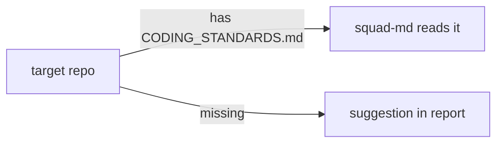

# PS08: CODING_STANDARDS.md per repo plus .github instructions example
- Status: todo (docs only; build waits for Sven go per PBI)
- Batch: B2
- Depends on: PS07
- Absorbs old: none
- Lane: Builder (Cursor CLI for docs and markdown, Cloud Agent if multi-file C#)
- Release: squad v2 ([README](README.md#squad-v2))
- Docs: [STRUCTURE](STRUCTURE.md) (where), [SHAPES](SHAPES.md) (how it looks), [FLOWS](FLOWS.md) (flow per command), [MIGRATION](MIGRATION.md) (v1 to v2 rows), [FORKS](FORKS.md) (forks), [gh-aw](gh-aw/README.md)

## 1. Goal

**Problem on main (`6c59f49`).** [`plugins/squad/skills/squad/references/planning-contract.md`](https://github.com/svennijhuis/agentPacks/blob/6c59f49/plugins/squad/skills/squad/references/planning-contract.md):

> Optional `docs/decisions.md` is a human-readable drop-box, not eager memory.

Target repos have no single file that says which standards apply there, so every run re-discovers them.

**Why we change it.**

- Sven: "CODING_STANDARDS.md maybe add this per repo and instruction file for only .github ... used the other skills for it like chart skills".

**What it gives the user.**

- Local (Cursor, Claude Code, CLI): `/squad` reads `CODING_STANDARDS.md` in the target repo when present.
- gh-aw: Same file is read from the checkout; `.github/copilot-instructions.md` example points at it.

**Out of scope.** Writing it into target repos (squad suggests, a human adds).

Current state details:

- No template on main.

## 2. Depends on

PS07. Start only when those PBIs are merged on main. Build order: [README](README.md#new-set-and-build-order).

## 3. What gets replaced

Only the files named in **Target structure** and **Steps for Builder**. No moves or renames.

## 4. Technical design

### 4.1 Tree before and after

Before (main):

```text
(none)
```

After:

```text
plugins/squad/skills/squad-md/references/templates/CODING_STANDARDS.md   # NEW template
docs/examples/copilot-instructions.md                                   # NEW example
```

### 4.2 Skeleton of the new file

Shape rules: [SHAPES.md](SHAPES.md#summary).

```text
# Coding standards for <repo>

## Applies
- standard-no-em-dash
- shared: engineering, testing-principles

## Local
<repo-specific rules>
```

### 4.3 Target detail

Templates in `squad-md/references/templates/`: `CODING_STANDARDS.md` and `.github/instructions/coding-standards.instructions.md`. Planner adds a task when a target repo lacks it. Review Standards axis reads it. Written with technical-writing and unslop; statechart-md diagrams where state matters.

### 4.4 Interfaces and contracts

| Caller | Callee | Input | Output | State file |
|---|---|---|---|---|
| squad-md | target repo `CODING_STANDARDS.md` | read if present | extra standards | target repo file |

### 4.5 Flow



### 4.6 Choices

| Chosen | Rejected | Why |
|---|---|---|
| Read only, never write | Auto-create | Retro rule: nothing rewrites repo rules automatically. |

### 4.7 Checks and error messages

| Rule | Checks | Error message |
|---|---|---|
| REF01 | template link resolves | see PS03 |

### 4.8 Risks and what breaks

| Risk | Fix |
|---|---|
| Conflicting rules | target repo file wins for that repo; report names the conflict |

Also: Out: language content (PS17).

### 4.9 Per environment

| Environment | What is different |
|---|---|
| Local (Cursor, Claude Code, CLI) | Same. |
| gh-aw | Read from checkout; no write. |

### 4.10 Subagents and what they load

- squad-planner proposes it; squad-reviewer reads it.

## 5. Steps

0. **Inventory (forks and upstream alike).** `git diff --name-status <basis>...HEAD -- plugins shared docs .github` (basis: the agentPacks commit you started from; on upstream itself the list is empty). Add every own standard, rule, skill, agent, `custom-rules.md` and instructions file to `docs/pbi/squad/fork-inventory.md` ([format](FORKS.md#step-0-inventory-every-pbi-before-any-edit)). Never delete or overwrite a listed file; unsure means keep it and mark the row `open`.
1. Branch from main: `git switch -c pbi/ps08-coding-standards-file origin/main`.
2. Save the base for the fork check: `git rev-parse HEAD > /tmp/base.sha`.
3. Read [SHAPES.md](SHAPES.md) for every kind in section 3, and each source in section 6.
4. Do each row of section 3 in order. Move or rename with `git mv`. If a row's target path already holds a fork file, follow the [conflict table](MIGRATION.md#fork-path). A copy keeps the `Source:` line and `## What we changed or added`.
5. Do these steps, nothing else:
   1. Write templates.
   2. Planner rule.
   3. Fixtures.
6. Run every command in section 8. All must pass.
7. Open one PR titled `PS08: CODING_STANDARDS.md per repo plus .github instructions example`. Body: link to this file, the section 3 table, the section 8 output.

## 6. Sources

| Step | Skill (repo, path, SHA) | Licence | Mode | Lives in | Reason |
|---|---|---|---|---|---|
| docs | [technical-writing](https://github.com/cursor/plugins/blob/ae5650febf4320793844c12c4adaa937f417f8da/pstack/skills/technical-writing/SKILL.md) | MIT (cursor/plugins, Lauren Tan) | copy + adapt | `plugins/squad/skills/technical-writing/` | Cursor-only parts at ae5650f: calls swarm. Our copy moves them under `## Provider notes` and adds Standards, Gates, Autonomy. |
| docs | [statechart](https://github.com/cursor/plugins/blob/ae5650febf4320793844c12c4adaa937f417f8da/pstack/skills/statechart/SKILL.md) | MIT (cursor/plugins, Lauren Tan) | copy + adapt | `plugins/squad/skills/statechart-md/` | Upstream has `disable-model-invocation: true` and is named like the command. Sven wants `/statechart` plus auto use in the flow. We rename to `statechart-md`, allow model use, add `docs/architecture/` output and the scenario export to `/scenarios`. Scripts stay byte-equal. |
| review | [Matt code-review](https://github.com/mattpocock/skills/blob/4ae2317ddb22b046e26455e4f9c9b3aaaf62212d/skills/engineering/code-review/SKILL.md) | MIT (mattpocock/skills) | copy + adapt | `plugins/squad/skills/code-review/` | We add: `CODING_STANDARDS.md` per repo, a `.github/instructions/*.instructions.md` example, our severity words; drops `setup-matt-pocock-skills`. |

Route per external skill ([decision](README.md#decision-pin-copy--adapt-weave-or-not-used)):

- technical-writing: **copy + adapt**. `plugins/squad/skills/technical-writing/`.
- statechart: **copy + adapt**. `plugins/squad/skills/statechart-md/`.
- Matt code-review: **copy + adapt**. `plugins/squad/skills/code-review/`.

Every copy + adapt here adds, beyond its own changes: `Source:` line with SHA, a Standards line, the Gates, the Autonomy line for gh-aw, `## Provider notes`, `## What we changed or added`, and a NOTICE line.

Upstream: pstack [cursor/plugins at ae5650f](https://github.com/cursor/plugins/tree/ae5650febf4320793844c12c4adaa937f417f8da/pstack) (MIT), Matt [mattpocock/skills at 4ae2317](https://github.com/mattpocock/skills/tree/4ae2317ddb22b046e26455e4f9c9b3aaaf62212d) (MIT). Map: [skill map](sources/pstack-matt-skill-map.md).

## 7. Example

Good:

```markdown
# Coding standards (repo X)
- HTTP collections use a named envelope: `{"users": [...]}`.
- Application layer never calls a storage SDK directly.
Review cites: "CS-02 violated at src/Orders/Api.cs:41".
```

Bad:

A CODING_STANDARDS.md that says "write clean code" with no rule a reviewer can cite by id.

## 8. DoD (checkable)

```bash
dotnet run --project tools/AgentPacks.Cli -- validate                       # 0 errors, 0 warnings
dotnet test tools/AgentPacks.Cli.Tests                                      # green
dotnet run --project tools/AgentPacks.Cli -- validate-all --out /tmp/agentpacks-marketplace
dotnet run --project tools/AgentPacks.Cli -- migrate-check --base "$(cat /tmp/base.sha)"   # from PS03 on; 0 LOST
for f in tests/fixtures/gh-aw/*.md; do gh aw compile --strict "$f"; done   # from GA04 on; before: write "n/a, no fixture yet"
dotnet run --project tools/AgentPacks.Cli -- migrate-check --base <fixture base> --root tests/fixtures/fork-acme   # fixture fork, 0 LOST
dotnet run --project tools/AgentPacks.Cli -- validate --root tests/fixtures/fork-acme                              # fixture fork, 0 errors
grep -rnP "[\x{2013}\x{2014}]" plugins docs || echo "no dashes"
```

Then locally: install `/tmp/agentpacks-marketplace` in Cursor or Claude Code, run `/pack-check` (same result as `validate`) and each command this PBI touches once.

- [ ] Repo without the file gets a task; review cites a rule from it.
- [ ] Local: works in Cursor, Claude Code and CLI (Copilot CLI, Codex). Proof offline: generated client manifests and fixture tests (`ClientManifestTests`, `ComponentGenerationTests`).
- [ ] gh-aw: the fixture workflow under `tests/fixtures/gh-aw/` that uses this PBI's files passes `gh aw compile --strict` (pinned gh-aw, no run, no secrets, no Actions minutes). See [gh-aw README](gh-aw/README.md).
- [ ] `dotnet run --project tools/AgentPacks.Cli -- validate` exits 0, 0 errors, 0 warnings.
- [ ] `/pack-check` locally gives the same result (same rules, one source).
- [ ] `dotnet test tools/AgentPacks.Cli.Tests` green; main stays green and all 7 commands still load after merge ([MIGRATION](MIGRATION.md)).
- [ ] No em dash, no tokens in markdown, FAKE fixture values only.
- [ ] Every row of `docs/pbi/squad/fork-inventory.md` is present in v2 (status `done` or `open` with a reason) and `/pack-check` is green, locally and in gh-aw. The fixture fork `tests/fixtures/fork-acme` (one own standard, one own rule) still passes after this PBI.

## 9. Evidence

- Fixture output.

## 10. For forks

Rules for every fork: [FORKS.md](FORKS.md). For this PBI: Forks can ship their own template under the hub index; the hub reads the repo file first.
