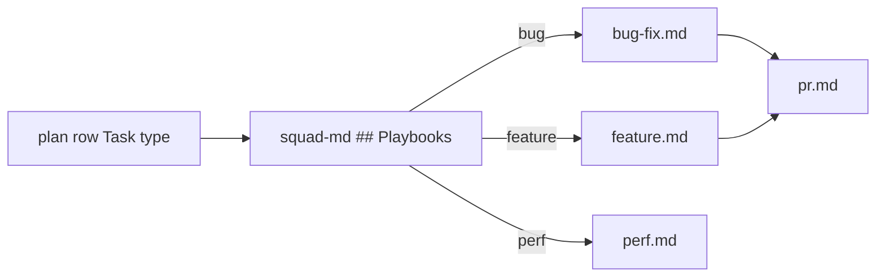

# PS09: Squad playbooks: copy + adapt is the default
- Status: todo (docs only; build waits for Sven go per PBI)
- Batch: B2
- Depends on: PS07
- Absorbs old: old 37, 38, 39, 40, 54, 61
- Lane: Builder (Cursor CLI for docs and markdown, Cloud Agent if multi-file C#)
- Release: squad v2 ([README](README.md#squad-v2))
- Docs: [STRUCTURE](STRUCTURE.md) (where), [SHAPES](SHAPES.md) (how it looks), [FLOWS](FLOWS.md) (flow per command), [MIGRATION](MIGRATION.md) (v1 to v2 rows), [FORKS](FORKS.md) (forks), [gh-aw](gh-aw/README.md)

## 1. Goal

**Problem on main (`6c59f49`).** [`plugins/squad/skills/squad/SKILL.md`](https://github.com/svennijhuis/agentPacks/blob/6c59f49/plugins/squad/skills/squad/SKILL.md):

> Two entrypoints only: `/squad` and `/squad-review`. Type the command.

Every task type runs the same steps; there is no bug, feature or perf path. Upstream playbooks exist; Sven wants them copied and adapted so our standards stay.

**Why we change it.**

- Sven: "every pbi bug ticket or every task ... can have different playbook ... if he see this pbi is bug he can use other playbook then new feature where is domain logic in it".

**What it gives the user.**

- Local (Cursor, Claude Code, CLI): Plan rows get `Task type:`; the hub picks one playbook per task.
- gh-aw: Playbooks are files inside the hub dir, so they travel with `squad-md` in the closure; Cursor-only lines are gone.

**Out of scope.** Matt weaves inside playbooks (PS10).

Current state details:

- No playbooks; one generic loop. No `Task type:` on main.

## 2. Depends on

PS07. Start only when those PBIs are merged on main. Build order: [README](README.md#new-set-and-build-order).

## 3. What gets replaced

| Kind | Now | After | Action |
|---|---|---|---|
| contract | `plugins/squad/skills/squad/references/planning-contract.md` | `plugins/squad/skills/squad-md/references/planning-contract.md` | edit: `Task type:` per task |
| playbook | (none) | `plugins/squad/skills/squad-md/playbooks/*.md (9)` | add (copy + adapt) |

Full list for all PBIs: [MIGRATION.md](MIGRATION.md#path-table).

## 4. Technical design

### 4.1 Tree before and after

Before (main):

```text
plugins/squad/skills/squad-md/   # no playbooks/
```

After:

```text
plugins/squad/skills/squad-md/playbooks/
  bug-fix.md feature.md domain.md perf.md investigation.md
  plan.md review.md pr.md retro.md
```

### 4.2 Skeleton of the new file

Shape rules: [SHAPES.md](SHAPES.md#summary).

```text
### <Task type>

Source: <upstream link at ae5650f...>, MIT, see NOTICE.

**You own this task.** <who does what>

1. <step>

**Reply:** <shape>
Standards: <bold names>

#### What we changed or added
- <line per change>
```

### 4.3 Target detail

Every copy starts with `Source: <upstream link at 40-hex SHA>, MIT, see NOTICE.` under the H1 and ends with `## What we changed` (one line per change). Scripts and assets stay byte-equal unless listed there. Cursor-only parts (model slugs, `poteto-agent`, Cursor Task, `/loop`, control skills) are removed, or moved under a last `## Provider notes` section with one H3 per provider, so the main text works the same in Cursor, Claude Code, Copilot, Codex and gh-aw.
```text
plugins/squad/skills/squad-md/playbooks/
  bug-fix.md  feature.md  domain.md  perf.md  investigation.md  plan.md  review.md  pr.md  retro.md
```

Default for playbooks (Sven 2026-11-01): copy + adapt. We copy each upstream playbook into our squad folder and fit it to what we already have, so no standard, gate or rule gets lost. Only `principle-*` leafs and stand-alone skills we can use unchanged stay pinned.

Every copied playbook:
- starts with `Source: <upstream link at 40-hex SHA>, MIT, see NOTICE.` under the H3 title,
- ends with `#### What we changed or added` (one line per change),
- keeps our rules by naming the standard leafs (PS07): No Em Dash, Squash Merge One by One, Personal Account Only, No Secrets in Markdown, Review Contract, Coding Standards File,
- keeps our gates: one PBI per PR, one PR at a time, `docs/squad-plan.md` rows and Session split (#85), max 2 fix rounds, findings fixed on the PR,
- drops client-only parts (`poteto-agent`, model slugs, `/loop`, swarm, control-cli, control-ui).

Example head of `playbooks/bug-fix.md`:

```markdown
### Bug fix

Source: https://github.com/cursor/plugins/blob/ae5650febf4320793844c12c4adaa937f417f8da/pstack/skills/poteto-mode/playbooks/bug-fix.md, MIT, see NOTICE.

1. Reproduce it yourself on the surface the user hit; write the repro row in `docs/squad-plan.md`.
...
Standards: **Review Contract**, **No Secrets in Markdown**.

#### What we changed or added
- Dropped `/loop` (client built-in).
- Added Matt diagnosing-bugs phases 1 to 6.
- Added the repro row and the one-PR rule.
```

Playbooks rule: the todo list starts with the matched playbook steps verbatim; a skipped step keeps `skip: <reason>`. Planner writes `Task type:` per task. No fit: figure-it-out.

### 4.4 Interfaces and contracts

| Caller | Callee | Input | Output | State file |
|---|---|---|---|---|
| squad-md | playbook | plan row `Task type:` | steps run | `docs/squad-plan.md` |
| planning contract | planner | request | plan with `Task type:` per task | `docs/squad-plan.md` |

### 4.5 Flow



### 4.6 Choices

| Chosen | Rejected | Why |
|---|---|---|
| Copy + adapt default | Pin upstream playbooks | Upstream uses `/loop` and model slugs and misses our gates. |
| H3 title | H1 | Playbooks are read inside the hub context (upstream shape). |

### 4.7 Checks and error messages

| Rule | Checks | Error message |
|---|---|---|
| REF04 | pointers resolve | see PS03 |
| REF06 | Source and What we changed | see PS03 |
| planning test | `Task type:` required | `plan: task 2 has no 'Task type:'` |

### 4.8 Risks and what breaks

| Risk | Fix |
|---|---|
| Playbook over 40 lines | split into two task types |

Also: Out: Matt weaves (PS10).

### 4.9 Per environment

| Environment | What is different |
|---|---|
| Local (Cursor, Claude Code, CLI) | Same text everywhere; Provider notes only for client extras. |
| gh-aw | Unattended: steps that ask take the default. |

### 4.10 Subagents and what they load

- planner: plan.md. implementer: bug-fix, feature, domain, perf. reviewer: review.md. retro: retro.md.

## 5. Steps

0. **Inventory (forks and upstream alike).** `git diff --name-status <basis>...HEAD -- plugins shared docs .github` (basis: the agentPacks commit you started from; on upstream itself the list is empty). Add every own standard, rule, skill, agent, `custom-rules.md` and instructions file to `docs/pbi/squad/fork-inventory.md` ([format](FORKS.md#step-0-inventory-every-pbi-before-any-edit)). Never delete or overwrite a listed file; unsure means keep it and mark the row `open`.
1. Branch from main: `git switch -c pbi/ps09-squad-playbooks origin/main`.
2. Save the base for the fork check: `git rev-parse HEAD > /tmp/base.sha`.
3. Read [SHAPES.md](SHAPES.md) for every kind in section 3, and each source in section 6.
4. Do each row of section 3 in order. Move or rename with `git mv`. If a row's target path already holds a fork file, follow the [conflict table](MIGRATION.md#fork-path). A copy keeps the `Source:` line and `## What we changed or added`.
5. Do these steps, nothing else:
   1. Copy and adapt each playbook.
   2. Playbooks index in hub.
   3. `Task type:` in the planning contract.
   4. One fixture per type.
6. Run every command in section 8. All must pass.
7. Open one PR titled `PS09: Squad playbooks: copy + adapt is the default`. Body: link to this file, the section 3 table, the section 8 output.

## 6. Sources

| Step | Skill (repo, path, SHA) | Licence | Mode | Lives in | Reason |
|---|---|---|---|---|---|
| bug | [upstream playbook bug-fix](https://github.com/cursor/plugins/blob/ae5650febf4320793844c12c4adaa937f417f8da/pstack/skills/poteto-mode/playbooks/bug-fix.md) | MIT (cursor/plugins, Lauren Tan) | copy + adapt | `squad-md/playbooks/bug-fix.md` | 15 lines, good steps, but uses `/loop` (client built-in). We drop `/loop`, add Matt diagnosing-bugs phases and our repro row. Keeps our standards and gates (PS09). |
| bug | [tdd](https://github.com/cursor/plugins/blob/ae5650febf4320793844c12c4adaa937f417f8da/pstack/skills/tdd/SKILL.md) | MIT (cursor/plugins, Lauren Tan) | copy + adapt | `plugins/squad/skills/tdd/` | Upstream has `disable-model-invocation: true` and says "use only when the user explicitly asks". Sven wants it on every behavior change ("We can use this really hard"). So we change the trigger and the flag; the loop stays. |
| feature | [upstream playbook feature](https://github.com/cursor/plugins/blob/ae5650febf4320793844c12c4adaa937f417f8da/pstack/skills/poteto-mode/playbooks/feature.md) | MIT (cursor/plugins, Lauren Tan) | copy + adapt | `squad-md/playbooks/feature.md` | 21 lines. We add statechart for docs, codebase-design, our plan file rows. Keeps our standards and gates (PS09). |
| domain | [upstream playbook refactoring](https://github.com/cursor/plugins/blob/ae5650febf4320793844c12c4adaa937f417f8da/pstack/skills/poteto-mode/playbooks/refactoring.md) | MIT (cursor/plugins, Lauren Tan) | copy + adapt | `squad-md/playbooks/domain.md` | Base for the domain playbook. We add model-the-domain, Matt domain-modeling, GLOSSARY and ADR rules. Keeps our standards and gates (PS09). |
| perf | [upstream playbook perf-issue](https://github.com/cursor/plugins/blob/ae5650febf4320793844c12c4adaa937f417f8da/pstack/skills/poteto-mode/playbooks/perf-issue.md) | MIT (cursor/plugins, Lauren Tan) | copy + adapt | `squad-md/playbooks/perf.md` | 25 lines. Keep baseline and benchmark-checklist, add our evidence fields. Keeps our standards and gates (PS09). |
| perf | [benchmark-checklist](https://github.com/cursor/plugins/blob/ae5650febf4320793844c12c4adaa937f417f8da/pstack/skills/benchmark-checklist/SKILL.md) | MIT (cursor/plugins, Lauren Tan) | pin | `plugins/squad/external-skills.json` | We change nothing and it has no Cursor-only parts (scanned at ae5650f), so it stays external at the 40-hex SHA. In gh-aw the generator vendors it into the commit and `aw-closure.json` lists it. |
| investigation | [upstream playbook investigation](https://github.com/cursor/plugins/blob/ae5650febf4320793844c12c4adaa937f417f8da/pstack/skills/poteto-mode/playbooks/investigation.md) | MIT (cursor/plugins, Lauren Tan) | copy + adapt | `squad-md/playbooks/investigation.md` | 14 lines, read-only. Almost unchanged; we add our file:line answer rule. Keeps our standards and gates (PS09). |
| plan | [upstream playbook multi-phase-plan](https://github.com/cursor/plugins/blob/ae5650febf4320793844c12c4adaa937f417f8da/pstack/skills/poteto-mode/playbooks/multi-phase-plan.md) | MIT (cursor/plugins, Lauren Tan) | copy + adapt | `squad-md/playbooks/plan.md` | 155 lines and Cursor-heavy (`poteto-agent`, swarm, control-cli, control-ui, `/loop`). We take the phase and gate idea only and keep our `docs/squad-plan.md` (#85). Keeps our standards and gates (PS09). |
| pr | [upstream playbook opening-a-pr](https://github.com/cursor/plugins/blob/ae5650febf4320793844c12c4adaa937f417f8da/pstack/skills/poteto-mode/playbooks/opening-a-pr.md) | MIT (cursor/plugins, Lauren Tan) | copy + adapt | `squad-md/playbooks/pr.md` | Uses deslop and swarm. We merge it with Matt pr (Evidence, Merge Danger) and our squash and personal-only standards. Keeps our standards and gates (PS09). |
| fallback | [figure-it-out](https://github.com/cursor/plugins/blob/ae5650febf4320793844c12c4adaa937f417f8da/pstack/skills/figure-it-out/SKILL.md) | MIT (cursor/plugins, Lauren Tan) | copy + adapt | `plugins/squad/skills/figure-it-out/` | Cursor-only parts at ae5650f: names poteto-mode. Our copy moves them under `## Provider notes` and adds Standards, Gates, Autonomy. |

Route per external skill ([decision](README.md#decision-pin-copy--adapt-weave-or-not-used)):

- upstream playbook bug-fix: **copy + adapt**. `squad-md/playbooks/bug-fix.md`.
- tdd: **copy + adapt**. `plugins/squad/skills/tdd/`.
- upstream playbook feature: **copy + adapt**. `squad-md/playbooks/feature.md`.
- upstream playbook refactoring: **copy + adapt**. `squad-md/playbooks/domain.md`.
- upstream playbook perf-issue: **copy + adapt**. `squad-md/playbooks/perf.md`.
- benchmark-checklist: **pin**. `plugins/squad/external-skills.json`.
- upstream playbook investigation: **copy + adapt**. `squad-md/playbooks/investigation.md`.
- upstream playbook multi-phase-plan: **copy + adapt**. `squad-md/playbooks/plan.md`.
- upstream playbook opening-a-pr: **copy + adapt**. `squad-md/playbooks/pr.md`.
- figure-it-out: **copy + adapt**. `plugins/squad/skills/figure-it-out/`.

Every copy + adapt here adds, beyond its own changes: `Source:` line with SHA, a Standards line, the Gates, the Autonomy line for gh-aw, `## Provider notes`, `## What we changed or added`, and a NOTICE line.

Upstream: pstack [cursor/plugins at ae5650f](https://github.com/cursor/plugins/tree/ae5650febf4320793844c12c4adaa937f417f8da/pstack) (MIT), Matt [mattpocock/skills at 4ae2317](https://github.com/mattpocock/skills/tree/4ae2317ddb22b046e26455e4f9c9b3aaaf62212d) (MIT). Map: [skill map](sources/pstack-matt-skill-map.md).

## 7. Example

Good:

```markdown
### Bug fix
Source: <bug-fix.md at ae5650f...>, MIT, see NOTICE.
1. Reproduce it yourself; add the repro row to `docs/squad-plan.md`.
2. Failing test first (**tdd**).
Standards: **Review Contract**, **Squash Merge One by One**.
#### What we changed or added
- Dropped `/loop`. Added the repro row and one PR per PBI.
```

Bad:

A playbook pasted from upstream unchanged: still calls `/loop` and swarm, no Source line, our gates gone. Or a pin of a playbook that needs our gates.

## 8. DoD (checkable)

```bash
dotnet run --project tools/AgentPacks.Cli -- validate                       # 0 errors, 0 warnings
dotnet test tools/AgentPacks.Cli.Tests                                      # green
dotnet run --project tools/AgentPacks.Cli -- validate-all --out /tmp/agentpacks-marketplace
dotnet run --project tools/AgentPacks.Cli -- migrate-check --base "$(cat /tmp/base.sha)"   # from PS03 on; 0 LOST
for f in tests/fixtures/gh-aw/*.md; do gh aw compile --strict "$f"; done   # from GA04 on; before: write "n/a, no fixture yet"
dotnet run --project tools/AgentPacks.Cli -- migrate-check --base <fixture base> --root tests/fixtures/fork-acme   # fixture fork, 0 LOST
dotnet run --project tools/AgentPacks.Cli -- validate --root tests/fixtures/fork-acme                              # fixture fork, 0 errors
grep -rnP "[\x{2013}\x{2014}]" plugins docs || echo "no dashes"
```

Then locally: install `/tmp/agentpacks-marketplace` in Cursor or Claude Code, run `/pack-check` (same result as `validate`) and each command this PBI touches once.

- [ ] Each fixture picks the right playbook and its first todo items.
- [ ] REF04 and REF06 pass.
- [ ] Local: works in Cursor, Claude Code and CLI (Copilot CLI, Codex). Proof offline: generated client manifests and fixture tests (`ClientManifestTests`, `ComponentGenerationTests`).
- [ ] gh-aw: the fixture workflow under `tests/fixtures/gh-aw/` that uses this PBI's files passes `gh aw compile --strict` (pinned gh-aw, no run, no secrets, no Actions minutes). See [gh-aw README](gh-aw/README.md).
- [ ] `dotnet run --project tools/AgentPacks.Cli -- validate` exits 0, 0 errors, 0 warnings.
- [ ] `/pack-check` locally gives the same result (same rules, one source).
- [ ] `dotnet test tools/AgentPacks.Cli.Tests` green; main stays green and all 7 commands still load after merge ([MIGRATION](MIGRATION.md)).
- [ ] No em dash, no tokens in markdown, FAKE fixture values only.
- [ ] Every row of `docs/pbi/squad/fork-inventory.md` is present in v2 (status `done` or `open` with a reason) and `/pack-check` is green, locally and in gh-aw. The fixture fork `tests/fixtures/fork-acme` (one own standard, one own rule) still passes after this PBI.

## 9. Evidence

- 9 fixture names.

## 10. For forks

Rules for every fork: [FORKS.md](FORKS.md). For this PBI: Your own task types: add `playbooks/<type>.md` and one line in `## Playbooks` inside the hub index.
