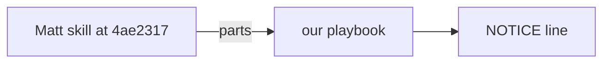

# PS10: Weave Matt skills into the playbooks and agents
- Status: todo (docs only; build waits for Sven go per PBI)
- Batch: B2
- Depends on: PS09
- Absorbs old: old 45 (hand-off in PR-body order)
- Lane: Builder (Cursor CLI for docs and markdown, Cloud Agent if multi-file C#)
- Release: squad v2 ([README](README.md#squad-v2))
- Docs: [STRUCTURE](STRUCTURE.md) (where), [SHAPES](SHAPES.md) (how it looks), [FLOWS](FLOWS.md) (flow per command), [MIGRATION](MIGRATION.md) (v1 to v2 rows), [FORKS](FORKS.md) (forks), [gh-aw](gh-aw/README.md)

## 1. Goal

**Problem on main (`6c59f49`).** [`plugins/squad/skills/squad/references/retro.md`](https://github.com/svennijhuis/agentPacks/blob/6c59f49/plugins/squad/skills/squad/references/retro.md):

> Nothing rewrites a skill, standard, or contract.

Matt code-review, diagnosing-bugs, domain-modeling, pr, research and retro have steps we lack; Sven 2026-11-01: copy them; our playbooks and agents call the copies, and only small parts (humanlayer Summary) are woven.

**Why we change it.**

- Sven on code-review, diagnose-bugs, domain-modeling ("docs/adr better"), pr ("when asking to create pr ... or when pr already open"), research, retro ("improve my retro stap").

**What it gives the user.**

- Local (Cursor, Claude Code, CLI): Review gets the two axes, bug-fix gets the diagnose phases, retro gets the lesson format.
- gh-aw: Weaves live inside our files; no extra closure entries.

**Out of scope.** Pinning Matt skills (PS05 pins only codebase-design).

Current state details:

- [`plugins/squad/skills/squad/references/review-contract.md`](https://github.com/svennijhuis/agentPacks/blob/6c59f49/plugins/squad/skills/squad/references/review-contract.md), `adr.md`, `retro.md`, [`plugins/squad/agents/squad-planner.md`](https://github.com/svennijhuis/agentPacks/blob/6c59f49/plugins/squad/agents/squad-planner.md).

## 2. Depends on

PS09. Start only when those PBIs are merged on main. Build order: [README](README.md#new-set-and-build-order).

## 3. What gets replaced

| Kind | Now | After | Action |
|---|---|---|---|
| contract | `plugins/squad/skills/squad/references/adr.md, retro.md` | same names under squad-mode | edit: Matt weave |
| skill | (none) | `plugins/squad/skills/{code-review,improve-codebase-architecture,chief-of-staff}` | add (copy + adapt of Matt); diagnosing-bugs, pr, retro woven into playbooks |

Full list for all PBIs: [MIGRATION.md](MIGRATION.md#path-table).

## 4. Technical design

### 4.1 Tree before and after

Before (main):

```text
squad-mode/references/review-contract.md  retro.md  adr.md
squad-mode/playbooks/bug-fix.md  domain.md  pr.md
```

After:

```text
same files, each with a `Source:` line per woven part and a NOTICE line
```

### 4.2 Skeleton of the new file

Shape rules: [SHAPES.md](SHAPES.md#summary).

```text
#### From Matt <skill>
Source: <link at 4ae2317...>, MIT.
<woven steps>
```

### 4.3 Target detail

One edit per Matt skill into its home (see reuse table), one NOTICE line each.

### 4.4 Interfaces and contracts

| Caller | Callee | Input | Output | State file |
|---|---|---|---|---|
| playbooks | woven sections | task | steps | plan row |

### 4.5 Flow



### 4.6 Choices

| Chosen | Rejected | Why |
|---|---|---|
| Weave | Pin whole skill | We own the flow file; a second skill would duplicate steps. |

### 4.7 Checks and error messages

| Rule | Checks | Error message |
|---|---|---|
| REF06 | woven part has Source | `REF06 <path>: woven part without Source` |

### 4.8 Risks and what breaks

| Risk | Fix |
|---|---|
| Contradiction with our gates | our gate wins; note it in What we changed |

Also: Out: architecture review (PS11).

### 4.9 Per environment

| Environment | What is different |
|---|---|
| Local (Cursor, Claude Code, CLI) | Same. |
| gh-aw | Same. |

### 4.10 Subagents and what they load

- reviewer two axes; planner research; retro Matt retro.

## 5. Steps

0. **Inventory (forks and upstream alike).** `git diff --name-status <basis>...HEAD -- plugins shared docs .github` (basis: the agentPacks commit you started from; on upstream itself the list is empty). Add every own standard, rule, skill, agent, `custom-rules.md` and instructions file to `docs/pbi/squad/fork-inventory.md` ([format](FORKS.md#step-0-inventory-every-pbi-before-any-edit)). Never delete or overwrite a listed file; unsure means keep it and mark the row `open`.
1. Branch from main: `git switch -c pbi/ps10-matt-weaves origin/main`.
2. Save the base for the fork check: `git rev-parse HEAD > /tmp/base.sha`.
3. Read [SHAPES.md](SHAPES.md) for every kind in section 3, and each source in section 6.
4. Do each row of section 3 in order. Move or rename with `git mv`. If a row's target path already holds a fork file, follow the [conflict table](MIGRATION.md#fork-path). A copy keeps the `Source:` line and `## What we changed or added`.
5. Do these steps, nothing else:
   1. One edit per row.
   2. Fixtures: two-axis review, bug phases, PR body with Evidence and Merge Danger.
6. Run every command in section 8. All must pass.
7. Open one PR titled `PS10: Weave Matt skills into the playbooks and agents`. Body: link to this file, the section 3 table, the section 8 output.

## 6. Sources

| Step | Skill (repo, path, SHA) | Licence | Mode | Lives in | Reason |
|---|---|---|---|---|---|
| review | [Matt code-review](https://github.com/mattpocock/skills/blob/4ae2317ddb22b046e26455e4f9c9b3aaaf62212d/skills/engineering/code-review/SKILL.md) | MIT (mattpocock/skills) | copy + adapt | `plugins/squad/skills/code-review/` | We add: `CODING_STANDARDS.md` per repo, a `.github/instructions/*.instructions.md` example, our severity words; drops `setup-matt-pocock-skills`. |
| bug | [Matt diagnosing-bugs](https://github.com/mattpocock/skills/blob/4ae2317ddb22b046e26455e4f9c9b3aaaf62212d/skills/engineering/diagnosing-bugs/SKILL.md) | MIT (mattpocock/skills) | weave | `squad-mode/playbooks/bug-fix.md` | Only its phases 1 to 6 (a technique), woven into the copied bug-fix playbook. Sven: diagnosing-bugs woven into poteto. |
| domain | [Matt domain-modeling](https://github.com/mattpocock/skills/blob/4ae2317ddb22b046e26455e4f9c9b3aaaf62212d/skills/engineering/domain-modeling/SKILL.md) | MIT (mattpocock/skills) | pin | `plugins/squad/external-skills.json` | Writes `docs/adr/*` and GLOSSARY as Sven wants; used unchanged from the domain playbook. |
| plan | [Matt research](https://github.com/mattpocock/skills/blob/4ae2317ddb22b046e26455e4f9c9b3aaaf62212d/skills/engineering/research/SKILL.md) | MIT (mattpocock/skills) | pin | `plugins/squad/external-skills.json` | Fresh-context research for the planner and subagents; used unchanged. |
| retro | [Matt retro](https://github.com/mattpocock/skills/blob/4ae2317ddb22b046e26455e4f9c9b3aaaf62212d/skills/engineering/retro/SKILL.md) | MIT (mattpocock/skills) | weave | `squad-retro`, `references/retro.md` | Environment-fix steps into our retro step. Also pinned unchanged as a dependency of chief-of-staff. |
| pr | [Matt pr (Summary from humanlayer show-me, Apache-2.0)](https://github.com/mattpocock/skills/blob/4ae2317ddb22b046e26455e4f9c9b3aaaf62212d/skills/engineering/pr/SKILL.md) | MIT (mattpocock/skills) | weave | `squad-mode/playbooks/pr.md` | Evidence, Merge Danger and the humanlayer Summary (Apache-2.0) woven into our pr playbook: create a PR or add to an open one. |

Route per external skill ([decision](README.md#decision-pin-copy--adapt-weave-or-not-used)):

- Matt code-review: **copy + adapt**. `plugins/squad/skills/code-review/`.
- Matt diagnosing-bugs: **weave**. `squad-mode/playbooks/bug-fix.md`.
- Matt domain-modeling: **pin**. `plugins/squad/external-skills.json`.
- Matt research: **pin**. `plugins/squad/external-skills.json`.
- Matt retro: **weave**. `squad-retro`, `references/retro.md`.
- Matt pr (Summary from humanlayer show-me, Apache-2.0): **weave**. `squad-mode/playbooks/pr.md`.

Every copy + adapt here adds, beyond its own changes: `Source:` line with SHA, a Standards line, the Gates, the Autonomy line for gh-aw, `## Provider notes`, `## What we changed or added`, and a NOTICE line.

Upstream: pstack [cursor/plugins at ae5650f](https://github.com/cursor/plugins/tree/ae5650febf4320793844c12c4adaa937f417f8da/pstack) (MIT), Matt [mattpocock/skills at 4ae2317](https://github.com/mattpocock/skills/tree/4ae2317ddb22b046e26455e4f9c9b3aaaf62212d) (MIT). Map: [skill map](sources/pstack-matt-skill-map.md).

## 7. Example

Good:

```markdown
## Review (two axes, from Matt code-review)
- Standards axis: each finding names a CODING_STANDARDS.md rule.
- Spec axis: each finding names a PBI acceptance line.
Severity words stay ours: blocker, high, medium, low, tiny.
```

Bad:

Replacing our review contract with Matt's file, which loses our severity words and finding identity.

## 8. DoD (checkable)

```bash
dotnet run --project tools/AgentPacks.Cli -- validate                       # 0 errors, 0 warnings
dotnet test tools/AgentPacks.Cli.Tests                                      # green
dotnet run --project tools/AgentPacks.Cli -- validate-all --out /tmp/agentpacks-marketplace
dotnet run --project tools/AgentPacks.Cli -- migrate-check --base "$(cat /tmp/base.sha)"   # from PS03 on; 0 LOST
for f in tests/fixtures/gh-aw/*.md; do gh aw compile --strict "$f"; done   # from GA04 on; before: write "n/a, no fixture yet"
dotnet run --project tools/AgentPacks.Cli -- migrate-check --base <fixture base> --root tests/fixtures/fork-acme   # fixture fork, 0 LOST
dotnet run --project tools/AgentPacks.Cli -- validate --root tests/fixtures/fork-acme                              # fixture fork, 0 errors
grep -rnP "[\x{2013}\x{2014}]" plugins docs || echo "no dashes"
```

Then locally: install `/tmp/agentpacks-marketplace` in Cursor or Claude Code, run `/pack-check` (same result as `validate`) and each command this PBI touches once.

- [ ] NOTICE line per weave; fixtures green.
- [ ] Local: works in Cursor, Claude Code and CLI (Copilot CLI, Codex). Proof offline: generated client manifests and fixture tests (`ClientManifestTests`, `ComponentGenerationTests`).
- [ ] gh-aw: the fixture workflow under `tests/fixtures/gh-aw/` that uses this PBI's files passes `gh aw compile --strict` (pinned gh-aw, no run, no secrets, no Actions minutes). See [gh-aw README](gh-aw/README.md).
- [ ] `dotnet run --project tools/AgentPacks.Cli -- validate` exits 0, 0 errors, 0 warnings.
- [ ] `/pack-check` locally gives the same result (same rules, one source).
- [ ] `dotnet test tools/AgentPacks.Cli.Tests` green; main stays green and all 7 commands still load after merge ([MIGRATION](MIGRATION.md)).
- [ ] No em dash, no tokens in markdown, FAKE fixture values only.
- [ ] Every row of `docs/pbi/squad/fork-inventory.md` is present in v2 (status `done` or `open` with a reason) and `/pack-check` is green, locally and in gh-aw. The fixture fork `tests/fixtures/fork-acme` (one own standard, one own rule) still passes after this PBI.

## 9. Evidence

- Fixture names.

## 10. For forks

Rules for every fork: [FORKS.md](FORKS.md). For this PBI: Your own additions to these files stay; weaves are appended under their own H4.
