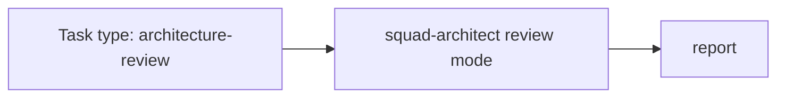

# PS11: Architecture review mode for code Sven wrote
- Status: todo (docs only; build waits for Sven go per PBI)
- Batch: B2
- Depends on: PS10
- Absorbs old: none
- Lane: Builder (Cursor CLI for docs and markdown, Cloud Agent if multi-file C#)
- Release: squad v2 ([README](README.md#squad-v2))
- Docs: [STRUCTURE](STRUCTURE.md) (where), [SHAPES](SHAPES.md) (how it looks), [FLOWS](FLOWS.md) (flow per command), [MIGRATION](MIGRATION.md) (v1 to v2 rows), [FORKS](FORKS.md) (forks), [gh-aw](gh-aw/README.md)

## 1. Goal

**Problem on main (`6c59f49`).** [`plugins/squad/agents/squad-architect.md`](https://github.com/svennijhuis/agentPacks/blob/6c59f49/plugins/squad/agents/squad-architect.md):

> Returns the plan's Design and Map sections for a full change that crosses layers, adds a project or package, or changes a public API.

Matt improve-codebase-architecture is useful only on code Sven wrote; today architect only designs new changes.

**Why we change it.**

- Sven: "only reviewing code that I created ... but way of pattern cursor I like more".

**What it gives the user.**

- Local (Cursor, Claude Code, CLI): `/squad` can run an architecture review task type on existing code.
- gh-aw: Read-only mode, report only; fits `workflow_dispatch` report workflows.

**Out of scope.** Code changes from the review (normal PBIs).

Current state details:

- No such mode.

## 2. Depends on

PS10. Start only when those PBIs are merged on main. Build order: [README](README.md#new-set-and-build-order).

## 3. What gets replaced

| Kind | Now | After | Action |
|---|---|---|---|
| skill | (none) | `plugins/squad/skills/{code-review,improve-codebase-architecture,chief-of-staff}` | add (copy + adapt of Matt); diagnosing-bugs, pr, retro woven into playbooks |

Full list for all PBIs: [MIGRATION.md](MIGRATION.md#path-table).

## 4. Technical design

### 4.1 Tree before and after

Before (main):

```text
plugins/squad/agents/squad-architect.md
```

After:

```text
plugins/squad/agents/squad-architect.md   # + review mode
squad-mode/playbooks/architecture-review.md   # NEW (rewrite of Matt idea)
```

### 4.2 Skeleton of the new file

Shape rules: [SHAPES.md](SHAPES.md#summary).

```text
### Architecture review

**You own this task.**
1. Map modules (blast-radius).
2. Find deep vs shallow modules.
3. Report candidates, no edits.

**Reply:** table of candidates.
```

### 4.3 Target detail

`squad-mode/references/architecture-review.md`, used by review.md only for files whose git author is Sven's personal account. codebase-design vocabulary plus architect red flags; no grilling, no HTML.

### 4.4 Interfaces and contracts

| Caller | Callee | Input | Output | State file |
|---|---|---|---|---|
| squad-mode | squad-architect | mode=review + paths | candidate table | report only |

### 4.5 Flow



### 4.6 Choices

| Chosen | Rejected | Why |
|---|---|---|
| Rewrite | Pin Matt skill | Text assumes his repo layout. |

### 4.7 Checks and error messages

| Rule | Checks | Error message |
|---|---|---|
| REF04 | pointer resolves | see PS03 |

### 4.8 Risks and what breaks

| Risk | Fix |
|---|---|
| Runs on foreign code | playbook step 0: only repos under svennijhuis |

Also: Git author only, never org data.

### 4.9 Per environment

| Environment | What is different |
|---|---|
| Local (Cursor, Claude Code, CLI) | Same. |
| gh-aw | Report only. |

### 4.10 Subagents and what they load

- squad-architect, readonly.

## 5. Steps

0. **Inventory (forks and upstream alike).** `git diff --name-status <basis>...HEAD -- plugins shared docs .github` (basis: the agentPacks commit you started from; on upstream itself the list is empty). Add every own standard, rule, skill, agent, `custom-rules.md` and instructions file to `docs/pbi/squad/fork-inventory.md` ([format](FORKS.md#step-0-inventory-every-pbi-before-any-edit)). Never delete or overwrite a listed file; unsure means keep it and mark the row `open`.
1. Branch from main: `git switch -c pbi/ps11-architecture-review origin/main`.
2. Save the base for the fork check: `git rev-parse HEAD > /tmp/base.sha`.
3. Read [SHAPES.md](SHAPES.md) for every kind in section 3, and each source in section 6.
4. Do each row of section 3 in order. Move or rename with `git mv`. If a row's target path already holds a fork file, follow the [conflict table](MIGRATION.md#fork-path). A copy keeps the `Source:` line and `## What we changed or added`.
5. Do these steps, nothing else:
   1. Write it.
   2. Hook from review.md.
   3. Fixture with a shallow module.
6. Run every command in section 8. All must pass.
7. Open one PR titled `PS11: Architecture review mode for code Sven wrote`. Body: link to this file, the section 3 table, the section 8 output.

## 6. Sources

| Step | Skill (repo, path, SHA) | Licence | Mode | Lives in | Reason |
|---|---|---|---|---|---|
| review | [Matt improve-codebase-architecture](https://github.com/mattpocock/skills/blob/4ae2317ddb22b046e26455e4f9c9b3aaaf62212d/skills/engineering/improve-codebase-architecture/SKILL.md) | MIT (mattpocock/skills) | copy + adapt | `plugins/squad/skills/improve-codebase-architecture/` | We change it: review only, only on code Sven wrote; grilling and HTML report dropped. |
| review | [architect (+ design-red-flags)](https://github.com/cursor/plugins/blob/ae5650febf4320793844c12c4adaa937f417f8da/pstack/skills/architect/SKILL.md) | MIT (cursor/plugins, Lauren Tan) | copy + adapt | `plugins/squad/skills/architect/` | Cursor-only parts at ae5650f: names `claude-opus` model slug. Our copy moves them under `## Provider notes` and adds Standards, Gates, Autonomy. |
| review | [Matt codebase-design](https://github.com/mattpocock/skills/blob/4ae2317ddb22b046e26455e4f9c9b3aaaf62212d/skills/engineering/codebase-design/SKILL.md) | MIT (mattpocock/skills) | pin | `plugins/squad/external-skills.json` | Design it twice and deep vs shallow modules; we change nothing and it has no client-only parts. |

Route per external skill ([decision](README.md#decision-pin-copy--adapt-weave-or-not-used)):

- Matt improve-codebase-architecture: **copy + adapt**. `plugins/squad/skills/improve-codebase-architecture/`.
- architect (+ design-red-flags): **copy + adapt**. `plugins/squad/skills/architect/`.
- Matt codebase-design: **pin**. `plugins/squad/external-skills.json`.

Every copy + adapt here adds, beyond its own changes: `Source:` line with SHA, a Standards line, the Gates, the Autonomy line for gh-aw, `## Provider notes`, `## What we changed or added`, and a NOTICE line.

Upstream: pstack [cursor/plugins at ae5650f](https://github.com/cursor/plugins/tree/ae5650febf4320793844c12c4adaa937f417f8da/pstack) (MIT), Matt [mattpocock/skills at 4ae2317](https://github.com/mattpocock/skills/tree/4ae2317ddb22b046e26455e4f9c9b3aaaf62212d) (MIT). Map: [skill map](sources/pstack-matt-skill-map.md).

## 7. Example

Good:

```text
Finding (architecture, medium): OrderService is shallow (6 public
methods, each 1 line to the repo). Deepen: one PlaceOrder entry.
Only for code Sven wrote; no grilling, no HTML report.
```

Bad:

Running the architecture rewrite on vendored or generated code, or asking Sven 10 grilling questions first.

## 8. DoD (checkable)

```bash
dotnet run --project tools/AgentPacks.Cli -- validate                       # 0 errors, 0 warnings
dotnet test tools/AgentPacks.Cli.Tests                                      # green
dotnet run --project tools/AgentPacks.Cli -- validate-all --out /tmp/agentpacks-marketplace
dotnet run --project tools/AgentPacks.Cli -- migrate-check --base "$(cat /tmp/base.sha)"   # from PS03 on; 0 LOST
for f in tests/fixtures/gh-aw/*.md; do gh aw compile --strict "$f"; done   # from GA04 on; before: write "n/a, no fixture yet"
dotnet run --project tools/AgentPacks.Cli -- migrate-check --base <fixture base> --root tests/fixtures/fork-acme   # fixture fork, 0 LOST
dotnet run --project tools/AgentPacks.Cli -- validate --root tests/fixtures/fork-acme                              # fixture fork, 0 errors
grep -rnP "[\x{2013}\x{2014}]" plugins docs || echo "no dashes"
```

Then locally: install `/tmp/agentpacks-marketplace` in Cursor or Claude Code, run `/pack-check` (same result as `validate`) and each command this PBI touches once.

- [ ] Fixture returns a deepening finding with path:line.
- [ ] Local: works in Cursor, Claude Code and CLI (Copilot CLI, Codex). Proof offline: generated client manifests and fixture tests (`ClientManifestTests`, `ComponentGenerationTests`).
- [ ] gh-aw: the fixture workflow under `tests/fixtures/gh-aw/` that uses this PBI's files passes `gh aw compile --strict` (pinned gh-aw, no run, no secrets, no Actions minutes). See [gh-aw README](gh-aw/README.md).
- [ ] `dotnet run --project tools/AgentPacks.Cli -- validate` exits 0, 0 errors, 0 warnings.
- [ ] `/pack-check` locally gives the same result (same rules, one source).
- [ ] `dotnet test tools/AgentPacks.Cli.Tests` green; main stays green and all 7 commands still load after merge ([MIGRATION](MIGRATION.md)).
- [ ] No em dash, no tokens in markdown, FAKE fixture values only.
- [ ] Every row of `docs/pbi/squad/fork-inventory.md` is present in v2 (status `done` or `open` with a reason) and `/pack-check` is green, locally and in gh-aw. The fixture fork `tests/fixtures/fork-acme` (one own standard, one own rule) still passes after this PBI.

## 9. Evidence

- Fixture output.

## 10. For forks

Rules for every fork: [FORKS.md](FORKS.md). For this PBI: Not applied to fork code unless the fork owner enables the task type.
