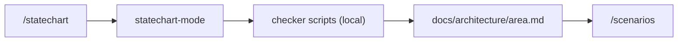

# PS12: /statechart command plus statechart-mode in the squad flow
- Status: todo (docs only; build waits for Sven go per PBI)
- Batch: B2
- Depends on: PS09
- Absorbs old: none
- Lane: Builder (Cursor CLI for docs and markdown, Cloud Agent if multi-file C#)
- Release: squad v2 ([README](README.md#squad-v2))
- Docs: [STRUCTURE](STRUCTURE.md) (where), [SHAPES](SHAPES.md) (how it looks), [FLOWS](FLOWS.md) (flow per command), [MIGRATION](MIGRATION.md) (v1 to v2 rows), [FORKS](FORKS.md) (forks), [gh-aw](gh-aw/README.md)

## 1. Goal

**Problem on main (`6c59f49`).** [`plugins/pack-author/skills/pack-author-md/references/style.md`](https://github.com/svennijhuis/agentPacks/blob/6c59f49/plugins/pack-author/skills/pack-author-md/references/style.md):

> the six user commands (squad, squad-review, scenarios, pack-check, pack-author, security-audit)

Features with states have no check; pstack statechart does it but is Cursor-shaped. Sven agreed to a seventh command.

**Why we change it.**

- Sven: "statechart wil ik aparte commando voor maar moet ook in flow zijn die we al hebben".
- Sven: charts in docs so architects and developers see how the app is built; also for unit, integration, component and smoke test scenarios.

**What it gives the user.**

- Local (Cursor, Claude Code, CLI): `/statechart` models states, runs the checker, writes `docs/architecture/<area>.md`.
- gh-aw: The chart page is read in gh-aw; the TLA+ scripts are local only.

**Out of scope.** Running TLA+ in CI.

Current state details:

- No statechart. `/scenarios` ([`plugins/squad/skills/scenarios-md/SKILL.md`](https://github.com/svennijhuis/agentPacks/blob/6c59f49/plugins/squad/skills/scenarios-md/SKILL.md)) reads changed handlers only.

## 2. Depends on

PS09. Start only when those PBIs are merged on main. Build order: [README](README.md#new-set-and-build-order).

## 3. What gets replaced

| Kind | Now | After | Action |
|---|---|---|---|
| command | (none) | `plugins/squad/commands/statechart.md` | add |
| skill | (none) | `plugins/squad/skills/tdd, statechart-mode, arena, no-comments` | add (copy + adapt) |
| validator | `"six user commands" FAIL bar` | `seven (adds statechart)` | edit |

Full list for all PBIs: [MIGRATION.md](MIGRATION.md#path-table).

## 4. Technical design

### 4.1 Tree before and after

Before (main):

```text
plugins/squad/commands/  squad.md squad-review.md scenarios.md
```

After:

```text
plugins/squad/commands/statechart.md   # NEW
plugins/squad/skills/statechart-mode/   # copy + adapt, scripts byte-equal
style bar: seven user commands
```

### 4.2 Skeleton of the new file

Shape rules: [SHAPES.md](SHAPES.md#summary).

```text
---
name: statechart
description: Model a feature's states, check them, write the chart.
---

# Statechart

Load the `statechart-mode` skill with the Skill tool by exact name. Run its flow. Do not commit, merge or push.
```

### 4.3 Target detail

Every copy starts with `Source: <upstream link at 40-hex SHA>, MIT, see NOTICE.` under the H1 and ends with `## What we changed` (one line per change). Scripts and assets stay byte-equal unless listed there. Cursor-only parts (model slugs, `poteto-agent`, Cursor Task, `/loop`, control skills) are removed, or moved under a last `## Provider notes` section with one H3 per provider, so the main text works the same in Cursor, Claude Code, Copilot, Codex and gh-aw.
- Skill `plugins/squad/skills/statechart-mode/` (copy + adapt, reason in reuse table). Scripts byte-equal.
- Command `plugins/squad/commands/statechart.md`: thin wrapper, loads `statechart-mode`, no logic of its own.
- Output: Mermaid chart in `docs/architecture/<area>.md` plus shortest path to each rule-breaking state.
- In the flow: plan.md and feature.md call statechart-mode for stateful work (docs), review.md checks the chart still matches.
- Paths export to a scenario list that `/scenarios` reads (unit, integration, component, smoke rows).
- Slash count: 6 commands today (squad, squad-review, scenarios, pack-check, pack-author, security-audit). After this PBI 7; room user commands go from 4 to 5. Sven agreed to the extra slash (2026-11-01).

### 4.4 Interfaces and contracts

| Caller | Callee | Input | Output | State file |
|---|---|---|---|---|
| `/statechart` | `statechart-mode` | area | chart page + bad paths | `docs/architecture/<area>.md` |
| `/scenarios` | chart page | shortest bad paths | scenario rows | `docs/smoke/` |

### 4.5 Flow



### 4.6 Choices

| Chosen | Rejected | Why |
|---|---|---|
| Name statechart-mode | statechart | Skill name must differ from command. |
| Copy + adapt | Pin | Adds docs output and scenario export. |

### 4.7 Checks and error messages

| Rule | Checks | Error message |
|---|---|---|
| command bar | exactly 7 user commands | `expected 7 user commands, found 6: missing statechart` |
| REF06 | copy marks | see PS03 |

### 4.8 Risks and what breaks

| Risk | Fix |
|---|---|
| Copilot command naming | ClientManifestTests updated |

Also: Needs Bun, TLC and Java via mise, network on first run: local only, not gh-aw offline.; Out: TLA+ guide.

### 4.9 Per environment

| Environment | What is different |
|---|---|
| Local (Cursor, Claude Code, CLI) | Scripts run locally. |
| gh-aw | No scripts; chart page only. |

### 4.10 Subagents and what they load

- squad-planner and squad-architect load statechart-mode for stateful tasks.

## 5. Steps

0. **Inventory (forks and upstream alike).** `git diff --name-status <basis>...HEAD -- plugins shared docs .github` (basis: the agentPacks commit you started from; on upstream itself the list is empty). Add every own standard, rule, skill, agent and instructions file to `docs/pbi/squad/fork-inventory.md` ([format](FORKS.md#step-0-inventory-every-pbi-before-any-edit)). Never delete or overwrite a listed file; unsure means keep it and mark the row `open`.
1. Branch from main: `git switch -c pbi/ps12-statechart-command-and-flow origin/main`.
2. Save the base for the fork check: `git rev-parse HEAD > /tmp/base.sha`.
3. Read [SHAPES.md](SHAPES.md) for every kind in section 3, and each source in section 6.
4. Do each row of section 3 in order. Move or rename with `git mv`. If a row's target path already holds a fork file, follow the [conflict table](MIGRATION.md#fork-path). A copy keeps the `Source:` line and `## What we changed or added`.
5. Do these steps, nothing else:
   1. Copy and adapt statechart.
   2. Write the command.
   3. Hooks in plan.md, feature.md, review.md.
   4. Scenario export read by scenarios-mode.
   5. Update command count in README files, `docs/PLAN.md` and room docs.
6. Run every command in section 8. All must pass.
7. Open one PR titled `PS12: /statechart command plus statechart-mode in the squad flow`. Body: link to this file, the section 3 table, the section 8 output.

## 6. Sources

| Step | Skill (repo, path, SHA) | Licence | Mode | Lives in | Reason |
|---|---|---|---|---|---|
| command and flow | [statechart](https://github.com/cursor/plugins/blob/ae5650febf4320793844c12c4adaa937f417f8da/pstack/skills/statechart/SKILL.md) | MIT (cursor/plugins, Lauren Tan) | copy + adapt | `plugins/squad/skills/statechart-mode/` | Upstream has `disable-model-invocation: true` and is named like the command. Sven wants `/statechart` plus auto use in the flow. We rename to `statechart-mode`, allow model use, add `docs/architecture/` output and the scenario export to `/scenarios`. Scripts stay byte-equal. |
| formal | [create-formal-verification-skill](https://github.com/cursor/plugins/blob/ae5650febf4320793844c12c4adaa937f417f8da/pstack/skills/create-formal-verification-skill/SKILL.md) | MIT (cursor/plugins, Lauren Tan) | copy + adapt | `plugins/squad/skills/` (copy) | Upstream has `disable-model-invocation: true` (line 4 at ae5650f), so `/setup-github` cannot call it as is. The copy drops that line, writes `.github/skills/formal-<area>/` and the model to `docs/architecture/`, keeps the name, NOTICE, source SHA, What we changed or added (PS22). |

Route per external skill ([decision](README.md#decision-pin-copy--adapt-weave-or-not-used)):

- statechart: **copy + adapt**. `plugins/squad/skills/statechart-mode/`.
- create-formal-verification-skill: **copy + adapt**. `plugins/squad/skills/` (copy).

Every copy + adapt here adds, beyond its own changes: `Source:` line with SHA, a Standards line, the Gates, the Autonomy line for gh-aw, `## Provider notes`, `## What we changed or added`, and a NOTICE line.

Upstream: pstack [cursor/plugins at ae5650f](https://github.com/cursor/plugins/tree/ae5650febf4320793844c12c4adaa937f417f8da/pstack) (MIT), Matt [mattpocock/skills at 4ae2317](https://github.com/mattpocock/skills/tree/4ae2317ddb22b046e26455e4f9c9b3aaaf62212d) (MIT). Map: [skill map](sources/pstack-matt-skill-map.md).

## 7. Example

Good:

```text
/statechart orders
  wrote docs/architecture/orders.md (mermaid, 5 states)
  shortest path to bad state: Paid -> Cancelled without refund
  added 1 row to docs/smoke/orders.md via /scenarios
```

Bad:

A `/statechart` command that copies the whole upstream skill into the command file, or a chart nobody turns into tests.

## 8. DoD (checkable)

```bash
dotnet run --project tools/AgentPacks.Cli -- validate                       # 0 errors, 0 warnings
dotnet test tools/AgentPacks.Cli.Tests                                      # green
dotnet run --project tools/AgentPacks.Cli -- validate-all --out /tmp/agentpacks-marketplace
dotnet run --project tools/AgentPacks.Cli -- migrate-check --base "$(cat /tmp/base.sha)"   # from PS03 on; 0 LOST
for f in tests/fixtures/gh-aw/*.md; do gh aw compile --strict "$f"; done   # from GA04 on; before: write "n/a, no fixture yet"
dotnet run --project tools/AgentPacks.Cli -- migrate-check --base <fixture base> --root tests/fixtures/fork-acme   # fixture fork, 0 LOST
dotnet run --project tools/AgentPacks.Cli -- validate --root tests/fixtures/fork-acme                              # fixture fork, 0 errors
grep -rnP "[\x{2013}\x{2014}]" plugins docs || echo "no dashes"
```

Then locally: install `/tmp/agentpacks-marketplace` in Cursor or Claude Code, run `/pack-check` (same result as `validate`) and each command this PBI touches once.

- [ ] Command and skill have different names.
- [ ] Fixture 1: `/statechart` alone writes a chart in `docs/architecture/`.
- [ ] Fixture 2: squad feature run calls statechart-mode and `/scenarios` reads the paths.
- [ ] validate 0 warnings.
- [ ] Local: works in Cursor, Claude Code and CLI (Copilot CLI, Codex). Proof offline: generated client manifests and fixture tests (`ClientManifestTests`, `ComponentGenerationTests`).
- [ ] gh-aw: the fixture workflow under `tests/fixtures/gh-aw/` that uses this PBI's files passes `gh aw compile --strict` (pinned gh-aw, no run, no secrets, no Actions minutes). See [gh-aw README](gh-aw/README.md).
- [ ] `dotnet run --project tools/AgentPacks.Cli -- validate` exits 0, 0 errors, 0 warnings.
- [ ] `/pack-check` locally gives the same result (same rules, one source).
- [ ] `dotnet test tools/AgentPacks.Cli.Tests` green; main stays green and all 7 commands still load after merge ([MIGRATION](MIGRATION.md)).
- [ ] No em dash, no tokens in markdown, FAKE fixture values only.
- [ ] Every row of `docs/pbi/squad/fork-inventory.md` is present in v2 (status `done` or `open` with a reason) and `/pack-check` is green, locally and in gh-aw. The fixture fork `tests/fixtures/fork-acme` (one own standard, one own rule) still passes after this PBI.

## 9. Evidence

- Both fixture outputs.

## 10. For forks

Rules for every fork: [FORKS.md](FORKS.md). For this PBI: Fork commands beyond the 7: list them in `## Local commands` in style bars; the bar counts ours only.
