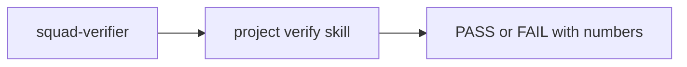

# PS13: Verification and formal verification pairs
- Status: todo (docs only; build waits for Sven go per PBI)
- Batch: B2
- Depends on: PS09
- Absorbs old: old 41, 52, 53, 59
- Lane: Builder (Cursor CLI for docs and markdown, Cloud Agent if multi-file C#)
- Release: squad v2 ([README](README.md#squad-v2))
- Docs: [STRUCTURE](STRUCTURE.md) (where), [SHAPES](SHAPES.md) (how it looks), [FLOWS](FLOWS.md) (flow per command), [MIGRATION](MIGRATION.md) (v1 to v2 rows), [FORKS](FORKS.md) (forks), [gh-aw](gh-aw/README.md)

## 1. Goal

**Problem on main (`6c59f49`).** [`plugins/squad/skills/verify-harness/SKILL.md`](https://github.com/svennijhuis/agentPacks/blob/6c59f49/plugins/squad/skills/verify-harness/SKILL.md):

> Write for the next agent: it arrives cold, mid-task, and must prove a change by running the real app.

verify-harness writes `docs/verify.md` but no skill makes a project-local verification skill; pstack has create and maintain pairs.

**Why we change it.**

- Sven: create-verification-skill plus its maintain follow-up, and the formal pair.

**What it gives the user.**

- Local (Cursor, Claude Code, CLI): A repo can get its own verify skill once and keep it fresh.
- gh-aw: Verify skills run report-only; tools must match the allowlist (REF07).

**Out of scope.** Formal TLA+ beyond statechart (local only).

Current state details:

- [`plugins/squad/skills/verify-harness/SKILL.md`](https://github.com/svennijhuis/agentPacks/blob/6c59f49/plugins/squad/skills/verify-harness/SKILL.md) writes `docs/verify.md`. No feature map, no gardener.

## 2. Depends on

PS09. Start only when those PBIs are merged on main. Build order: [README](README.md#new-set-and-build-order).

## 3. What gets replaced

| Kind | Now | After | Action |
|---|---|---|---|
| skill | (none) | `plugins/squad/skills/principle-*/ (24) and pstack skills we change (architect, how, why, figure-it-out, technical-writing, show-me-your-work, arena, no-comments)` | add (copy + adapt) |

Full list for all PBIs: [MIGRATION.md](MIGRATION.md#path-table).

## 4. Technical design

### 4.1 Tree before and after

Before (main):

```text
plugins/squad/skills/verify-harness/SKILL.md
```

After:

```text
skills/create-verification-skill/, maintain-verification-skill/ (copy + adapt)
verify-harness/SKILL.md   # restyled, points at the pair
```

### 4.2 Skeleton of the new file

Shape rules: [SHAPES.md](SHAPES.md#summary).

```text
(upstream body plus Source, Standards, Gates, Autonomy, Provider notes, What we changed)
```

### 4.3 Target detail

Copies (copy + adapt, see PS22 for why) live in `plugins/squad/skills/`. feature and domain playbooks call create-verification-skill when the repo has none; retro calls maintain-verification-skill (one session, at most one PR). Risky code: the formal pair. `/setup-github` runs them per repo (PS22). verify-harness stays (different deliverable). Old Drive kinds api and trace (41) live in the generated verification skill.

### 4.4 Interfaces and contracts

| Caller | Callee | Input | Output | State file |
|---|---|---|---|---|
| squad-verifier | project verify skill | plan verify rows | numbers | `docs/verify.md` |

### 4.5 Flow



### 4.6 Choices

| Chosen | Rejected | Why |
|---|---|---|
| Pin the pair | Copy | Unchanged text fits. |

### 4.7 Checks and error messages

| Rule | Checks | Error message |
|---|---|---|
| REF05 | byte-equal | see PS03 |

### 4.8 Risks and what breaks

| Risk | Fix |
|---|---|
| Writes into target repo | only on user yes; unattended skips |

Also: Out: verify-harness changes (PS16).

### 4.9 Per environment

| Environment | What is different |
|---|---|
| Local (Cursor, Claude Code, CLI) | Writes allowed after yes. |
| gh-aw | No writes, report only. |

### 4.10 Subagents and what they load

- implementer runs create; retro runs maintain.

## 5. Steps

0. **Inventory (forks and upstream alike).** `git diff --name-status <basis>...HEAD -- plugins shared docs .github` (basis: the agentPacks commit you started from; on upstream itself the list is empty). Add every own standard, rule, skill, agent and instructions file to `docs/pbi/squad/fork-inventory.md` ([format](FORKS.md#step-0-inventory-every-pbi-before-any-edit)). Never delete or overwrite a listed file; unsure means keep it and mark the row `open`.
1. Branch from main: `git switch -c pbi/ps13-verification-pairs origin/main`.
2. Save the base for the fork check: `git rev-parse HEAD > /tmp/base.sha`.
3. Read [SHAPES.md](SHAPES.md) for every kind in section 3, and each source in section 6.
4. Do each row of section 3 in order. Move or rename with `git mv`. If a row's target path already holds a fork file, follow the [conflict table](MIGRATION.md#fork-path). A copy keeps the `Source:` line and `## What we changed or added`.
5. Do these steps, nothing else:
   1. Hooks.
   2. Fixture with create then maintain.
6. Run every command in section 8. All must pass.
7. Open one PR titled `PS13: Verification and formal verification pairs`. Body: link to this file, the section 3 table, the section 8 output.

## 6. Sources

| Step | Skill (repo, path, SHA) | Licence | Mode | Lives in | Reason |
|---|---|---|---|---|---|
| build | [create-verification-skill](https://github.com/cursor/plugins/blob/ae5650febf4320793844c12c4adaa937f417f8da/pstack/skills/create-verification-skill/SKILL.md) | MIT (cursor/plugins, Lauren Tan) | copy + adapt | `plugins/squad/skills/create-verification-skill/` | Upstream writes `.cursor/skills/verify-<app>/` (Cursor-only) and has `disable-model-invocation: true`. Copy writes `.github/skills/verify-<app>/` so Copilot and gh-aw load it, and `/setup-github` may call it (PS22). |
| retro | [maintain-verification-skill](https://github.com/cursor/plugins/blob/ae5650febf4320793844c12c4adaa937f417f8da/pstack/skills/maintain-verification-skill/SKILL.md) | MIT (cursor/plugins, Lauren Tan) | copy + adapt | `plugins/squad/skills/maintain-verification-skill/` | Upstream writes `.cursor/skills/verify-<app>/` (Cursor-only) and has `disable-model-invocation: true`. Copy writes `.github/skills/verify-<app>/` so Copilot and gh-aw load it, and `/setup-github` may call it (PS22). |
| build | [create-formal-verification-skill](https://github.com/cursor/plugins/blob/ae5650febf4320793844c12c4adaa937f417f8da/pstack/skills/create-formal-verification-skill/SKILL.md) | MIT (cursor/plugins, Lauren Tan) | pin | `plugins/squad/external-skills.json` | Works unchanged: writes a project-local skill with no fixed path and no Cursor-only part (scanned at ae5650f). Our setup playbook says where output goes (`.github/skills/formal-<area>/`, model in `docs/architecture/`), the skill stays external at the 40-hex SHA (PS22). |
| retro | [maintain-formal-verification-skill](https://github.com/cursor/plugins/blob/ae5650febf4320793844c12c4adaa937f417f8da/pstack/skills/maintain-formal-verification-skill/SKILL.md) | MIT (cursor/plugins, Lauren Tan) | pin | `plugins/squad/external-skills.json` | Works unchanged: writes a project-local skill with no fixed path and no Cursor-only part (scanned at ae5650f). Our setup playbook says where output goes (`.github/skills/formal-<area>/`, model in `docs/architecture/`), the skill stays external at the 40-hex SHA (PS22). |

Route per external skill ([decision](README.md#decision-pin-copy--adapt-weave-or-not-used)):

- create-verification-skill: **copy + adapt**. `plugins/squad/skills/create-verification-skill/`.
- maintain-verification-skill: **copy + adapt**. `plugins/squad/skills/maintain-verification-skill/`.
- create-formal-verification-skill: **pin**. `plugins/squad/external-skills.json`.
- maintain-formal-verification-skill: **pin**. `plugins/squad/external-skills.json`.

Every copy + adapt here adds, beyond its own changes: `Source:` line with SHA, a Standards line, the Gates, the Autonomy line for gh-aw, `## Provider notes`, `## What we changed or added`, and a NOTICE line.

Upstream: pstack [cursor/plugins at ae5650f](https://github.com/cursor/plugins/tree/ae5650febf4320793844c12c4adaa937f417f8da/pstack) (MIT), Matt [mattpocock/skills at 4ae2317](https://github.com/mattpocock/skills/tree/4ae2317ddb22b046e26455e4f9c9b3aaaf62212d) (MIT). Map: [skill map](sources/pstack-matt-skill-map.md).

## 7. Example

Good:

```text
Repo has no verification skill -> create-verification-skill writes
.cursor/skills/verify-orders/ with 3 checks; verifier runs them.
Formal pair only for code marked risky in the plan.
```

Bad:

Writing a formal verification skill for every small change (token cost, no gain).

## 8. DoD (checkable)

```bash
dotnet run --project tools/AgentPacks.Cli -- validate                       # 0 errors, 0 warnings
dotnet test tools/AgentPacks.Cli.Tests                                      # green
dotnet run --project tools/AgentPacks.Cli -- validate-all --out /tmp/agentpacks-marketplace
dotnet run --project tools/AgentPacks.Cli -- migrate-check --base "$(cat /tmp/base.sha)"   # from PS03 on; 0 LOST
for f in tests/fixtures/gh-aw/*.md; do gh aw compile --strict "$f"; done   # from GA04 on; before: write "n/a, no fixture yet"
dotnet run --project tools/AgentPacks.Cli -- migrate-check --base <fixture base> --root tests/fixtures/fork-acme   # fixture fork, 0 LOST
dotnet run --project tools/AgentPacks.Cli -- validate --root tests/fixtures/fork-acme                              # fixture fork, 0 errors
grep -rnP "[\x{2013}\x{2014}]" plugins docs || echo "no dashes"
```

Then locally: install `/tmp/agentpacks-marketplace` in Cursor or Claude Code, run `/pack-check` (same result as `validate`) and each command this PBI touches once.

- [ ] Order fixture green.
- [ ] Local: works in Cursor, Claude Code and CLI (Copilot CLI, Codex). Proof offline: generated client manifests and fixture tests (`ClientManifestTests`, `ComponentGenerationTests`).
- [ ] gh-aw: the fixture workflow under `tests/fixtures/gh-aw/` that uses this PBI's files passes `gh aw compile --strict` (pinned gh-aw, no run, no secrets, no Actions minutes). See [gh-aw README](gh-aw/README.md).
- [ ] `dotnet run --project tools/AgentPacks.Cli -- validate` exits 0, 0 errors, 0 warnings.
- [ ] `/pack-check` locally gives the same result (same rules, one source).
- [ ] `dotnet test tools/AgentPacks.Cli.Tests` green; main stays green and all 7 commands still load after merge ([MIGRATION](MIGRATION.md)).
- [ ] No em dash, no tokens in markdown, FAKE fixture values only.
- [ ] Every row of `docs/pbi/squad/fork-inventory.md` is present in v2 (status `done` or `open` with a reason) and `/pack-check` is green, locally and in gh-aw. The fixture fork `tests/fixtures/fork-acme` (one own standard, one own rule) still passes after this PBI.

## 9. Evidence

- Fixture output.

## 10. For forks

Rules for every fork: [FORKS.md](FORKS.md). For this PBI: Your own verify skills stay; the pair only creates new ones.
