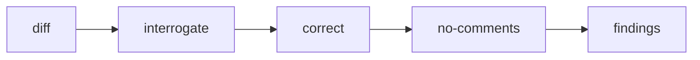

# PS14: Review and lesson stack
- Status: todo (docs only; build waits for Sven go per PBI)
- Batch: B2
- Depends on: PS09
- Absorbs old: old 51, 57, 58
- Lane: Builder (Cursor CLI for docs and markdown, Cloud Agent if multi-file C#)
- Release: squad v2 ([README](README.md#squad-v2))
- Docs: [STRUCTURE](STRUCTURE.md) (where), [SHAPES](SHAPES.md) (how it looks), [FLOWS](FLOWS.md) (flow per command), [MIGRATION](MIGRATION.md) (v1 to v2 rows), [FORKS](FORKS.md) (forks), [gh-aw](gh-aw/README.md)

## 1. Goal

**Problem on main (`6c59f49`).** [`plugins/squad/skills/squad/references/review-contract.md`](https://github.com/svennijhuis/agentPacks/blob/6c59f49/plugins/squad/skills/squad/references/review-contract.md):

> In a planned loop, any `high` or `medium` means `fix`; only `low` and `tiny` can pass with notes.

Review findings and lessons do not stack: the same finding comes back each run.

**Why we change it.**

- Sven: arena "different models are in arena and so in end we have best of all"; interrogate "try to break it"; blast-radius in plan, task, work items, review; correct "not making the same mistakes"; teach and how in planning.

**What it gives the user.**

- Local (Cursor, Claude Code, CLI): Review uses interrogate, correct and no-comments; lessons go to a ledger read at the next run.
- gh-aw: Ledger is read only in gh-aw; writes stay local.

**Out of scope.** Auto-rewriting skills from lessons (never).

Current state details:

- One reviewer pass; no repeated-mistake check.

## 2. Depends on

PS09. Start only when those PBIs are merged on main. Build order: [README](README.md#new-set-and-build-order).

## 3. What gets replaced

| Kind | Now | After | Action |
|---|---|---|---|
| skill | (none) | `plugins/squad/skills/principle-*/ (24) and pstack skills we change (architect, how, why, figure-it-out, technical-writing, show-me-your-work, arena, no-comments)` | add (copy + adapt) |

Full list for all PBIs: [MIGRATION.md](MIGRATION.md#path-table).

## 4. Technical design

### 4.1 Tree before and after

Before (main):

```text
squad-mode/references/review-contract.md  retro.md
```

After:

```text
squad-mode/references/review-contract.md   # + stack order
squad-mode/playbooks/review.md   # interrogate, correct, no-comments
docs/lessons.md in target repo (read, human writes)
```

### 4.2 Skeleton of the new file

Shape rules: [SHAPES.md](SHAPES.md#summary).

```text
### Review
1. interrogate the diff
2. correct (known agent mistakes)
3. no-comments pass
**Reply:** findings by severity
```

### 4.3 Target detail

| Slot | Skill | When |
|---|---|---|
| plan | blast-radius, teach, how, why | every plan with code |
| review | interrogate, blast-radius | every review |
| review | arena (our copy, max 3) | high risk only: security, data loss, concurrency |
| retro | correct | every retro; repeated mistakes become checks (old 57, 58, 51) |
| any | figure-it-out | no playbook fits |

### 4.4 Interfaces and contracts

| Caller | Callee | Input | Output | State file |
|---|---|---|---|---|
| squad-reviewer | review playbook | diff + plan | findings with severity | none |

### 4.5 Flow



### 4.6 Choices

| Chosen | Rejected | Why |
|---|---|---|
| Fixed order | Free choice | Same order every run makes results comparable. |

### 4.7 Checks and error messages

| Rule | Checks | Error message |
|---|---|---|
| REF02 | named skills resolve | see PS03 |

### 4.8 Risks and what breaks

| Risk | Fix |
|---|---|
| Longer review | each step capped at its findings |

Also: Token cost: arena high risk only.

### 4.9 Per environment

| Environment | What is different |
|---|---|
| Local (Cursor, Claude Code, CLI) | Writes lessons after yes. |
| gh-aw | Read only. |

### 4.10 Subagents and what they load

- reviewer, orchestrator (arena), planner, retro.

## 5. Steps

0. **Inventory (forks and upstream alike).** `git diff --name-status <basis>...HEAD -- plugins shared docs .github` (basis: the agentPacks commit you started from; on upstream itself the list is empty). Add every own standard, rule, skill, agent and instructions file to `docs/pbi/squad/fork-inventory.md` ([format](FORKS.md#step-0-inventory-every-pbi-before-any-edit)). Never delete or overwrite a listed file; unsure means keep it and mark the row `open`.
1. Branch from main: `git switch -c pbi/ps14-review-and-lesson-stack origin/main`.
2. Save the base for the fork check: `git rev-parse HEAD > /tmp/base.sha`.
3. Read [SHAPES.md](SHAPES.md) for every kind in section 3, and each source in section 6.
4. Do each row of section 3 in order. Move or rename with `git mv`. If a row's target path already holds a fork file, follow the [conflict table](MIGRATION.md#fork-path). A copy keeps the `Source:` line and `## What we changed or added`.
5. Do these steps, nothing else:
   1. Hooks in review.md, plan.md, retro.md.
   2. Risk flag decides arena.
   3. Fixtures.
6. Run every command in section 8. All must pass.
7. Open one PR titled `PS14: Review and lesson stack`. Body: link to this file, the section 3 table, the section 8 output.

## 6. Sources

| Step | Skill (repo, path, SHA) | Licence | Mode | Lives in | Reason |
|---|---|---|---|---|---|
| review | [interrogate](https://github.com/cursor/plugins/blob/ae5650febf4320793844c12c4adaa937f417f8da/pstack/skills/interrogate/SKILL.md) | MIT (cursor/plugins, Lauren Tan) | pin | `plugins/squad/external-skills.json` | We change nothing and it has no Cursor-only parts (scanned at ae5650f), so it stays external at the 40-hex SHA. In gh-aw the generator vendors it into the commit and `aw-closure.json` lists it. |
| review | [arena](https://github.com/cursor/plugins/blob/ae5650febf4320793844c12c4adaa937f417f8da/pstack/skills/arena/SKILL.md) | MIT (cursor/plugins, Lauren Tan) | copy + adapt | `plugins/squad/skills/arena/` | Cursor-only parts at ae5650f: Cursor model roles (`claude-opus`, composer), Task tool, `~/.cursor`. Our copy moves them under `## Provider notes` and adds Standards, Gates, Autonomy. |
| plan, review | [blast-radius](https://github.com/cursor/plugins/blob/ae5650febf4320793844c12c4adaa937f417f8da/pstack/skills/blast-radius/SKILL.md) | MIT (cursor/plugins, Lauren Tan) | pin | `plugins/squad/external-skills.json` | We change nothing and it has no Cursor-only parts (scanned at ae5650f), so it stays external at the 40-hex SHA. In gh-aw the generator vendors it into the commit and `aw-closure.json` lists it. |
| retro | [correct](https://github.com/cursor/plugins/blob/ae5650febf4320793844c12c4adaa937f417f8da/pstack/skills/correct/SKILL.md) | MIT (cursor/plugins, Lauren Tan) | pin | `plugins/squad/external-skills.json` | We change nothing and it has no Cursor-only parts (scanned at ae5650f), so it stays external at the 40-hex SHA. In gh-aw the generator vendors it into the commit and `aw-closure.json` lists it. |
| plan | [teach](https://github.com/cursor/plugins/blob/ae5650febf4320793844c12c4adaa937f417f8da/pstack/skills/teach/SKILL.md) | MIT (cursor/plugins, Lauren Tan) | pin | `plugins/squad/external-skills.json` | We change nothing and it has no Cursor-only parts (scanned at ae5650f), so it stays external at the 40-hex SHA. In gh-aw the generator vendors it into the commit and `aw-closure.json` lists it. |
| plan | [how](https://github.com/cursor/plugins/blob/ae5650febf4320793844c12c4adaa937f417f8da/pstack/skills/how/SKILL.md) | MIT (cursor/plugins, Lauren Tan) | copy + adapt | `plugins/squad/skills/how/` | Cursor-only parts at ae5650f: Cursor Task tool, `claude-opus`, poteto-mode. Our copy moves them under `## Provider notes` and adds Standards, Gates, Autonomy. |
| plan | [why](https://github.com/cursor/plugins/blob/ae5650febf4320793844c12c4adaa937f417f8da/pstack/skills/why/SKILL.md) | MIT (cursor/plugins, Lauren Tan) | copy + adapt | `plugins/squad/skills/why/` | Cursor-only parts at ae5650f: Cursor Task tool, `claude-opus`, poteto-mode. Our copy moves them under `## Provider notes` and adds Standards, Gates, Autonomy. |
| fallback | [figure-it-out](https://github.com/cursor/plugins/blob/ae5650febf4320793844c12c4adaa937f417f8da/pstack/skills/figure-it-out/SKILL.md) | MIT (cursor/plugins, Lauren Tan) | copy + adapt | `plugins/squad/skills/figure-it-out/` | Cursor-only parts at ae5650f: names poteto-mode. Our copy moves them under `## Provider notes` and adds Standards, Gates, Autonomy. |

Route per external skill ([decision](README.md#decision-pin-copy--adapt-weave-or-not-used)):

- interrogate: **pin**. `plugins/squad/external-skills.json`.
- arena: **copy + adapt**. `plugins/squad/skills/arena/`.
- blast-radius: **pin**. `plugins/squad/external-skills.json`.
- correct: **pin**. `plugins/squad/external-skills.json`.
- teach: **pin**. `plugins/squad/external-skills.json`.
- how: **copy + adapt**. `plugins/squad/skills/how/`.
- why: **copy + adapt**. `plugins/squad/skills/why/`.
- figure-it-out: **copy + adapt**. `plugins/squad/skills/figure-it-out/`.

Every copy + adapt here adds, beyond its own changes: `Source:` line with SHA, a Standards line, the Gates, the Autonomy line for gh-aw, `## Provider notes`, `## What we changed or added`, and a NOTICE line.

Upstream: pstack [cursor/plugins at ae5650f](https://github.com/cursor/plugins/tree/ae5650febf4320793844c12c4adaa937f417f8da/pstack) (MIT), Matt [mattpocock/skills at 4ae2317](https://github.com/mattpocock/skills/tree/4ae2317ddb22b046e26455e4f9c9b3aaaf62212d) (MIT). Map: [skill map](sources/pstack-matt-skill-map.md).

## 7. Example

Good:

```text
Retro: same missing-null-check found in 2 PRs ->
correct turns it into validator rule or standard leaf (one PR).
```

Bad:

A retro that only lists lessons in prose and never changes a check, test or leaf.

## 8. DoD (checkable)

```bash
dotnet run --project tools/AgentPacks.Cli -- validate                       # 0 errors, 0 warnings
dotnet test tools/AgentPacks.Cli.Tests                                      # green
dotnet run --project tools/AgentPacks.Cli -- validate-all --out /tmp/agentpacks-marketplace
dotnet run --project tools/AgentPacks.Cli -- migrate-check --base "$(cat /tmp/base.sha)"   # from PS03 on; 0 LOST
for f in tests/fixtures/gh-aw/*.md; do gh aw compile --strict "$f"; done   # from GA04 on; before: write "n/a, no fixture yet"
dotnet run --project tools/AgentPacks.Cli -- migrate-check --base <fixture base> --root tests/fixtures/fork-acme   # fixture fork, 0 LOST
dotnet run --project tools/AgentPacks.Cli -- validate --root tests/fixtures/fork-acme                              # fixture fork, 0 errors
grep -rnP "[\x{2013}\x{2014}]" plugins docs || echo "no dashes"
```

Then locally: install `/tmp/agentpacks-marketplace` in Cursor or Claude Code, run `/pack-check` (same result as `validate`) and each command this PBI touches once.

- [ ] Arena only in the high-risk fixture.
- [ ] Local: works in Cursor, Claude Code and CLI (Copilot CLI, Codex). Proof offline: generated client manifests and fixture tests (`ClientManifestTests`, `ComponentGenerationTests`).
- [ ] gh-aw: the fixture workflow under `tests/fixtures/gh-aw/` that uses this PBI's files passes `gh aw compile --strict` (pinned gh-aw, no run, no secrets, no Actions minutes). See [gh-aw README](gh-aw/README.md).
- [ ] `dotnet run --project tools/AgentPacks.Cli -- validate` exits 0, 0 errors, 0 warnings.
- [ ] `/pack-check` locally gives the same result (same rules, one source).
- [ ] `dotnet test tools/AgentPacks.Cli.Tests` green; main stays green and all 7 commands still load after merge ([MIGRATION](MIGRATION.md)).
- [ ] No em dash, no tokens in markdown, FAKE fixture values only.
- [ ] Every row of `docs/pbi/squad/fork-inventory.md` is present in v2 (status `done` or `open` with a reason) and `/pack-check` is green, locally and in gh-aw. The fixture fork `tests/fixtures/fork-acme` (one own standard, one own rule) still passes after this PBI.

## 9. Evidence

- Fixture output.

## 10. For forks

Rules for every fork: [FORKS.md](FORKS.md). For this PBI: Fork lessons file is read too if it exists.
