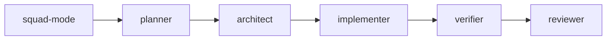

# PS15: Squad agents: one general squad-agent plus reviewer, security-reviewer and retro
- Status: todo (docs only; build waits for Sven go per PBI)
- Batch: B3
- Depends on: PS02, PS07, PS14
- Absorbs old: none
- Lane: Builder (Cursor CLI for docs and markdown, Cloud Agent if multi-file C#)
- Release: squad v2 ([README](README.md#squad-v2))
- Docs: [STRUCTURE](STRUCTURE.md) (where), [SHAPES](SHAPES.md) (how it looks), [FLOWS](FLOWS.md) (flow per command), [MIGRATION](MIGRATION.md) (v1 to v2 rows), [FORKS](FORKS.md) (forks), [gh-aw](gh-aw/README.md)

## 1. Goal

**Problem on main (`6c59f49`).** [`plugins/squad/agents/squad-reviewer.md`](https://github.com/svennijhuis/agentPacks/blob/6c59f49/plugins/squad/agents/squad-reviewer.md):

> Load the `squad` skill with the Skill tool by exact name `squad`, then read `references/review-contract.md`.

Agents load the whole hub by name, carry no principle or standard names and have no fixed Return.

**Why we change it.**

- Sven: subagents too. Each gets role, Non-negotiables, principles, standards and playbooks it uses, plus the absolute path line.

**What it gives the user.**

- Local (Cursor, Claude Code, CLI): Each agent gets the hub path, named leafs and a Return block.
- gh-aw: Agents load via `plugins:` at a tag; text is client-neutral.

**Out of scope.** New agents.

Current state details:

- 10 agents in `plugins/squad/agents/` (architect, implementer, indexer, orchestrator, planner, retro, reviewer, security-reviewer, simplifier, verifier). No principle or standard refs.

## 2. Depends on

PS02, PS07, PS14. Start only when those PBIs are merged on main. Build order: [README](README.md#new-set-and-build-order).

## 3. What gets replaced

| Kind | Now | After | Action |
|---|---|---|---|
| agent | `plugins/squad/agents/squad-*.md (10)` | same names | rewrite with write-subagent |
| agent | `plugins/squad/agents/squad-{planner,architect,indexer,implementer,simplifier,orchestrator,verifier}.md` | `squad-agent.md + same names as one-line pointers until GA07` | merge into general delegate |

Full list for all PBIs: [MIGRATION.md](MIGRATION.md#path-table).

## 4. Technical design

### 4.1 Tree before and after

Before (main):

```text
plugins/squad/agents/  10 files, 25 to 40 lines
```

After:

```text
squad-agent.md (NEW, general delegate)
squad-reviewer.md  squad-security-reviewer.md  squad-retro.md (own prompt)
7 pointer files to squad-agent until GA07
```

### 4.2 Skeleton of the new file

Shape rules: [SHAPES.md](SHAPES.md#summary).

```text
(see PS02 skeleton)
```

### 4.3 Target detail

pstack pattern ([poteto-agent](https://github.com/cursor/plugins/blob/ae5650febf4320793844c12c4adaa937f417f8da/pstack/agents/poteto-agent.md)): one general delegate that reads the hub first, plus an agent only where an own prompt is needed.

| Agent | Tier | Skills | Principles | Standards |
|---|---|---|---|---|
| squad-agent | per role, from the hub Subagents table | the role's playbook names them | per role | global, then language |
| squad-reviewer | standard | interrogate, blast-radius, Matt code-review | Minimize Reader Load, Test Behavior | Review Contract, repo custom standards (PS21) |
| squad-security-reviewer | standard | none | Boundary Discipline | No Secrets in Markdown |
| squad-retro | standard | correct, maintain-verification-skill, Matt retro | Encode Lessons in Structure | none |

Hub `## Subagents` table: role (planner, architect, indexer, implementer, simplifier, orchestrator, verifier) to tier and playbook. `squad-agent` gets the absolute hub path plus the role. The 7 old files become one-line pointers to `squad-agent` until GA07 (no delete without Sven's yes). PR a: squad-agent plus pointers. PR b: the 3 own agents.

### 4.4 Interfaces and contracts

| Caller | Callee | Input | Output | State file |
|---|---|---|---|---|
| squad-mode | each agent | task + absolute hub path | Return fields | none |

### 4.5 Flow



### 4.6 Choices

| Chosen | Rejected | Why |
|---|---|---|
| One general squad-agent plus 3 own agents | 10 role agents | pstack has one delegate that reads the hub; a role is a playbook, not a prompt. Repo Research 2026-11-01. |
| Two PRs | One PR | One PBI per PR still; split keeps review small. |
| Every agent prompt loads caveman (pinned, unchanged) and has the bundled-path line | Only the hub | Sven: caveman always on in every agent, locally and in gh-aw. |

### 4.7 Checks and error messages

| Rule | Checks | Error message |
|---|---|---|
| check-subagent | bars | see PS02 |

### 4.8 Risks and what breaks

| Risk | Fix |
|---|---|
| Behavior drift | SquadContractTests unchanged expectations except paths |

Also: Out: security plugin agents (PS18).

### 4.9 Per environment

| Environment | What is different |
|---|---|
| Local (Cursor, Claude Code, CLI) | Codex TOML regenerated. |
| gh-aw | plugins: at tag only. |

### 4.10 Subagents and what they load

- This PBI is the agents. Same table goes in the hub Subagents chapter.

## 5. Steps

0. **Inventory (forks and upstream alike).** `git diff --name-status <basis>...HEAD -- plugins shared docs .github` (basis: the agentPacks commit you started from; on upstream itself the list is empty). Add every own standard, rule, skill, agent and instructions file to `docs/pbi/squad/fork-inventory.md` ([format](FORKS.md#step-0-inventory-every-pbi-before-any-edit)). Never delete or overwrite a listed file; unsure means keep it and mark the row `open`.
1. Branch from main: `git switch -c pbi/ps15-squad-agents origin/main`.
2. Save the base for the fork check: `git rev-parse HEAD > /tmp/base.sha`.
3. Read [SHAPES.md](SHAPES.md) for every kind in section 3, and each source in section 6.
4. Do each row of section 3 in order. Move or rename with `git mv`. If a row's target path already holds a fork file, follow the [conflict table](MIGRATION.md#fork-path). A copy keeps the `Source:` line and `## What we changed or added`.
5. Do these steps, nothing else:
   1. Rewrite each with write-subagent.
   2. Fill Subagents chapter.
   3. gh-aw generator emits concrete models.
6. Run every command in section 8. All must pass.
7. Open one PR titled `PS15: Squad agents: one general squad-agent plus reviewer, security-reviewer and retro`. Body: link to this file, the section 3 table, the section 8 output.

## 6. Sources

| Step | Skill (repo, path, SHA) | Licence | Mode | Lives in | Reason |
|---|---|---|---|---|---|
| always on | [caveman, caveman-compress](https://github.com/JuliusBrussee/caveman/tree/5184b3d11ac6a1acb7d44b9bfaa31698157cff97/skills/caveman) | MIT (cursor/plugins, Lauren Tan) | pin | `plugins/squad/external-skills.json` | We change nothing (Sven 2026-11-01: "als we geen wijzigingen gaan doen hou gewoon extern"). Always on: hub `## Writing the reply` and every agent prompt, locally and in gh-aw. |
| all | [24 principle-* leafs](https://github.com/cursor/plugins/blob/ae5650febf4320793844c12c4adaa937f417f8da/pstack/skills/principle-prove-it-works/SKILL.md) | MIT (cursor/plugins, Lauren Tan) | copy + adapt | `plugins/squad/skills/principle-*/` (24 dirs) | We add to them: a Standards line, the Gates and the gh-aw Autonomy line next to the upstream body (byte-equal). Sven and PO 2026-11-01. |
| all | [tdd](https://github.com/cursor/plugins/blob/ae5650febf4320793844c12c4adaa937f417f8da/pstack/skills/tdd/SKILL.md) | MIT (cursor/plugins, Lauren Tan) | copy + adapt | `plugins/squad/skills/tdd/` | Upstream has `disable-model-invocation: true` and says "use only when the user explicitly asks". Sven wants it on every behavior change ("We can use this really hard"). So we change the trigger and the flag; the loop stays. |
| all | [arena](https://github.com/cursor/plugins/blob/ae5650febf4320793844c12c4adaa937f417f8da/pstack/skills/arena/SKILL.md) | MIT (cursor/plugins, Lauren Tan) | copy + adapt | `plugins/squad/skills/arena/` | Cursor-only parts at ae5650f: Cursor model roles (`claude-opus`, composer), Task tool, `~/.cursor`. Our copy moves them under `## Provider notes` and adds Standards, Gates, Autonomy. |

Route per external skill ([decision](README.md#decision-pin-copy--adapt-weave-or-not-used)):

- caveman, caveman-compress: **pin**. `plugins/squad/external-skills.json`.
- 24 principle-* leafs: **copy + adapt**. `plugins/squad/skills/principle-*/` (24 dirs).
- tdd: **copy + adapt**. `plugins/squad/skills/tdd/`.
- arena: **copy + adapt**. `plugins/squad/skills/arena/`.

Every copy + adapt here adds, beyond its own changes: `Source:` line with SHA, a Standards line, the Gates, the Autonomy line for gh-aw, `## Provider notes`, `## What we changed or added`, and a NOTICE line.

Upstream: pstack [cursor/plugins at ae5650f](https://github.com/cursor/plugins/tree/ae5650febf4320793844c12c4adaa937f417f8da/pstack) (MIT), Matt [mattpocock/skills at 4ae2317](https://github.com/mattpocock/skills/tree/4ae2317ddb22b046e26455e4f9c9b3aaaf62212d) (MIT). Map: [skill map](sources/pstack-matt-skill-map.md).

## 7. Example

Good:

```markdown
| Agent | Loads | Standards | Returns |
|---|---|---|---|
| squad-implementer | tdd, no-comments, playbook | Coding Standards File | diff, tests |
```

Bad:

An agent prompt that inlines whole skills, or has no absolute hub path.

## 8. DoD (checkable)

```bash
dotnet run --project tools/AgentPacks.Cli -- validate                       # 0 errors, 0 warnings
dotnet test tools/AgentPacks.Cli.Tests                                      # green
dotnet run --project tools/AgentPacks.Cli -- validate-all --out /tmp/agentpacks-marketplace
dotnet run --project tools/AgentPacks.Cli -- migrate-check --base "$(cat /tmp/base.sha)"   # from PS03 on; 0 LOST
for f in tests/fixtures/gh-aw/*.md; do gh aw compile --strict "$f"; done   # from GA04 on; before: write "n/a, no fixture yet"
dotnet run --project tools/AgentPacks.Cli -- migrate-check --base <fixture base> --root tests/fixtures/fork-acme   # fixture fork, 0 LOST
dotnet run --project tools/AgentPacks.Cli -- validate --root tests/fixtures/fork-acme                              # fixture fork, 0 errors
grep -rnP "[\x{2013}\x{2014}]" plugins docs || echo "no dashes"
```

Then locally: install `/tmp/agentpacks-marketplace` in Cursor or Claude Code, run `/pack-check` (same result as `validate`) and each command this PBI touches once.

- [ ] check-subagent PASS for squad-agent and the 3 own agents.
- [ ] Every role in the hub `## Subagents` table runs via squad-agent in a fixture (planner, implementer, verifier at least).
- [ ] 7 pointer files load squad-agent; SquadContractTests green.
- [ ] Local: works in Cursor, Claude Code and CLI (Copilot CLI, Codex). Proof offline: generated client manifests and fixture tests (`ClientManifestTests`, `ComponentGenerationTests`).
- [ ] gh-aw: the fixture workflow under `tests/fixtures/gh-aw/` that uses this PBI's files passes `gh aw compile --strict` (pinned gh-aw, no run, no secrets, no Actions minutes). See [gh-aw README](gh-aw/README.md).
- [ ] `dotnet run --project tools/AgentPacks.Cli -- validate` exits 0, 0 errors, 0 warnings.
- [ ] `/pack-check` locally gives the same result (same rules, one source).
- [ ] `dotnet test tools/AgentPacks.Cli.Tests` green; main stays green and all 7 commands still load after merge ([MIGRATION](MIGRATION.md)).
- [ ] No em dash, no tokens in markdown, FAKE fixture values only.
- [ ] Every row of `docs/pbi/squad/fork-inventory.md` is present in v2 (status `done` or `open` with a reason) and `/pack-check` is green, locally and in gh-aw. The fixture fork `tests/fixtures/fork-acme` (one own standard, one own rule) still passes after this PBI.

## 9. Evidence

- Verdict list.

## 10. For forks

Rules for every fork: [FORKS.md](FORKS.md). For this PBI: Fork-owned agents untouched; fork edits to our agents: re-apply inside a `## Local` section at the end.
