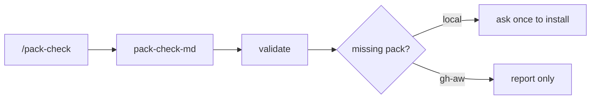

# PS16: Helpers: scenarios-md, verify-harness, pack-check-md
- Status: todo (docs only; build waits for Sven go per PBI)
- Batch: B4
- Depends on: PS15
- Absorbs old: none
- Lane: Builder (Cursor CLI for docs and markdown, Cloud Agent if multi-file C#)
- Release: squad v2 ([README](README.md#squad-v2))
- Docs: [STRUCTURE](STRUCTURE.md) (where), [SHAPES](SHAPES.md) (how it looks), [FLOWS](FLOWS.md) (flow per command), [MIGRATION](MIGRATION.md) (v1 to v2 rows), [FORKS](FORKS.md) (forks), [gh-aw](gh-aw/README.md)

## 1. Goal

**Problem on main (`6c59f49`).** [`plugins/pack-check/skills/pack-check/SKILL.md`](https://github.com/svennijhuis/agentPacks/blob/6c59f49/plugins/pack-check/skills/pack-check/SKILL.md):

> name: pack-check

pack-check's skill name equals its command; scenarios-md has 12 inline steps and a first-step yes or no ask.

**Why we change it.**

- PO decision 1 and 2: `validate` is the gate and `/pack-check` runs the same checks; rename to `pack-check-md`.

**What it gives the user.**

- Local (Cursor, Claude Code, CLI): `/pack-check` loads `pack-check-md`; scenarios steps move to a playbook.
- gh-aw: Install and reload are local only; imported files keep `name` and `description` only.

**Out of scope.** New checks.

Current state details:

- [`plugins/squad/skills/scenarios-md/SKILL.md`](https://github.com/svennijhuis/agentPacks/blob/6c59f49/plugins/squad/skills/scenarios-md/SKILL.md) (12 inline steps), `verify-harness` (43 lines), [`plugins/pack-check/skills/pack-check/SKILL.md`](https://github.com/svennijhuis/agentPacks/blob/6c59f49/plugins/pack-check/skills/pack-check/SKILL.md) (name equals command).

## 2. Depends on

PS15. Start only when those PBIs are merged on main. Build order: [README](README.md#new-set-and-build-order).

## 3. What gets replaced

| Kind | Now | After | Action |
|---|---|---|---|
| command | `plugins/squad/commands/scenarios.md` | same | edit: restyled skill |
| command | `plugins/pack-check/commands/pack-check.md` | same | edit: load `pack-check-md` |
| skill | `plugins/squad/skills/scenarios-md/SKILL.md` | same | restyle; steps to a playbook |
| skill | `plugins/squad/skills/verify-harness/SKILL.md` | same | restyle |
| skill | `plugins/pack-check/skills/pack-check/SKILL.md` | `plugins/pack-check/skills/pack-check-md/SKILL.md` | rename (name equals command today); pointer until GA07 |

Full list for all PBIs: [MIGRATION.md](MIGRATION.md#path-table).

## 4. Technical design

### 4.1 Tree before and after

Before (main):

```text
plugins/pack-check/skills/pack-check/
plugins/squad/skills/scenarios-md/SKILL.md (45 lines)
plugins/squad/skills/verify-harness/SKILL.md
```

After:

```text
plugins/pack-check/skills/pack-check-md/   # renamed; old dir pointer until GA07
plugins/squad/skills/scenarios-md/playbooks/write-scenarios.md
verify-harness restyled
```

### 4.2 Skeleton of the new file

Shape rules: [SHAPES.md](SHAPES.md#summary).

```text
---
name: pack-check-md
description: When checking whether required language-pack skills are present.
license: UNLICENSED
user-invocable: false
disable-model-invocation: true
---
```

### 4.3 Target detail

gh-aw: `pack-check-md` install and reload and `/statechart` TLA+ scripts are local only; imported command and skill files carry only `name` and `description` frontmatter so `gh aw compile --strict` stays clean ([gh-aw README](gh-aw/README.md)). scenarios-md steps to `playbooks/write-scenarios.md` and it reads statechart paths; verify-harness restyle; pack-check-md rename plus hygiene mode that runs validate locally.

### 4.4 Interfaces and contracts

| Caller | Callee | Input | Output | State file |
|---|---|---|---|---|
| `/pack-check` | `pack-check-md` | repo | missing packs, validate result | none |

### 4.5 Flow



### 4.6 Choices

| Chosen | Rejected | Why |
|---|---|---|
| Pointer dir | Hard rename | Installed v1 users and forks read the old name. |

### 4.7 Checks and error messages

| Rule | Checks | Error message |
|---|---|---|
| PackCheckContractTests | new name | `expected skill pack-check-md` |

### 4.8 Risks and what breaks

| Risk | Fix |
|---|---|
| Two skills same job | pointer is one line, no steps |

Also: Out: CI changes.

### 4.9 Per environment

| Environment | What is different |
|---|---|
| Local (Cursor, Claude Code, CLI) | Ask and install. |
| gh-aw | Report only. |

### 4.10 Subagents and what they load

- none new

## 5. Steps

0. **Inventory (forks and upstream alike).** `git diff --name-status <basis>...HEAD -- plugins shared docs .github` (basis: the agentPacks commit you started from; on upstream itself the list is empty). Add every own standard, rule, skill, agent, `custom-rules.md` and instructions file to `docs/pbi/squad/fork-inventory.md` ([format](FORKS.md#step-0-inventory-every-pbi-before-any-edit)). Never delete or overwrite a listed file; unsure means keep it and mark the row `open`.
1. Branch from main: `git switch -c pbi/ps16-squad-helpers origin/main`.
2. Save the base for the fork check: `git rev-parse HEAD > /tmp/base.sha`.
3. Read [SHAPES.md](SHAPES.md) for every kind in section 3, and each source in section 6.
4. Do each row of section 3 in order. Move or rename with `git mv`. If a row's target path already holds a fork file, follow the [conflict table](MIGRATION.md#fork-path). A copy keeps the `Source:` line and `## What we changed or added`.
5. Do these steps, nothing else:
   1. Restyle with write-skill.
   2. Rename.
   3. Hygiene mode.
6. Run every command in section 8. All must pass.
7. Open one PR titled `PS16: Helpers: scenarios-md, verify-harness, pack-check-md`. Body: link to this file, the section 3 table, the section 8 output.

## 6. Sources

| Step | Skill (repo, path, SHA) | Licence | Mode | Lives in | Reason |
|---|---|---|---|---|---|
| scenarios | [statechart](https://github.com/cursor/plugins/blob/ae5650febf4320793844c12c4adaa937f417f8da/pstack/skills/statechart/SKILL.md) | MIT (cursor/plugins, Lauren Tan) | copy + adapt | `plugins/squad/skills/statechart-md/` | Upstream has `disable-model-invocation: true` and is named like the command. Sven wants `/statechart` plus auto use in the flow. We rename to `statechart-md`, allow model use, add `docs/architecture/` output and the scenario export to `/scenarios`. Scripts stay byte-equal. |
| verify | [create-verification-skill](https://github.com/cursor/plugins/blob/ae5650febf4320793844c12c4adaa937f417f8da/pstack/skills/create-verification-skill/SKILL.md) | MIT (cursor/plugins, Lauren Tan) | copy + adapt | `plugins/squad/skills/create-verification-skill/` | Used as is; covers old feature map PBIs. Sven 2026-11-01: copy, not pin. We add a Standards line, the gates, the Autonomy line for gh-aw and Provider notes. |

Route per external skill ([decision](README.md#decision-pin-copy--adapt-weave-or-not-used)):

- statechart: **copy + adapt**. `plugins/squad/skills/statechart-md/`.
- create-verification-skill: **copy + adapt**. `plugins/squad/skills/create-verification-skill/`.

Every copy + adapt here adds, beyond its own changes: `Source:` line with SHA, a Standards line, the Gates, the Autonomy line for gh-aw, `## Provider notes`, `## What we changed or added`, and a NOTICE line.

Upstream: pstack [cursor/plugins at ae5650f](https://github.com/cursor/plugins/tree/ae5650febf4320793844c12c4adaa937f417f8da/pstack) (MIT), Matt [mattpocock/skills at 4ae2317](https://github.com/mattpocock/skills/tree/4ae2317ddb22b046e26455e4f9c9b3aaaf62212d) (MIT). Map: [skill map](sources/pstack-matt-skill-map.md).

## 7. Example

Good:

```text
/pack-check
  REF01..REF06, HUB01: 0 errors, 0 warnings (same as CLI validate)
  language pack csharp: installed
```

Bad:

`/pack-check` with its own rule copy that drifts from `validate`.

## 8. DoD (checkable)

```bash
dotnet run --project tools/AgentPacks.Cli -- validate                       # 0 errors, 0 warnings
dotnet test tools/AgentPacks.Cli.Tests                                      # green
dotnet run --project tools/AgentPacks.Cli -- validate-all --out /tmp/agentpacks-marketplace
dotnet run --project tools/AgentPacks.Cli -- migrate-check --base "$(cat /tmp/base.sha)"   # from PS03 on; 0 LOST
for f in tests/fixtures/gh-aw/*.md; do gh aw compile --strict "$f"; done   # from GA04 on; before: write "n/a, no fixture yet"
dotnet run --project tools/AgentPacks.Cli -- migrate-check --base <fixture base> --root tests/fixtures/fork-acme   # fixture fork, 0 LOST
dotnet run --project tools/AgentPacks.Cli -- validate --root tests/fixtures/fork-acme                              # fixture fork, 0 errors
grep -rnP "[\x{2013}\x{2014}]" plugins docs || echo "no dashes"
```

Then locally: install `/tmp/agentpacks-marketplace` in Cursor or Claude Code, run `/pack-check` (same result as `validate`) and each command this PBI touches once.

- [ ] `/pack-check` output equals validate on a fixture with all new skills.
- [ ] Local: works in Cursor, Claude Code and CLI (Copilot CLI, Codex). Proof offline: generated client manifests and fixture tests (`ClientManifestTests`, `ComponentGenerationTests`).
- [ ] gh-aw: the fixture workflow under `tests/fixtures/gh-aw/` that uses this PBI's files passes `gh aw compile --strict` (pinned gh-aw, no run, no secrets, no Actions minutes). See [gh-aw README](gh-aw/README.md).
- [ ] `dotnet run --project tools/AgentPacks.Cli -- validate` exits 0, 0 errors, 0 warnings.
- [ ] `/pack-check` locally gives the same result (same rules, one source).
- [ ] `dotnet test tools/AgentPacks.Cli.Tests` green; main stays green and all 7 commands still load after merge ([MIGRATION](MIGRATION.md)).
- [ ] No em dash, no tokens in markdown, FAKE fixture values only.
- [ ] Every row of `docs/pbi/squad/fork-inventory.md` is present in v2 (status `done` or `open` with a reason) and `/pack-check` is green, locally and in gh-aw. The fixture fork `tests/fixtures/fork-acme` (one own standard, one own rule) still passes after this PBI.

## 9. Evidence

- Side by side output.

## 10. For forks

Rules for every fork: [FORKS.md](FORKS.md). For this PBI: Your registry additions in `references/packs.md` move with `git mv`; keep them below a `## Local packs` heading.
