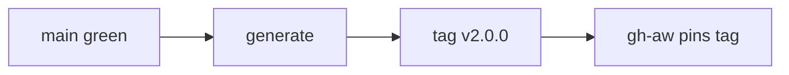

# PS20: Squad v2 release: versions, marketplace tag, changelog, v1 to v2 guide
- Status: todo (docs only; build waits for Sven go per PBI)
- Batch: B7
- Depends on: PS01 to PS19, PS21, PS22, GA01 to GA06
- Absorbs old: none
- Lane: Builder (Cursor CLI for docs and markdown, Cloud Agent if multi-file C#)
- Release: squad v2 ([README](README.md#squad-v2))
- Docs: [STRUCTURE](STRUCTURE.md) (where), [SHAPES](SHAPES.md) (how it looks), [FLOWS](FLOWS.md) (flow per command), [MIGRATION](MIGRATION.md) (v1 to v2 rows), [FORKS](FORKS.md) (forks), [gh-aw](gh-aw/README.md)

## 1. Goal

**Problem on main (`6c59f49`).** [`plugins/squad/plugin.json`](https://github.com/svennijhuis/agentPacks/blob/6c59f49/plugins/squad/plugin.json):

> "version": "0.1.5",

Users and forks need one version where v2 starts.

**Why we change it.**

- Sven: "nu is moment dat we naar v2 gaan dus doe goed".
- Users of v1, local and in gh-aw, need one clear switch point.

**What it gives the user.**

- Local (Cursor, Claude Code, CLI): Marketplace update to 2.0.0 shows the change.
- gh-aw: Pin `@v2.0.0`.

**Out of scope.** AW repo bump (GA05).

Current state details:

- `plugins/squad/plugin.json` is `0.1.5`; other plugins are on 0.x or 1.0.0; gh-aw pins `@v1.0.0` or a 40-hex SHA.

## 2. Depends on

PS01 to PS19, PS21, PS22, GA01 to GA06. Start only when those PBIs are merged on main. Build order: [README](README.md#new-set-and-build-order).

## 3. What gets replaced

| Kind | Now | After | Action |
|---|---|---|---|
| version | `plugin.json 0.x / 1.0.0` | `2.0.0 for moved plugins, tag v2.0.0` | bump |

Full list for all PBIs: [MIGRATION.md](MIGRATION.md#path-table).

## 4. Technical design

### 4.1 Tree before and after

Before (main):

```text
plugin.json 0.x / 1.0.0
```

After:

```text
plugin.json 2.0.0 (moved plugins)
CHANGELOG.md ## 2.0.0
tag v2.0.0 on generated commit
```

### 4.2 Skeleton of the new file

Shape rules: [SHAPES.md](SHAPES.md#summary).

```text
## 2.0.0
**Breaking**
- <from MIGRATION>
**Added**
**Changed**
```

### 4.3 Target detail

Version `2.0.0` in `plugin.json` of every plugin whose files moved (squad, pack-author, pack-check, security, dotnet, rust, typescript). Git and other untouched plugins keep theirs.
Generated marketplace commit gets tag `v2.0.0`; gh-aw pins that tag or its 40-hex SHA (never `marketplace-beta`, it is force-pushed).
`CHANGELOG.md` has a `## 2.0.0` block with a **Breaking** list taken from [MIGRATION](MIGRATION.md#what-breaks-from-v1).
Repo README links the v1 to v2 guide.

### 4.4 Interfaces and contracts

| Caller | Callee | Input | Output | State file |
|---|---|---|---|---|
| publish workflow | generated commit | main | tag v2.0.0 | marketplace branch |

### 4.5 Flow



### 4.6 Choices

| Chosen | Rejected | Why |
|---|---|---|
| Tag generated commit | Tag main | Consumers pin generated tree. |

### 4.7 Checks and error messages

| Rule | Checks | Error message |
|---|---|---|
| PluginVersionContractTests | moved plugin is 2.0.0 | `squad: version 0.1.5, expected 2.0.0` |

### 4.8 Risks and what breaks

| Risk | Fix |
|---|---|
| Tag before fixtures pass | GA04 is a dependency |

Also: Tag before GA fixtures pass would publish a broken gh-aw path.; Out: AW repo pin bump (GA05, done in the AW room).

### 4.9 Per environment

| Environment | What is different |
|---|---|
| Local (Cursor, Claude Code, CLI) | Update and reload. |
| gh-aw | Pin tag. |

### 4.10 Subagents and what they load

- none

## 5. Steps

0. **Inventory (forks and upstream alike).** `git diff --name-status <basis>...HEAD -- plugins shared docs .github` (basis: the agentPacks commit you started from; on upstream itself the list is empty). Add every own standard, rule, skill, agent and instructions file to `docs/pbi/squad/fork-inventory.md` ([format](FORKS.md#step-0-inventory-every-pbi-before-any-edit)). Never delete or overwrite a listed file; unsure means keep it and mark the row `open`.
1. Branch from main: `git switch -c pbi/ps20-v2-release origin/main`.
2. Save the base for the fork check: `git rev-parse HEAD > /tmp/base.sha`.
3. Read [SHAPES.md](SHAPES.md) for every kind in section 3, and each source in section 6.
4. Do each row of section 3 in order. Move or rename with `git mv`. If a row's target path already holds a fork file, follow the [conflict table](MIGRATION.md#fork-path). A copy keeps the `Source:` line and `## What we changed or added`.
5. Do these steps, nothing else:
   1. Bump versions (PluginVersionContractTests rule).
   2. Changelog block.
   3. Tag after the generated commit exists; no tag on source main.
   4. README link.
6. Run every command in section 8. All must pass.
7. Open one PR titled `PS20: Squad v2 release: versions, marketplace tag, changelog, v1 to v2 guide`. Body: link to this file, the section 3 table, the section 8 output.

## 6. Sources

| Step | Skill (repo, path, SHA) | Licence | Mode | Lives in | Reason |
|---|---|---|---|---|---|
| release notes | [technical-writing](https://github.com/cursor/plugins/blob/ae5650febf4320793844c12c4adaa937f417f8da/pstack/skills/technical-writing/SKILL.md) | MIT (cursor/plugins, Lauren Tan) | copy + adapt | `plugins/squad/skills/technical-writing/` | Cursor-only parts at ae5650f: calls swarm. Our copy moves them under `## Provider notes` and adds Standards, Gates, Autonomy. |
| release notes | [unslop](https://github.com/cursor/plugins/blob/ae5650febf4320793844c12c4adaa937f417f8da/pstack/skills/unslop/SKILL.md) | MIT (cursor/plugins, Lauren Tan) | pin | `plugins/squad/external-skills.json` | We change nothing and it has no Cursor-only parts (scanned at ae5650f), so it stays external at the 40-hex SHA. In gh-aw the generator vendors it into the commit and `aw-closure.json` lists it. |

Route per external skill ([decision](README.md#decision-pin-copy--adapt-weave-or-not-used)):

- technical-writing: **copy + adapt**. `plugins/squad/skills/technical-writing/`.
- unslop: **pin**. `plugins/squad/external-skills.json`.

Every copy + adapt here adds, beyond its own changes: `Source:` line with SHA, a Standards line, the Gates, the Autonomy line for gh-aw, `## Provider notes`, `## What we changed or added`, and a NOTICE line.

Upstream: pstack [cursor/plugins at ae5650f](https://github.com/cursor/plugins/tree/ae5650febf4320793844c12c4adaa937f417f8da/pstack) (MIT), Matt [mattpocock/skills at 4ae2317](https://github.com/mattpocock/skills/tree/4ae2317ddb22b046e26455e4f9c9b3aaaf62212d) (MIT). Map: [skill map](sources/pstack-matt-skill-map.md).

## 7. Example

Good:

```markdown
## 2.0.0
**Breaking**
- `skills/squad` is now `skills/squad-mode`. gh-aw: change the `skills:` path when you bump to `@v2.0.0`.
- `/statechart` is new; room commands go from 4 to 5.
```

Bad:

Bumping to 2.0.0 with no Breaking list, or tagging `marketplace-beta` and telling gh-aw users to pin it.

## 8. DoD (checkable)

```bash
dotnet run --project tools/AgentPacks.Cli -- validate                       # 0 errors, 0 warnings
dotnet test tools/AgentPacks.Cli.Tests                                      # green
dotnet run --project tools/AgentPacks.Cli -- validate-all --out /tmp/agentpacks-marketplace
dotnet run --project tools/AgentPacks.Cli -- migrate-check --base "$(cat /tmp/base.sha)"   # from PS03 on; 0 LOST
for f in tests/fixtures/gh-aw/*.md; do gh aw compile --strict "$f"; done   # from GA04 on; before: write "n/a, no fixture yet"
dotnet run --project tools/AgentPacks.Cli -- migrate-check --base <fixture base> --root tests/fixtures/fork-acme   # fixture fork, 0 LOST
dotnet run --project tools/AgentPacks.Cli -- validate --root tests/fixtures/fork-acme                              # fixture fork, 0 errors
grep -rnP "[\x{2013}\x{2014}]" plugins docs || echo "no dashes"
```

Then locally: install `/tmp/agentpacks-marketplace` in Cursor or Claude Code, run `/pack-check` (same result as `validate`) and each command this PBI touches once.

- [ ] Every plugin with a moved file is 2.0.0; untouched plugins unchanged.
- [ ] Tag points at a generated commit, not a branch.
- [ ] Local: works in Cursor, Claude Code and CLI (Copilot CLI, Codex). Proof offline: generated client manifests and fixture tests (`ClientManifestTests`, `ComponentGenerationTests`).
- [ ] gh-aw: the fixture workflow under `tests/fixtures/gh-aw/` that uses this PBI's files passes `gh aw compile --strict` (pinned gh-aw, no run, no secrets, no Actions minutes). See [gh-aw README](gh-aw/README.md).
- [ ] `dotnet run --project tools/AgentPacks.Cli -- validate` exits 0, 0 errors, 0 warnings.
- [ ] `/pack-check` locally gives the same result (same rules, one source).
- [ ] `dotnet test tools/AgentPacks.Cli.Tests` green; main stays green and all 7 commands still load after merge ([MIGRATION](MIGRATION.md)).
- [ ] No em dash, no tokens in markdown, FAKE fixture values only.
- [ ] Every row of `docs/pbi/squad/fork-inventory.md` is present in v2 (status `done` or `open` with a reason) and `/pack-check` is green, locally and in gh-aw. The fixture fork `tests/fixtures/fork-acme` (one own standard, one own rule) still passes after this PBI.

## 9. Evidence

- Version list, tag SHA.

## 10. For forks

Rules for every fork: [FORKS.md](FORKS.md). For this PBI: Forks keep their own version line; bump major when you take this PBI.
