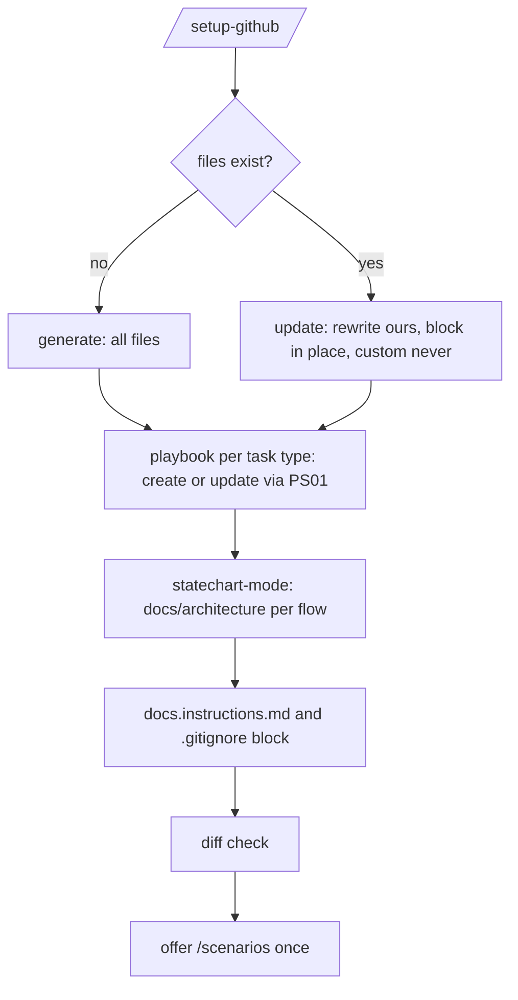

# PS21: /setup-github: generate or update the repo .github instruction files
- Status: todo (docs only; build waits for Sven go per PBI)
- Batch: B6
- Depends on: PS07, PS17
- Absorbs old: none
- Lane: Builder (Cursor CLI for docs and markdown, Cloud Agent if multi-file C#)
- Release: squad v2 ([README](README.md#squad-v2))
- Docs: [STRUCTURE](STRUCTURE.md) (where), [SHAPES](SHAPES.md) (how it looks), [FLOWS](FLOWS.md) (flow per command), [MIGRATION](MIGRATION.md) (v1 to v2 rows), [FORKS](FORKS.md) (forks), [gh-aw](gh-aw/README.md)

## 1. Goal

**Problem on main (`6c59f49`).** [`plugins/dotnet/skills/dotnet-build/references/commands.md`](https://github.com/svennijhuis/agentPacks/blob/6c59f49/plugins/dotnet/skills/dotnet-build/references/commands.md):

> dotnet build

No repo gets our caveman rule, structure, chart or standards map in the files Copilot reads; people have no place for their own standards.

**Why we change it.**

- Sven 2026-11-01: one command that sets up a repo only for GitHub: `.github` instruction files with caveman always on, the structure, the decision chart, how to generate or update playbooks, the dotnet commands and where every standard lives.
- Sven: it always also generates a file where people add their own standards.

**What it gives the user.**

- Local (Cursor, Claude Code, CLI): `/setup-github` once, then again after an upgrade; second run is a no-op.
- gh-aw: Report-only run takes recommended answers; writes only through a PR.

**Out of scope.** Non-GitHub hosts, languages without a pack.

Current state details:

- No command writes `.github` instructions. dotnet commands live in [`plugins/dotnet/skills/dotnet-build/references/commands.md`](https://github.com/svennijhuis/agentPacks/blob/6c59f49/plugins/dotnet/skills/dotnet-build/references/commands.md) and [`plugins/dotnet/skills/dotnet-test-patterns/references/commands.md`](https://github.com/svennijhuis/agentPacks/blob/6c59f49/plugins/dotnet/skills/dotnet-test-patterns/references/commands.md); language standards in [`plugins/dotnet/standards/csharp.md`](https://github.com/svennijhuis/agentPacks/blob/6c59f49/plugins/dotnet/standards/csharp.md) and siblings.

## 2. Depends on

PS07, PS17. Start only when those PBIs are merged on main. Build order: [README](README.md#new-set-and-build-order).

## 3. What gets replaced

| Kind | Now | After | Action |
|---|---|---|---|
| command | (none) | `plugins/squad/commands/setup-github.md` | add |
| hub | (none) | `plugins/squad/skills/setup-github-mode/ (SKILL.md, playbooks/generate.md, playbooks/update.md, references/*.md)` | add |

Full list for all PBIs: [MIGRATION.md](MIGRATION.md#path-table).

## 4. Technical design

### 4.1 Tree before and after

Before (main):

```text
(none)
```

After:

```text
plugins/squad/commands/setup-github.md
plugins/squad/skills/setup-github-mode/  SKILL.md  playbooks/generate.md  playbooks/update.md  references/*.md (flat: copilot-block, squad-standards, squad-dotnet, custom-standards, docs, gitignore-block)
```

### 4.2 Skeleton of the new file

Shape rules: [SHAPES.md](SHAPES.md#summary).

```text
---
applyTo: "**"
---
# Custom standards
Source: mattpocock/skills retro and code-review at 4ae2317.
Rules that need judgment go here. Mechanical rules become a linter, hook or CI check.
## Global
- (example) **Version every public API.** Why: clients pin versions.
## Language
See custom-standards-<language>.instructions.md.
```

### 4.3 Target detail

Command `/setup-github` (thin, loads `setup-github-mode`). Poteto name like `setup-pstack`: the skill name differs from the command. One command does both: step 0 detects generate or update.

| File in target repo | Owner | Update rule |
|---|---|---|
| `.github/copilot-instructions.md`, block `## Squad` only | shared | rewrite the block in place; text outside it stays (Matt setup weave) |
| `.github/instructions/squad-standards.instructions.md` (`applyTo: "**"`) | ours | rewrite whole file (setup-pstack route) |
| `.github/instructions/squad-<language>.instructions.md`, for example `squad-dotnet` with `applyTo: "**/*.cs,**/*.csproj,**/*.sln,**/*.slnx"` | ours, one per language pack found | rewrite whole file |
| `.github/instructions/custom-standards.instructions.md` (`applyTo: "**"`) and `custom-standards-<language>.instructions.md` | repo | create only if missing, never touched again |
| `AGENTS.md` or `CLAUDE.md` if present | shared | one pointer line, no copy |
| `.github/instructions/docs.instructions.md` (`applyTo: "docs/**"`) | ours | rewrite whole file |
| `docs/architecture/<flow>.md` (statechart per repo flow) | shared | update the same file per flow, never a second copy |
| playbook per task type (`playbooks/<task>.md` in the repo's own skill) | shared | missing: create; present: update via the write-skill playbook (PS01) |
| `.gitignore`, block `# squad: begin` to `# squad: end` | shared | rewrite the block; lines outside stay byte-equal |

**Playbook check.** Per task type (feature, bug, refactor, investigate, perf, PR, plan, skill) it looks for a playbook. Missing: create it with the write-skill playbook (PS01) and the decision chart. Present: update it with the same playbook; never a second file for one task type.

**Statechart.** Runs `statechart-mode` (PS12) on the repo flows it finds (request path, job, state machine) and writes `docs/architecture/<flow>.md`. Same flow name on run 2 means update in place.

**docs tree** in `docs.instructions.md`, sources Matt [`docs/`](https://github.com/mattpocock/skills/blob/4ae2317ddb22b046e26455e4f9c9b3aaaf62212d/docs) and [`.agents/adr/`](https://github.com/mattpocock/skills/blob/4ae2317ddb22b046e26455e4f9c9b3aaaf62212d/.agents/adr) plus Matt [domain-modeling](https://github.com/mattpocock/skills/blob/4ae2317ddb22b046e26455e4f9c9b3aaaf62212d/skills/engineering/domain-modeling/SKILL.md) (create folders lazily):

| Folder | Belongs | Does not belong | Good | Bad |
|---|---|---|---|---|
| `docs/architecture/` | statecharts, shapes, contracts | screenshots of a whiteboard with no text | `docs/architecture/checkout.md` with the chart and its states | `docs/architecture/notes-tuesday.md` |
| `docs/adr/` | one decision per file, numbered | open questions, meeting notes | `docs/adr/0003-sqlite-local-postgres-server.md` | `docs/adr/ideas.md` |
| `docs/pbi/` | PBIs with goal, DoD, steps | task logs, run output | `docs/pbi/ps21-setup-github.md` | `docs/pbi/run-2026-11-01.log.md` |
| `docs/agents/` | agent-facing reference the skills read | personal data, secrets, plan dumps | `docs/agents/triage-labels.md` | `docs/agents/plan-dump.md` |

Never in `docs/`: task logs, scratch, plan dumps, personal data, tokens.

**What may go in a PR, what not.** Own file `.github/instructions/pr.instructions.md` (`applyTo: "**"`, ours, rewritten each run), woven from Matt pr in our pr playbook (PS10). The `## Squad` block links it. The `.gitignore` block keeps the second column out of `git add`; check REF09 catches what slips through:

| In a PR | Never in a PR |
|---|---|
| code, tests, fixtures with FAKE values | `.squad/` run state, `*.scratch.md`, `.scratch/` |
| `docs/architecture/`, `docs/adr/`, `docs/pbi/`, `docs/agents/` | task logs, run output, plan dumps, `docs/squad-plan.md` run copies |
| `.github/instructions/*`, `copilot-instructions.md` block | `.claude/settings.local.json`, `.cursor/tmp/`, local model or agent state |
| playbooks and skills made by `/pack-author` | tokens, `.env`, personal data, screenshots with personal data |
| the PBI of this PR, ADRs it needs | files outside the PBI's Files list, generated dumps |

Good: PR for PS21 changes `plugins/squad/skills/setup-github-mode/**`, its fixtures and `docs/pbi/ps21-setup-github.md`. Bad: same PR also adds `.squad/run-12.json`, `notes.scratch.md` and an unrelated `README.md` rewrite.

Check **REF09** (`/pack-check` validate and the review step): a path in the PR diff that matches the forbidden list in `pr.instructions.md` fails; a path outside the PBI's Files list is a warning. Fixture `pr-forbidden`: a diff with `.squad/state.json` fails, the clean diff passes.

**Upstream setup modes, all checked** (pstack `ae5650f`, Matt `4ae2317`):

| Upstream | What it sets up | In `/setup-github` | Route |
|---|---|---|---|
| [setup-pstack](https://github.com/cursor/plugins/blob/ae5650febf4320793844c12c4adaa937f417f8da/pstack/skills/setup-pstack/SKILL.md) | model per role, always-applied rule | `## Squad` block points to the model roles doc (PS19); no `~/.cursor` write | copy + adapt |
| [setup-matt-pocock-skills](https://github.com/mattpocock/skills/blob/4ae2317ddb22b046e26455e4f9c9b3aaaf62212d/skills/engineering/setup-matt-pocock-skills/SKILL.md) | issue tracker, triage labels, domain doc layout in `docs/agents/` | `docs/agents/issue-tracker.md` (GitHub, recommended), `docs/agents/triage-labels.md` (5 default labels), `docs/agents/domain.md` plus `GLOSSARY.md` created lazily | weave |
| [create-verification-skill](https://github.com/cursor/plugins/blob/ae5650febf4320793844c12c4adaa937f417f8da/pstack/skills/create-verification-skill/SKILL.md), [create-formal-verification-skill](https://github.com/cursor/plugins/blob/ae5650febf4320793844c12c4adaa937f417f8da/pstack/skills/create-formal-verification-skill/SKILL.md) | project-local verify skill | run 1 creates one per repo, later runs maintain it (PS22) | copy + adapt |
| [maintain-verification-skill](https://github.com/cursor/plugins/blob/ae5650febf4320793844c12c4adaa937f417f8da/pstack/skills/maintain-verification-skill/SKILL.md) | keeps the verify skill true to the code | every later run (PS22) | copy + adapt |
| [automate-me](https://github.com/cursor/plugins/blob/ae5650febf4320793844c12c4adaa937f417f8da/pstack/skills/automate-me/SKILL.md) | personal `-mode` skill | not here: personal, not repo | not used |
| [poteto-help](https://github.com/cursor/plugins/blob/ae5650febf4320793844c12c4adaa937f417f8da/pstack/skills/poteto-help/SKILL.md) | guide to setup and skills | `## Squad` block lists the commands and where to start | weave (one list) |
| [setup-pre-commit](https://github.com/mattpocock/skills/blob/4ae2317ddb22b046e26455e4f9c9b3aaaf62212d/skills/misc/setup-pre-commit/SKILL.md) | Husky, lint-staged | not here: Node only; mechanical rules become a hook or CI check per language pack | not used |
| [git-guardrails-claude-code](https://github.com/mattpocock/skills/blob/4ae2317ddb22b046e26455e4f9c9b3aaaf62212d/skills/misc/git-guardrails-claude-code/SKILL.md) | hooks that block push, reset --hard | not here: Claude-only hooks; our rule lives in the `## Squad` block (no force push) | not used |
| [setup-ts-deep-modules](https://github.com/mattpocock/skills/blob/4ae2317ddb22b046e26455e4f9c9b3aaaf62212d/skills/in-progress/setup-ts-deep-modules/SKILL.md) | dependency-cruiser | not here: in-progress upstream, TypeScript pack later | not used |
| [wizard](https://github.com/mattpocock/skills/blob/4ae2317ddb22b046e26455e4f9c9b3aaaf62212d/skills/engineering/wizard/SKILL.md) | bash wizard for human-only steps | not here: secrets and dashboards stay named asks | not used |

**`.gitignore` block** holds task, scratch and plan files and local agent state, for example `docs/squad-plan.md` run copies, `.squad/`, `*.scratch.md`, `.cursor/tmp/`, `.claude/settings.local.json`. Fork lines outside the block are never edited.

`## Squad` block holds: caveman always on; the pack structure tree; the decision chart (pin, copy + adapt, weave, not used); how to generate or update a skill or playbook (`/pack-author`); where standards live (global `standard-<topic>`, then `standard-<language>-<topic>`, then the custom files). `squad-dotnet` holds the dotnet commands, linked from the pack, plus the C# standard names.

Custom file body follows Matt's form ([retro](https://github.com/mattpocock/skills/blob/4ae2317ddb22b046e26455e4f9c9b3aaaf62212d/skills/engineering/retro/SKILL.md), [code-review](https://github.com/mattpocock/skills/blob/4ae2317ddb22b046e26455e4f9c9b3aaaf62212d/skills/engineering/code-review/SKILL.md) step 3; Source line at the top): rules that need judgment go here, mechanical rules become a linter, hook or CI check; one empty example per level. Copilot reads it via `applyTo`, review reads it via PS08. An existing `CODING_STANDARDS.md` gets a pointer line in the custom file, never a duplicate.

Route via the chart: [setup-pstack](https://github.com/cursor/plugins/blob/ae5650febf4320793844c12c4adaa937f417f8da/pstack/skills/setup-pstack/SKILL.md) copy + adapt (whole-file rewrite, idempotent; `~/.cursor` is Cursor-only, so repo files only). Matt [setup-matt-pocock-skills](https://github.com/mattpocock/skills/blob/4ae2317ddb22b046e26455e4f9c9b3aaaf62212d/skills/engineering/setup-matt-pocock-skills/SKILL.md) weave (explore, show, confirm, write; one block updated in place). verification skills not used here; the one-time offer of `/scenarios` at the end is kept.

Idempotent: a second run gives `git diff --exit-code` 0. gh-aw or no human: take the recommended answers and list open questions in the report.

Files: `plugins/squad/commands/setup-github.md`, `plugins/squad/skills/setup-github-mode/SKILL.md`, `playbooks/generate.md`, `playbooks/update.md`, `references/` (flat): `copilot-block.md`, `squad-standards.instructions.md`, `squad-dotnet.instructions.md`, `custom-standards.instructions.md`.

### 4.4 Interfaces and contracts

| Caller | Callee | Input | Output | State file |
|---|---|---|---|---|
| setup-github-mode | target repo `.github/` | repo tree, language packs found | instruction files | repo files |
| review (PS08) | custom-standards*.instructions.md | read | repo rules | none |

### 4.5 Flow



### 4.6 Choices

| Chosen | Rejected | Why |
|---|---|---|
| `.instructions.md` with `applyTo` for custom rules | Matt `CODING_STANDARDS.md` | Copilot loads `.github/instructions` by itself, not `CODING_STANDARDS.md` (Repo Research 2026-11-01); an existing one gets a pointer. |
| One command, step 0 detects generate or update | Two commands | setup-pstack and automate-me do the same; keeps the command count at 8. |
| Whole-file rewrite for our files, block in place for the shared file | Merge line by line | setup-pstack is idempotent by full rewrite; Matt updates one block and leaves the rest. |

### 4.7 Checks and error messages

| Rule | Checks | Error message |
|---|---|---|
| SetupGithubFixtureTests | run 2 gives 0 diff; fork files byte-equal | `.github/instructions/custom-standards.instructions.md: changed on update` |
| SetupGithubPlaybookTests | existing playbook updated, not duplicated | `playbooks/bug-2.md: duplicate of bug.md` |
| SetupGithubGitignoreTests | one squad block, rest byte-equal | `.gitignore: 2 squad blocks` |

### 4.8 Risks and what breaks

| Risk | Fix |
|---|---|
| Overwriting a repo's own copilot-instructions text | only the `## Squad` block is ours; fixture proves the rest is byte-equal |

Also: Command count 7 to 8: Sven must say yes.; Out: other languages than the packs we ship; non-GitHub hosts.

### 4.9 Per environment

| Environment | What is different |
|---|---|
| Local (Cursor, Claude Code, CLI) | Run from any client that has the squad plugin. |
| gh-aw | Report-only workflow, changes go through a PR. |

### 4.10 Subagents and what they load

- none (main agent).

## 5. Steps

0. **Inventory (forks and upstream alike).** `git diff --name-status <basis>...HEAD -- plugins shared docs .github` (basis: the agentPacks commit you started from; on upstream itself the list is empty). Add every own standard, rule, skill, agent and instructions file to `docs/pbi/squad/fork-inventory.md` ([format](FORKS.md#step-0-inventory-every-pbi-before-any-edit)). Never delete or overwrite a listed file; unsure means keep it and mark the row `open`.
1. Branch from main: `git switch -c pbi/ps21-setup-github origin/main`.
2. Save the base for the fork check: `git rev-parse HEAD > /tmp/base.sha`.
3. Read [SHAPES.md](SHAPES.md) for every kind in section 3, and each source in section 6.
4. Do each row of section 3 in order. Move or rename with `git mv`. If a row's target path already holds a fork file, follow the [conflict table](MIGRATION.md#fork-path). A copy keeps the `Source:` line and `## What we changed or added`.
5. Do these steps, nothing else:
   1. Write `setup-github-mode` with write-skill (PS01), playbooks generate and update.
   2. Templates in `references/` (flat); dotnet commands and standards linked, not copied (REF08).
   3. Step 0: detect existing files, language packs, task types with or without a playbook, repo flows and `docs/` folders.
   4. Playbook check per task type: create or update via PS01, chart first.
   5. Statechart per flow via `statechart-mode` into `docs/architecture/<flow>.md`, update in place.
   6. Write `docs.instructions.md`, `pr.instructions.md` and the `.gitignore` block; add REF09 to the validator table (PS03) and the review step.
   7. Matt setup weave: `docs/agents/issue-tracker.md`, `triage-labels.md`, `domain.md`; recommended answers first, skip a section exploration already settled.
   8. Command file, add to the command list (8 commands: needs Sven's yes).
6. Run every command in section 8. All must pass.
7. Open one PR titled `PS21: /setup-github: generate or update the repo .github instruction files`. Body: link to this file, the section 3 table, the section 8 output.

## 6. Sources

| Step | Skill (repo, path, SHA) | Licence | Mode | Lives in | Reason |
|---|---|---|---|---|---|
| setup | [setup-pstack](https://github.com/cursor/plugins/blob/ae5650febf4320793844c12c4adaa937f417f8da/pstack/skills/setup-pstack/SKILL.md) | MIT (cursor/plugins, Lauren Tan) | copy + adapt | `plugins/pack-check/skills/pack-check-mode/playbooks/setup.md` | Our plugin setup (Sven). Upstream writes `~/.cursor/rules` (Cursor only, home dir); our copy writes the role to tier table into the repo from `models.source.json`. |
| always on | [caveman, caveman-compress](https://github.com/JuliusBrussee/caveman/tree/5184b3d11ac6a1acb7d44b9bfaa31698157cff97/skills/caveman) | MIT (cursor/plugins, Lauren Tan) | pin | `plugins/squad/external-skills.json` | We change nothing (Sven 2026-11-01: "als we geen wijzigingen gaan doen hou gewoon extern"). Always on: hub `## Writing the reply` and every agent prompt, locally and in gh-aw. |
| playbooks | [upstream playbook authoring-a-skill](https://github.com/cursor/plugins/blob/ae5650febf4320793844c12c4adaa937f417f8da/pstack/skills/poteto-mode/playbooks/authoring-a-skill.md) | MIT (cursor/plugins, Lauren Tan) | copy + adapt | `pack-author-mode/playbooks/write-skill.md` | Calls Cursor built-in create-skill. We replace it with our make steps and validate. Keeps our standards and gates (PS09). |
| flows | [statechart](https://github.com/cursor/plugins/blob/ae5650febf4320793844c12c4adaa937f417f8da/pstack/skills/statechart/SKILL.md) | MIT (cursor/plugins, Lauren Tan) | copy + adapt | `plugins/squad/skills/statechart-mode/` | Upstream has `disable-model-invocation: true` and is named like the command. Sven wants `/statechart` plus auto use in the flow. We rename to `statechart-mode`, allow model use, add `docs/architecture/` output and the scenario export to `/scenarios`. Scripts stay byte-equal. |
| docs tree | [Matt domain-modeling](https://github.com/mattpocock/skills/blob/4ae2317ddb22b046e26455e4f9c9b3aaaf62212d/skills/engineering/domain-modeling/SKILL.md) | MIT (mattpocock/skills) | pin | `plugins/squad/external-skills.json` | Writes `docs/adr/*` and GLOSSARY as Sven wants; used unchanged from the domain playbook. |
| docs | [technical-writing](https://github.com/cursor/plugins/blob/ae5650febf4320793844c12c4adaa937f417f8da/pstack/skills/technical-writing/SKILL.md) | MIT (cursor/plugins, Lauren Tan) | copy + adapt | `plugins/squad/skills/technical-writing/` | Cursor-only parts at ae5650f: calls swarm. Our copy moves them under `## Provider notes` and adds Standards, Gates, Autonomy. |
| docs | [unslop](https://github.com/cursor/plugins/blob/ae5650febf4320793844c12c4adaa937f417f8da/pstack/skills/unslop/SKILL.md) | MIT (cursor/plugins, Lauren Tan) | pin | `plugins/squad/external-skills.json` | We change nothing and it has no Cursor-only parts (scanned at ae5650f), so it stays external at the 40-hex SHA. In gh-aw the generator vendors it into the commit and `aw-closure.json` lists it. |

Route per external skill ([decision](README.md#decision-pin-copy--adapt-weave-or-not-used)):

- setup-pstack: **copy + adapt**. `plugins/pack-check/skills/pack-check-mode/playbooks/setup.md`.
- caveman, caveman-compress: **pin**. `plugins/squad/external-skills.json`.
- upstream playbook authoring-a-skill: **copy + adapt**. `pack-author-mode/playbooks/write-skill.md`.
- statechart: **copy + adapt**. `plugins/squad/skills/statechart-mode/`.
- Matt domain-modeling: **pin**. `plugins/squad/external-skills.json`.
- technical-writing: **copy + adapt**. `plugins/squad/skills/technical-writing/`.
- unslop: **pin**. `plugins/squad/external-skills.json`.

Every copy + adapt here adds, beyond its own changes: `Source:` line with SHA, a Standards line, the Gates, the Autonomy line for gh-aw, `## Provider notes`, `## What we changed or added`, and a NOTICE line.

Upstream: pstack [cursor/plugins at ae5650f](https://github.com/cursor/plugins/tree/ae5650febf4320793844c12c4adaa937f417f8da/pstack) (MIT), Matt [mattpocock/skills at 4ae2317](https://github.com/mattpocock/skills/tree/4ae2317ddb22b046e26455e4f9c9b3aaaf62212d) (MIT). Map: [skill map](sources/pstack-matt-skill-map.md).

## 7. Example

Good:

```markdown
<!-- .github/copilot-instructions.md -->
# Team notes (theirs, kept)

## Squad
- Use the **caveman** skill for every reply.
- Standards: global `standard-<topic>`, then `standard-csharp-*`, then `.github/instructions/custom-standards*.instructions.md`.
- New or changed skill or playbook: `/pack-author`, decision chart first.
```
```gitignore
# team lines (kept)
bin/
# squad: begin
.squad/
*.scratch.md
# squad: end
```

Second run: `git diff --exit-code` is 0.

Bad:

Rewriting the whole `copilot-instructions.md` (team notes lost), or regenerating `custom-standards.instructions.md` on update so a team's own rules vanish.

## 8. DoD (checkable)

```bash
dotnet run --project tools/AgentPacks.Cli -- validate                       # 0 errors, 0 warnings
dotnet test tools/AgentPacks.Cli.Tests                                      # green
dotnet run --project tools/AgentPacks.Cli -- validate-all --out /tmp/agentpacks-marketplace
dotnet run --project tools/AgentPacks.Cli -- migrate-check --base "$(cat /tmp/base.sha)"   # from PS03 on; 0 LOST
for f in tests/fixtures/gh-aw/*.md; do gh aw compile --strict "$f"; done   # from GA04 on; before: write "n/a, no fixture yet"
dotnet run --project tools/AgentPacks.Cli -- migrate-check --base <fixture base> --root tests/fixtures/fork-acme   # fixture fork, 0 LOST
dotnet run --project tools/AgentPacks.Cli -- validate --root tests/fixtures/fork-acme                              # fixture fork, 0 errors
grep -rnP "[\x{2013}\x{2014}]" plugins docs || echo "no dashes"
```

Then locally: install `/tmp/agentpacks-marketplace` in Cursor or Claude Code, run `/pack-check` (same result as `validate`) and each command this PBI touches once.

- [ ] Fixture `empty-repo`: run 1 creates all files listed above.
- [ ] Same fixture run 2: `git diff --exit-code` 0.
- [ ] Fixture `fork-repo` with own `team.instructions.md`, text outside `## Squad` and rules in `custom-standards.instructions.md`: all byte-equal after update.
- [ ] Fixture with `CODING_STANDARDS.md`: only a pointer line appears, the file is untouched.
- [ ] Fixture `fork-repo` also has its own `.gitignore` lines and own `docs/` rules: byte-equal outside `# squad: begin` to `# squad: end` and outside our files.
- [ ] Fixture `playbook-repo` with `playbooks/bug.md`: updated in place, `ls playbooks | grep -c bug` is 1.
- [ ] `git status --porcelain` after a fake run that makes `.squad/` and `x.scratch.md`: both ignored.
- [ ] Fixture with own `docs/agents/triage-labels.md` (other names): kept, not overwritten.
- [ ] Fixture `pr-forbidden`: REF09 fails on `.squad/state.json` in the diff, passes on the clean diff.
- [ ] Run 2 on any fixture: no second `docs/architecture/<flow>.md` and no second `.gitignore` block (`grep -c "# squad: begin" .gitignore` is 1).
- [ ] `grep -rnP "[\x{2013}\x{2014}]"` and placeholder grep `{[A-Z]*}` on generated files: 0.
- [ ] Local install: plugin installed from the local marketplace, `/setup-github` run on the fixture, Copilot lists the instruction files.
- [ ] Local: works in Cursor, Claude Code and CLI (Copilot CLI, Codex). Proof offline: generated client manifests and fixture tests (`ClientManifestTests`, `ComponentGenerationTests`).
- [ ] gh-aw: the fixture workflow under `tests/fixtures/gh-aw/` that uses this PBI's files passes `gh aw compile --strict` (pinned gh-aw, no run, no secrets, no Actions minutes). See [gh-aw README](gh-aw/README.md).
- [ ] `dotnet run --project tools/AgentPacks.Cli -- validate` exits 0, 0 errors, 0 warnings.
- [ ] `/pack-check` locally gives the same result (same rules, one source).
- [ ] `dotnet test tools/AgentPacks.Cli.Tests` green; main stays green and all 7 commands still load after merge ([MIGRATION](MIGRATION.md)).
- [ ] No em dash, no tokens in markdown, FAKE fixture values only.
- [ ] Every row of `docs/pbi/squad/fork-inventory.md` is present in v2 (status `done` or `open` with a reason) and `/pack-check` is green, locally and in gh-aw. The fixture fork `tests/fixtures/fork-acme` (one own standard, one own rule) still passes after this PBI.

## 9. Evidence

- Fixture diffs, grep output, local run log.

## 10. For forks

Rules for every fork: [FORKS.md](FORKS.md). For this PBI: Fork instruction files, `.gitignore` lines outside the squad block and own `docs/` rules are not ours, so `/setup-github` never touches them; the fork fixture proves it.
