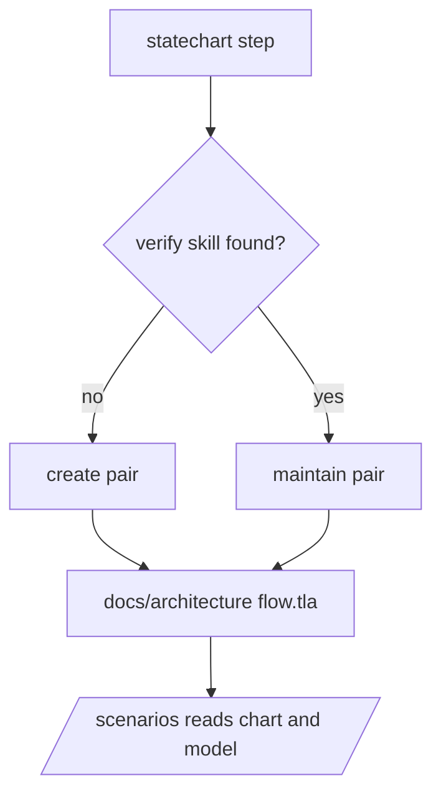

# PS22: /setup-github: create once, then maintain, the repo verification and formal verification skills
- Status: todo (docs only; build waits for Sven go per PBI)
- Batch: B6
- Depends on: PS12, PS13, PS21
- Absorbs old: none
- Lane: Builder (Cursor CLI for docs and markdown, Cloud Agent if multi-file C#)
- Release: squad v2 ([README](README.md#squad-v2))
- Docs: [STRUCTURE](STRUCTURE.md) (where), [SHAPES](SHAPES.md) (how it looks), [FLOWS](FLOWS.md) (flow per command), [MIGRATION](MIGRATION.md) (v1 to v2 rows), [FORKS](FORKS.md) (forks), [gh-aw](gh-aw/README.md)

## 1. Goal

**Problem on main (`6c59f49`).** [`plugins/squad/skills/verify-harness/SKILL.md`](https://github.com/svennijhuis/agentPacks/blob/6c59f49/plugins/squad/skills/verify-harness/SKILL.md):

> verify

The repo gets no lasting verification skill, and the formal one never runs from setup.

**Why we change it.**

- Sven 2026-11-01: "formal-verification yes this are realy good". PO: run 1 creates a project-local verification skill per repo, every later run maintains it, never a second one.

**What it gives the user.**

- Local (Cursor, Claude Code, CLI): Run 1 creates, later runs maintain; one of each per repo.
- gh-aw: Defaults taken, open choice in the report, no prompt.

**Out of scope.** Installing a model checker in CI.

Current state details:

- Upstream pair writes `.cursor/skills/verify-<app>/` ([create-verification-skill](https://github.com/cursor/plugins/blob/ae5650febf4320793844c12c4adaa937f417f8da/pstack/skills/create-verification-skill/SKILL.md) line 9), Cursor-only. All four have `disable-model-invocation: true`, so `/setup-github` could not call them. Our reuse table had them as pin; that was wrong.

## 2. Depends on

PS12, PS13, PS21. Start only when those PBIs are merged on main. Build order: [README](README.md#new-set-and-build-order).

## 3. What gets replaced

| Kind | Now | After | Action |
|---|---|---|---|
| skill | `external-skills.json pins: create/maintain(-formal)-verification-skill` | `plugins/squad/skills/{create,maintain}-verification-skill/, {create,maintain}-formal-verification-skill/` | copy + adapt (was pin) |

Full list for all PBIs: [MIGRATION.md](MIGRATION.md#path-table).

## 4. Technical design

### 4.1 Tree before and after

Before (main):

```text
(pin) external-skills.json: create/maintain(-formal)-verification-skill
```

After:

```text
plugins/squad/skills/create-verification-skill/
plugins/squad/skills/maintain-verification-skill/
plugins/squad/skills/create-formal-verification-skill/
plugins/squad/skills/maintain-formal-verification-skill/
target repo: .github/skills/verify-<app>/  .github/skills/formal-<area>/  docs/architecture/<flow>.tla
```

### 4.2 Skeleton of the new file

Shape rules: [SHAPES.md](SHAPES.md#summary).

```text
NOTICE: copied from cursor/plugins pstack at ae5650f.
## What we changed
- Output path .github/skills/ instead of .cursor/skills/.
- Dropped disable-model-invocation so /setup-github can call it.
- Our standards and gates.
```

### 4.3 Target detail

Step in `setup-github-mode` after the statechart step (PS21).

| Run | Plain verification | Formal verification |
|---|---|---|
| 1 (none found) | `create-verification-skill` writes `.github/skills/verify-<app>/` | `create-formal-verification-skill` picks the riskiest promise, writes `.github/skills/formal-<area>/` and the model `docs/architecture/<flow>.tla` |
| 2 and later | `maintain-verification-skill` updates the same skill | `maintain-formal-verification-skill` updates the same skill and model |
| gh-aw, no human | defaults: one app, first entry point | defaults: riskiest flow from the statechart step; open choice listed in the report |

Find rule: a skill is found by what it does (launch and drive sections; a model checker against named code), like upstream maintain step 0, so a renamed one is still found.

Link to `statechart-mode`: the flow name is shared, so `docs/architecture/<flow>.md` (chart) and `<flow>.tla` (model) sit side by side. `/scenarios` reads both and turns states and proved properties into scenario rows.

Route via the chart: all four are copy + adapt (Cursor-only path, model-invocation flag). Copies keep upstream names, a NOTICE with source SHA and a What we changed section: `.github/skills/` output path, flag dropped, our standards and gates.

Files: `plugins/squad/skills/{create,maintain}-verification-skill/`, `plugins/squad/skills/{create,maintain}-formal-verification-skill/`, step in `setup-github-mode/playbooks/generate.md` and `update.md`, `/scenarios` read step.

### 4.4 Interfaces and contracts

| Caller | Callee | Input | Output | State file |
|---|---|---|---|---|
| setup-github-mode | verify step | repo, statechart flows | one verify skill, one formal skill, .tla per flow | repo files |
| /scenarios | docs/architecture | <flow>.md + <flow>.tla | scenario rows | none |

### 4.5 Flow



### 4.6 Choices

| Chosen | Rejected | Why |
|---|---|---|
| copy + adapt | pin | `.cursor/skills/` is Cursor-only and the flag blocks calls from setup. |
| find by what it does | find by name | upstream maintain does the same; a renamed skill is still found. |

### 4.7 Checks and error messages

| Rule | Checks | Error message |
|---|---|---|
| SetupVerifyFixtureTests | one verify and one formal skill after any run count | `.github/skills/verify-app-2: duplicate` |

### 4.8 Risks and what breaks

| Risk | Fix |
|---|---|
| Model checker missing in gh-aw | report says not run, names the tool |

Also: Model checker not installed in gh-aw: the formal skill names the tool and the report says it was not run.; Token cost: maintain runs only when code under the skill changed since the last run.

### 4.9 Per environment

| Environment | What is different |
|---|---|
| Local (Cursor, Claude Code, CLI) | Local: model checker from the formal skill's own install note. |
| gh-aw | gh-aw: report only when the checker is missing. |

### 4.10 Subagents and what they load

- main agent; reviewer checks the copies' What we changed section.

## 5. Steps

0. **Inventory (forks and upstream alike).** `git diff --name-status <basis>...HEAD -- plugins shared docs .github` (basis: the agentPacks commit you started from; on upstream itself the list is empty). Add every own standard, rule, skill, agent and instructions file to `docs/pbi/squad/fork-inventory.md` ([format](FORKS.md#step-0-inventory-every-pbi-before-any-edit)). Never delete or overwrite a listed file; unsure means keep it and mark the row `open`.
1. Branch from main: `git switch -c pbi/ps22-setup-verification origin/main`.
2. Save the base for the fork check: `git rev-parse HEAD > /tmp/base.sha`.
3. Read [SHAPES.md](SHAPES.md) for every kind in section 3, and each source in section 6.
4. Do each row of section 3 in order. Move or rename with `git mv`. If a row's target path already holds a fork file, follow the [conflict table](MIGRATION.md#fork-path). A copy keeps the `Source:` line and `## What we changed or added`.
5. Do these steps, nothing else:
   1. Copy the four skills with write-skill (PS01), apply the three changes, NOTICE.
   2. Add the verify step to generate and update playbooks.
   3. `/scenarios` reads `docs/architecture/*.tla` next to the chart.
   4. Fix the four rows in the reuse table (pin to copy + adapt).
6. Run every command in section 8. All must pass.
7. Open one PR titled `PS22: /setup-github: create once, then maintain, the repo verification and formal verification skills`. Body: link to this file, the section 3 table, the section 8 output.

## 6. Sources

| Step | Skill (repo, path, SHA) | Licence | Mode | Lives in | Reason |
|---|---|---|---|---|---|
| run 1 | [create-verification-skill](https://github.com/cursor/plugins/blob/ae5650febf4320793844c12c4adaa937f417f8da/pstack/skills/create-verification-skill/SKILL.md) | MIT (cursor/plugins, Lauren Tan) | copy + adapt | `plugins/squad/skills/create-verification-skill/` | Upstream writes `.cursor/skills/verify-<app>/` (Cursor-only) and has `disable-model-invocation: true`. Copy writes `.github/skills/verify-<app>/` so Copilot and gh-aw load it, and `/setup-github` may call it (PS22). |
| later runs | [maintain-verification-skill](https://github.com/cursor/plugins/blob/ae5650febf4320793844c12c4adaa937f417f8da/pstack/skills/maintain-verification-skill/SKILL.md) | MIT (cursor/plugins, Lauren Tan) | copy + adapt | `plugins/squad/skills/maintain-verification-skill/` | Upstream writes `.cursor/skills/verify-<app>/` (Cursor-only) and has `disable-model-invocation: true`. Copy writes `.github/skills/verify-<app>/` so Copilot and gh-aw load it, and `/setup-github` may call it (PS22). |
| run 1 | [create-formal-verification-skill](https://github.com/cursor/plugins/blob/ae5650febf4320793844c12c4adaa937f417f8da/pstack/skills/create-formal-verification-skill/SKILL.md) | MIT (cursor/plugins, Lauren Tan) | copy + adapt | `plugins/squad/skills/create-formal-verification-skill/` | Upstream has `disable-model-invocation: true`, so `/setup-github` could not call it. Copy drops that flag, writes the skill to `.github/skills/formal-<area>/` and TLA+ models to `docs/architecture/<flow>.tla` (PS22). |
| later runs | [maintain-formal-verification-skill](https://github.com/cursor/plugins/blob/ae5650febf4320793844c12c4adaa937f417f8da/pstack/skills/maintain-formal-verification-skill/SKILL.md) | MIT (cursor/plugins, Lauren Tan) | copy + adapt | `plugins/squad/skills/maintain-formal-verification-skill/` | Upstream has `disable-model-invocation: true`, so `/setup-github` could not call it. Copy drops that flag, writes the skill to `.github/skills/formal-<area>/` and TLA+ models to `docs/architecture/<flow>.tla` (PS22). |
| flows | [statechart](https://github.com/cursor/plugins/blob/ae5650febf4320793844c12c4adaa937f417f8da/pstack/skills/statechart/SKILL.md) | MIT (cursor/plugins, Lauren Tan) | copy + adapt | `plugins/squad/skills/statechart-mode/` | Upstream has `disable-model-invocation: true` and is named like the command. Sven wants `/statechart` plus auto use in the flow. We rename to `statechart-mode`, allow model use, add `docs/architecture/` output and the scenario export to `/scenarios`. Scripts stay byte-equal. |
| always on | [caveman, caveman-compress](https://github.com/JuliusBrussee/caveman/tree/5184b3d11ac6a1acb7d44b9bfaa31698157cff97/skills/caveman) | MIT (cursor/plugins, Lauren Tan) | pin | `plugins/squad/external-skills.json` | We change nothing (Sven 2026-11-01: "als we geen wijzigingen gaan doen hou gewoon extern"). Always on: hub `## Writing the reply` and every agent prompt, locally and in gh-aw. |

Route per external skill ([decision](README.md#decision-pin-copy--adapt-weave-or-not-used)):

- create-verification-skill: **copy + adapt**. `plugins/squad/skills/create-verification-skill/`.
- maintain-verification-skill: **copy + adapt**. `plugins/squad/skills/maintain-verification-skill/`.
- create-formal-verification-skill: **copy + adapt**. `plugins/squad/skills/create-formal-verification-skill/`.
- maintain-formal-verification-skill: **copy + adapt**. `plugins/squad/skills/maintain-formal-verification-skill/`.
- statechart: **copy + adapt**. `plugins/squad/skills/statechart-mode/`.
- caveman, caveman-compress: **pin**. `plugins/squad/external-skills.json`.

Every copy + adapt here adds, beyond its own changes: `Source:` line with SHA, a Standards line, the Gates, the Autonomy line for gh-aw, `## Provider notes`, `## What we changed or added`, and a NOTICE line.

Upstream: pstack [cursor/plugins at ae5650f](https://github.com/cursor/plugins/tree/ae5650febf4320793844c12c4adaa937f417f8da/pstack) (MIT), Matt [mattpocock/skills at 4ae2317](https://github.com/mattpocock/skills/tree/4ae2317ddb22b046e26455e4f9c9b3aaaf62212d) (MIT). Map: [skill map](sources/pstack-matt-skill-map.md).

## 7. Example

Good:

```text
.github/skills/verify-shop/SKILL.md        # run 1 creates, run 2 maintains
.github/skills/formal-checkout/SKILL.md
docs/architecture/checkout.md              # statechart
docs/architecture/checkout.tla             # model, read by /scenarios
```

Bad:

Run 2 adds `.github/skills/verify-shop-2/`, or the copy still writes `.cursor/skills/verify-shop/` so Copilot never loads it.

## 8. DoD (checkable)

```bash
dotnet run --project tools/AgentPacks.Cli -- validate                       # 0 errors, 0 warnings
dotnet test tools/AgentPacks.Cli.Tests                                      # green
dotnet run --project tools/AgentPacks.Cli -- validate-all --out /tmp/agentpacks-marketplace
dotnet run --project tools/AgentPacks.Cli -- migrate-check --base "$(cat /tmp/base.sha)"   # from PS03 on; 0 LOST
for f in tests/fixtures/gh-aw/*.md; do gh aw compile --strict "$f"; done   # from GA04 on; before: write "n/a, no fixture yet"
dotnet run --project tools/AgentPacks.Cli -- migrate-check --base <fixture base> --root tests/fixtures/fork-acme   # fixture fork, 0 LOST
dotnet run --project tools/AgentPacks.Cli -- validate --root tests/fixtures/fork-acme                              # fixture fork, 0 errors
grep -rnP "[\x{2013}\x{2014}]" plugins docs || echo "no dashes"
```

Then locally: install `/tmp/agentpacks-marketplace` in Cursor or Claude Code, run `/pack-check` (same result as `validate`) and each command this PBI touches once.

- [ ] Fixture `empty-repo`: run 1 makes exactly one `.github/skills/verify-*` and one `.github/skills/formal-*` plus `docs/architecture/<flow>.tla`.
- [ ] Run 2: maintain runs, `ls -d .github/skills/verify-* | wc -l` is 1, same for formal.
- [ ] Fixture with a renamed verify skill: found and maintained, not duplicated.
- [ ] gh-aw fixture (no human): defaults taken, report lists the open choice, no prompt.
- [ ] No `.cursor/skills/` path in any copy: `grep -rn ".cursor/skills" plugins/squad/skills/*verification*` is 0.
- [ ] Dash and placeholder grep 0; local install, `/setup-github` on the fixture.
- [ ] Local: works in Cursor, Claude Code and CLI (Copilot CLI, Codex). Proof offline: generated client manifests and fixture tests (`ClientManifestTests`, `ComponentGenerationTests`).
- [ ] gh-aw: the fixture workflow under `tests/fixtures/gh-aw/` that uses this PBI's files passes `gh aw compile --strict` (pinned gh-aw, no run, no secrets, no Actions minutes). See [gh-aw README](gh-aw/README.md).
- [ ] `dotnet run --project tools/AgentPacks.Cli -- validate` exits 0, 0 errors, 0 warnings.
- [ ] `/pack-check` locally gives the same result (same rules, one source).
- [ ] `dotnet test tools/AgentPacks.Cli.Tests` green; main stays green and all 7 commands still load after merge ([MIGRATION](MIGRATION.md)).
- [ ] No em dash, no tokens in markdown, FAKE fixture values only.
- [ ] Every row of `docs/pbi/squad/fork-inventory.md` is present in v2 (status `done` or `open` with a reason) and `/pack-check` is green, locally and in gh-aw. The fixture fork `tests/fixtures/fork-acme` (one own standard, one own rule) still passes after this PBI.

## 9. Evidence

- Fixture tree before and after each run, gh-aw report.

## 10. For forks

Rules for every fork: [FORKS.md](FORKS.md). For this PBI: A fork's own verify skill is found by what it does and maintained, never replaced.
