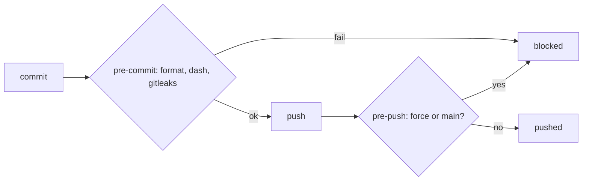

# PS23: /setup-github: repo process (git guardrails, pre-commit per language, issue tracker, setup state, retro target)
- Status: todo (docs only; build waits for Sven go per PBI)
- Batch: B6
- Depends on: PS21
- Absorbs old: none
- Lane: Builder (Cursor CLI for docs and markdown, Cloud Agent if multi-file C#)
- Release: squad v2 ([README](README.md#squad-v2))
- Docs: [STRUCTURE](STRUCTURE.md) (where), [SHAPES](SHAPES.md) (how it looks), [FLOWS](FLOWS.md) (flow per command), [MIGRATION](MIGRATION.md) (v1 to v2 rows), [FORKS](FORKS.md) (forks), [gh-aw](gh-aw/README.md)

## 1. Goal

**Problem on main (`6c59f49`).** [`plugins/dotnet/README.md`](https://github.com/svennijhuis/agentPacks/blob/6c59f49/plugins/dotnet/README.md):

> dotnet format

Our git rules live only in bot memory; nothing in the repo stops a force push or a dash before it lands.

**Why we change it.**

- Sven 2026-11-01: take good upstream setup parts as copy + adapt when they do not fit 1:1, do not drop them.
- Repo Research 2026-11-01 gap list: guardrails, pre-commit, issue tracker, setup state, one-time scenarios offer, retro target.

**What it gives the user.**

- Local (Cursor, Claude Code, CLI): Hooks run on every commit and push.
- gh-aw: CI keeps the same checks; hooks are local only.

**Out of scope.** pre-commit for rust and typescript (later rows).

Current state details:

- Our rules (no force push, no push to main, squash only) live only in bot memory, not in the repo. No hook checks dashes or secrets before a commit.

## 2. Depends on

PS21. Start only when those PBIs are merged on main. Build order: [README](README.md#new-set-and-build-order).

## 3. What gets replaced

| Kind | Now | After | Action |
|---|---|---|---|
| skill | (none) | `plugins/squad/skills/git-guardrails/` | add (copy + adapt of Matt git-guardrails-claude-code) |
| skill | (none) | `plugins/dotnet/skills/setup-pre-commit-dotnet/` | add (copy + adapt of Matt setup-pre-commit) |

Full list for all PBIs: [MIGRATION.md](MIGRATION.md#path-table).

## 4. Technical design

### 4.1 Tree before and after

Before (main):

```text
(none)
```

After:

```text
plugins/squad/skills/git-guardrails/  (copy of Matt git-guardrails-claude-code)
plugins/dotnet/skills/setup-pre-commit-dotnet/  (copy of Matt setup-pre-commit)
target repo: .githooks/pre-push  .githooks/pre-commit  docs/agents/issue-tracker.md
```

### 4.2 Skeleton of the new file

Shape rules: [SHAPES.md](SHAPES.md#summary).

```text
#!/bin/sh
# squad: owned (setup-github manifest)
while read local_ref local_sha remote_ref remote_sha; do
  [ "$remote_ref" = refs/heads/main ] && echo 'no push to main' && exit 1
done
exit 0
```

### 4.3 Target detail

| Part | Source | Route | What ends up in the target repo |
|---|---|---|---|
| git guardrails | [Matt git-guardrails-claude-code](https://github.com/mattpocock/skills/blob/4ae2317ddb22b046e26455e4f9c9b3aaaf62212d/skills/misc/git-guardrails-claude-code/SKILL.md) | copy + adapt as `plugins/squad/skills/git-guardrails/` | `.githooks/pre-push` blocks `--force`, `--force-with-lease` and any push to `main`; `git config core.hooksPath .githooks`; rule text in the `## Squad` block; Claude hook only under Provider notes |
| pre-commit per language | [Matt setup-pre-commit](https://github.com/mattpocock/skills/blob/4ae2317ddb22b046e26455e4f9c9b3aaaf62212d/skills/misc/setup-pre-commit/SKILL.md) | copy + adapt as `plugins/dotnet/skills/setup-pre-commit-dotnet/` (more packs later) | `.githooks/pre-commit`: `dotnet format --verify-no-changes`, dash grep on staged text, `gitleaks protect --staged` |
| issue tracker and glossary | [Matt setup-matt-pocock-skills](https://github.com/mattpocock/skills/blob/4ae2317ddb22b046e26455e4f9c9b3aaaf62212d/skills/engineering/setup-matt-pocock-skills/SKILL.md) | weave | `docs/agents/issue-tracker.md` (GitHub issues or `docs/pbi/`, recommended first), `triage-labels.md` only with triage, `GLOSSARY.md` and `docs/adr/` lazily, offer `git mv` of a legacy `CONTEXT.md` |
| setup state | [poteto-help](https://github.com/cursor/plugins/blob/ae5650febf4320793844c12c4adaa937f417f8da/pstack/skills/poteto-help/SKILL.md) | weave | `/pack-check` says "setup-github not run" while the `## Squad` block is missing |
| one-time offer | [setup-pstack](https://github.com/cursor/plugins/blob/ae5650febf4320793844c12c4adaa937f417f8da/pstack/skills/setup-pstack/SKILL.md) | weave | end of run 1: ask once "want `/scenarios`?" when no scenarios exist; gh-aw lists it in the report |
| retro target | [Matt retro](https://github.com/mattpocock/skills/blob/4ae2317ddb22b046e26455e4f9c9b3aaaf62212d/skills/engineering/retro/SKILL.md) | weave | retro (PS15) proposes rules only in `custom-standards*.instructions.md`, never in `owned` files |

Hooks are `owned` in the manifest (PS21); a repo with its own `.githooks/pre-commit` gets ours as `.githooks/pre-commit.d/squad` and one call line, never an overwrite.

Each copy: source SHA at top, NOTICE, What we changed or added.

### 4.4 Interfaces and contracts

| Caller | Callee | Input | Output | State file |
|---|---|---|---|---|
| pre-push hook | git push | refs on stdin | exit 1 on main | none |
| pre-commit hook | git commit | staged files | exit 1 on format, dash or secret | none |

### 4.5 Flow



### 4.6 Choices

| Chosen | Rejected | Why |
|---|---|---|
| git hooks in `.githooks/` | Claude-only hook | agent-neutral: works for every client and for humans |
| copy + adapt per language | one Husky setup | Husky is JS only; each pack knows its formatter |

### 4.7 Checks and error messages

| Rule | Checks | Error message |
|---|---|---|
| GuardHookTests | force push and push to main fail | `push --force: allowed` |
| PreCommitDotnetTests | format, dash, FAKE token fail | `em dash staged: allowed` |

### 4.8 Risks and what breaks

| Risk | Fix |
|---|---|
| `--no-verify` skips hooks | CI runs the same checks |

Also: A hook can be skipped with `--no-verify`: CI keeps the same checks (gitleaks, dash grep, format).; Out: pre-commit for rust and typescript packs (follow-up rows).

### 4.9 Per environment

| Environment | What is different |
|---|---|
| Local (Cursor, Claude Code, CLI) | Local: `core.hooksPath` set by setup. |
| gh-aw | gh-aw: hooks not used; CI checks. |

### 4.10 Subagents and what they load

- main agent; retro (PS15) for the retro target.

## 5. Steps

0. **Inventory (forks and upstream alike).** `git diff --name-status <basis>...HEAD -- plugins shared docs .github` (basis: the agentPacks commit you started from; on upstream itself the list is empty). Add every own standard, rule, skill, agent and instructions file to `docs/pbi/squad/fork-inventory.md` ([format](FORKS.md#step-0-inventory-every-pbi-before-any-edit)). Never delete or overwrite a listed file; unsure means keep it and mark the row `open`.
1. Branch from main: `git switch -c pbi/ps23-setup-repo-process origin/main`.
2. Save the base for the fork check: `git rev-parse HEAD > /tmp/base.sha`.
3. Read [SHAPES.md](SHAPES.md) for every kind in section 3, and each source in section 6.
4. Do each row of section 3 in order. Move or rename with `git mv`. If a row's target path already holds a fork file, follow the [conflict table](MIGRATION.md#fork-path). A copy keeps the `Source:` line and `## What we changed or added`.
5. Do these steps, nothing else:
   1. Copy git-guardrails and setup-pre-commit with write-skill (PS01), NOTICE, What we changed or added.
   2. Add the steps to `setup-github-mode` generate and update playbooks and the manifest.
   3. `/pack-check` setup-state step.
   4. Retro target rule in the retro agent prompt.
6. Run every command in section 8. All must pass.
7. Open one PR titled `PS23: /setup-github: repo process (git guardrails, pre-commit per language, issue tracker, setup state, retro target)`. Body: link to this file, the section 3 table, the section 8 output.

## 6. Sources

| Step | Skill (repo, path, SHA) | Licence | Mode | Lives in | Reason |
|---|---|---|---|---|---|
| guardrails | [Matt git-guardrails-claude-code](https://github.com/mattpocock/skills/blob/4ae2317ddb22b046e26455e4f9c9b3aaaf62212d/skills/misc/git-guardrails-claude-code/SKILL.md) | MIT (mattpocock/skills) | copy + adapt | `plugins/squad/skills/git-guardrails/` | Upstream is a Claude-only hook. Copy is agent-neutral: git `pre-push` hook blocks force push and push to main; Claude hook kept under Provider notes (PS23). |
| pre-commit | [Matt setup-pre-commit](https://github.com/mattpocock/skills/blob/4ae2317ddb22b046e26455e4f9c9b3aaaf62212d/skills/misc/setup-pre-commit/SKILL.md) | MIT (mattpocock/skills) | copy + adapt | `plugins/<pack>/skills/setup-pre-commit-<language>/` | Upstream is Husky and lint-staged (JS only). Copy per language pack: dotnet `dotnet format --verify-no-changes`, plus dash grep and gitleaks in every pack (PS23). |
| issue tracker | [Matt setup-matt-pocock-skills](https://github.com/mattpocock/skills/blob/4ae2317ddb22b046e26455e4f9c9b3aaaf62212d/skills/engineering/setup-matt-pocock-skills/SKILL.md) | MIT (mattpocock/skills) | weave | `setup-github-mode/playbooks/generate.md` | Explore, show, confirm, write; one block updated in place; `docs/agents/issue-tracker.md` and glossary. Woven into our setup, not shipped (PS21, PS23). |
| setup state | [poteto-help](https://github.com/cursor/plugins/blob/ae5650febf4320793844c12c4adaa937f417f8da/pstack/skills/poteto-help/SKILL.md) | MIT (cursor/plugins, Lauren Tan) | weave | `pack-check-mode` setup-state step | Knows setup did not run when its file is missing; we say the same when the `## Squad` block is missing (PS23). |
| retro | [Matt retro](https://github.com/mattpocock/skills/blob/4ae2317ddb22b046e26455e4f9c9b3aaaf62212d/skills/engineering/retro/SKILL.md) | MIT (mattpocock/skills) | weave | `squad-retro`, `references/retro.md` | Environment-fix steps into our retro step. Also pinned unchanged as a dependency of chief-of-staff. |
| always on | [caveman, caveman-compress](https://github.com/JuliusBrussee/caveman/tree/5184b3d11ac6a1acb7d44b9bfaa31698157cff97/skills/caveman) | MIT (cursor/plugins, Lauren Tan) | pin | `plugins/squad/external-skills.json` | We change nothing (Sven 2026-11-01: "als we geen wijzigingen gaan doen hou gewoon extern"). Always on: hub `## Writing the reply` and every agent prompt, locally and in gh-aw. |

Route per external skill ([decision](README.md#decision-pin-copy--adapt-weave-or-not-used)):

- Matt git-guardrails-claude-code: **copy + adapt**. `plugins/squad/skills/git-guardrails/`.
- Matt setup-pre-commit: **copy + adapt**. `plugins/<pack>/skills/setup-pre-commit-<language>/`.
- Matt setup-matt-pocock-skills: **weave**. `setup-github-mode/playbooks/generate.md`.
- poteto-help: **weave**. `pack-check-mode` setup-state step.
- Matt retro: **weave**. `squad-retro`, `references/retro.md`.
- caveman, caveman-compress: **pin**. `plugins/squad/external-skills.json`.

Every copy + adapt here adds, beyond its own changes: `Source:` line with SHA, a Standards line, the Gates, the Autonomy line for gh-aw, `## Provider notes`, `## What we changed or added`, and a NOTICE line.

Upstream: pstack [cursor/plugins at ae5650f](https://github.com/cursor/plugins/tree/ae5650febf4320793844c12c4adaa937f417f8da/pstack) (MIT), Matt [mattpocock/skills at 4ae2317](https://github.com/mattpocock/skills/tree/4ae2317ddb22b046e26455e4f9c9b3aaaf62212d) (MIT). Map: [skill map](sources/pstack-matt-skill-map.md).

## 7. Example

Good:

```text
$ git push --force origin feat/x
squad pre-push: force push blocked
$ git push origin main
squad pre-push: no push to main
```

Bad:

A hook that only Claude Code loads, or a pre-commit that overwrites the repo's own `.githooks/pre-commit`.

## 8. DoD (checkable)

```bash
dotnet run --project tools/AgentPacks.Cli -- validate                       # 0 errors, 0 warnings
dotnet test tools/AgentPacks.Cli.Tests                                      # green
dotnet run --project tools/AgentPacks.Cli -- validate-all --out /tmp/agentpacks-marketplace
dotnet run --project tools/AgentPacks.Cli -- migrate-check --base "$(cat /tmp/base.sha)"   # from PS03 on; 0 LOST
for f in tests/fixtures/gh-aw/*.md; do gh aw compile --strict "$f"; done   # from GA04 on; before: write "n/a, no fixture yet"
dotnet run --project tools/AgentPacks.Cli -- migrate-check --base <fixture base> --root tests/fixtures/fork-acme   # fixture fork, 0 LOST
dotnet run --project tools/AgentPacks.Cli -- validate --root tests/fixtures/fork-acme                              # fixture fork, 0 errors
grep -rnP "[\x{2013}\x{2014}]" plugins docs || echo "no dashes"
```

Then locally: install `/tmp/agentpacks-marketplace` in Cursor or Claude Code, run `/pack-check` (same result as `validate`) and each command this PBI touches once.

- [ ] Fixture `guard`: `git push --force` and `git push origin main` both exit non-zero; a push of a feature branch passes.
- [ ] Fixture `precommit-dotnet`: a badly formatted `.cs` file, a staged em dash and a FAKE `ghp_` token each fail the commit; a clean commit passes.
- [ ] Fixture with own `.githooks/pre-commit`: kept byte-equal, ours runs from `pre-commit.d/squad`.
- [ ] Fixture `no-setup`: `/pack-check` reports setup-github not run.
- [ ] Fixture `retro`: proposed rule lands only in `custom-standards.instructions.md`.
- [ ] Run 2 on every fixture: `git diff --exit-code` 0.
- [ ] Dash and placeholder grep 0; local install, `/setup-github` on the fixture.
- [ ] Local: works in Cursor, Claude Code and CLI (Copilot CLI, Codex). Proof offline: generated client manifests and fixture tests (`ClientManifestTests`, `ComponentGenerationTests`).
- [ ] gh-aw: the fixture workflow under `tests/fixtures/gh-aw/` that uses this PBI's files passes `gh aw compile --strict` (pinned gh-aw, no run, no secrets, no Actions minutes). See [gh-aw README](gh-aw/README.md).
- [ ] `dotnet run --project tools/AgentPacks.Cli -- validate` exits 0, 0 errors, 0 warnings.
- [ ] `/pack-check` locally gives the same result (same rules, one source).
- [ ] `dotnet test tools/AgentPacks.Cli.Tests` green; main stays green and all 7 commands still load after merge ([MIGRATION](MIGRATION.md)).
- [ ] No em dash, no tokens in markdown, FAKE fixture values only.
- [ ] Every row of `docs/pbi/squad/fork-inventory.md` is present in v2 (status `done` or `open` with a reason) and `/pack-check` is green, locally and in gh-aw. The fixture fork `tests/fixtures/fork-acme` (one own standard, one own rule) still passes after this PBI.

## 9. Evidence

- Hook exit codes, fixture diffs, `/pack-check` output.

## 10. For forks

Rules for every fork: [FORKS.md](FORKS.md). For this PBI: A fork's own hooks stay; ours run from `pre-commit.d/squad`.
