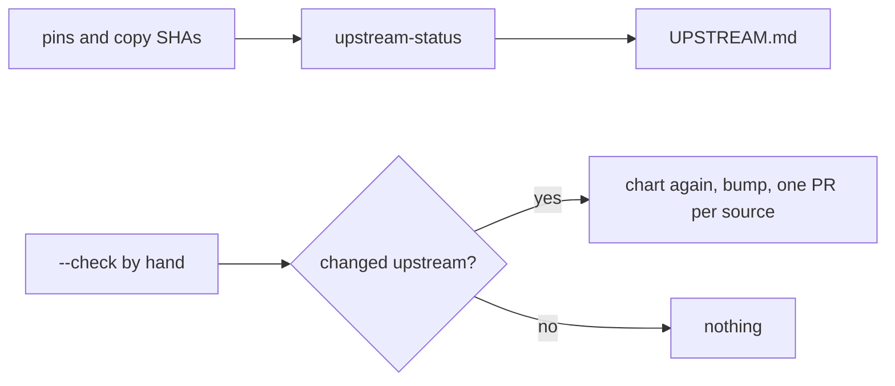

# PS24: UPSTREAM.md: last checked commit per source (pstack, Matt, caveman) and how to update
- Status: todo (docs only; build waits for Sven go per PBI)
- Batch: B6
- Depends on: PS04, PS05
- Absorbs old: none
- Lane: Builder (Cursor CLI for docs and markdown, Cloud Agent if multi-file C#)
- Release: squad v2 ([README](README.md#squad-v2))
- Docs: [STRUCTURE](STRUCTURE.md) (where), [SHAPES](SHAPES.md) (how it looks), [FLOWS](FLOWS.md) (flow per command), [MIGRATION](MIGRATION.md) (v1 to v2 rows), [FORKS](FORKS.md) (forks), [gh-aw](gh-aw/README.md)

## 1. Goal

**Problem on main (`6c59f49`).** [`plugins/squad/external-skills.json`](https://github.com/svennijhuis/agentPacks/blob/6c59f49/plugins/squad/external-skills.json):

> pin

Pins and copy SHAs are spread over many files; no one view shows what we last checked and what moved upstream.

**Why we change it.**

- Sven 2026-11-01: a doc with the last status commit from Matt and pstack, so changes can be tracked and things updated when needed.

**What it gives the user.**

- Local (Cursor, Claude Code, CLI): Run `scripts/upstream-status --check` by hand.
- gh-aw: CI only diffs the generated file; no network.

**Out of scope.** scheduled upstream checks.

Current state details:

- Pins sit in `external-skills.json`, source SHAs sit at the top of each copy. No one file says per source what we last checked, which skills came from it, and what changed upstream since.

## 2. Depends on

PS04, PS05. Start only when those PBIs are merged on main. Build order: [README](README.md#new-set-and-build-order).

## 3. What gets replaced

| Kind | Now | After | Action |
|---|---|---|---|
| doc | (none) | `plugins/squad/UPSTREAM.md` | add (generated by scripts/upstream-status) |

Full list for all PBIs: [MIGRATION.md](MIGRATION.md#path-table).

## 4. Technical design

### 4.1 Tree before and after

Before (main):

```text
(none)
```

After:

```text
plugins/squad/UPSTREAM.md  (generated)
scripts/upstream-status
```

### 4.2 Skeleton of the new file

Shape rules: [SHAPES.md](SHAPES.md#summary).

```text
| Source | Last checked | Date | Pins | Copies | Weaves |
|---|---|---|---|---|---|
| cursor/plugins | ae5650f | 2026-10-31 | 1 | 12 | 6 |
```

### 4.3 Target detail

`plugins/squad/UPSTREAM.md`, generated by `scripts/upstream-status` from `external-skills.json` and the source SHA line at the top of each copy. Never hand-edited.

**Per source** (one row each):

| Source | Last checked | Date | Pins | Copies | Weaves | Changes since |
|---|---|---|---|---|---|---|
| [cursor/plugins](https://github.com/cursor/plugins) (pstack) | `ae5650f` | 2026-10-31 | n | n | n | compare link `ae5650f...main` |
| [mattpocock/skills](https://github.com/mattpocock/skills) | `4ae2317` | 2026-10-31 | n | n | n | compare link `4ae2317...main` |
| [JuliusBrussee/caveman](https://github.com/JuliusBrussee/caveman) | `5184b3d` | pin date | 1 | 0 | 0 | compare link `5184b3d...main` |

**Per skill** (one row each): upstream path, route (pin, copy + adapt, weave), source SHA, our path, one line from What we changed or added.

**Update flow** (manual, on request only; nothing scheduled):
1. `scripts/upstream-status --check` reads each source's `main` head and lists the upstream files under our rows that changed since Last checked.
2. Per changed skill: pin gets a new 40-hex SHA; copy gets the upstream diff re-applied by hand, our changes kept, source SHA bumped; weave gets a look.
3. Run the decision chart again for any skill whose frontmatter changed (for example `disable-model-invocation`).
4. Regenerate `UPSTREAM.md`, one PR per source, Last checked moves to the new SHA.

`/pack-check` UPS01 (error): a copy's source SHA or an `external-skills.json` pin that is not in `UPSTREAM.md`, or `UPSTREAM.md` out of date with them.

### 4.4 Interfaces and contracts

| Caller | Callee | Input | Output | State file |
|---|---|---|---|---|
| upstream-status | script | external-skills.json, copy headers | UPSTREAM.md | none |
| upstream-status --check | script, by hand | upstream clones | changed skill list | read only |

### 4.5 Flow



### 4.6 Choices

| Chosen | Rejected | Why |
|---|---|---|
| generated file | hand-kept table | a hand table drifts; generated plus UPS01 cannot |
| check by hand | scheduled job | nothing scheduled without Sven yes |

### 4.7 Checks and error messages

| Rule | Checks | Error message |
|---|---|---|
| UpstreamStatusTests | generated equals committed | `UPSTREAM.md stale: passed` |
| UPS01 | unknown SHA fails | `0000000 copy: passed` |

### 4.8 Risks and what breaks

| Risk | Fix |
|---|---|
| upstream rename | listed as removed plus new |

Also: Upstream renames a file: `--check` lists it as removed plus new; the chart decides again.; Out: scheduled checks (needs Sven yes first).

### 4.9 Per environment

| Environment | What is different |
|---|---|
| Local (Cursor, Claude Code, CLI) | Local: script and `--check`. |
| gh-aw | gh-aw: diff check only. |

### 4.10 Subagents and what they load

- main agent.

## 5. Steps

0. **Inventory (forks and upstream alike).** `git diff --name-status <basis>...HEAD -- plugins shared docs .github` (basis: the agentPacks commit you started from; on upstream itself the list is empty). Add every own standard, rule, skill, agent and instructions file to `docs/pbi/squad/fork-inventory.md` ([format](FORKS.md#step-0-inventory-every-pbi-before-any-edit)). Never delete or overwrite a listed file; unsure means keep it and mark the row `open`.
1. Branch from main: `git switch -c pbi/ps24-upstream-status origin/main`.
2. Save the base for the fork check: `git rev-parse HEAD > /tmp/base.sha`.
3. Read [SHAPES.md](SHAPES.md) for every kind in section 3, and each source in section 6.
4. Do each row of section 3 in order. Move or rename with `git mv`. If a row's target path already holds a fork file, follow the [conflict table](MIGRATION.md#fork-path). A copy keeps the `Source:` line and `## What we changed or added`.
5. Do these steps, nothing else:
   1. Write `scripts/upstream-status` (generate and `--check`).
   2. Generate `plugins/squad/UPSTREAM.md` at the current pins.
   3. Add UPS01 to `/pack-check`.
   4. Link it from the README and from `/pack-author` write-skill (copy step says: bump UPSTREAM.md).
6. Run every command in section 8. All must pass.
7. Open one PR titled `PS24: UPSTREAM.md: last checked commit per source (pstack, Matt, caveman) and how to update`. Body: link to this file, the section 3 table, the section 8 output.

## 6. Sources

| Step | Skill (repo, path, SHA) | Licence | Mode | Lives in | Reason |
|---|---|---|---|---|---|
| pstack | [poteto-help](https://github.com/cursor/plugins/blob/ae5650febf4320793844c12c4adaa937f417f8da/pstack/skills/poteto-help/SKILL.md) | MIT (cursor/plugins, Lauren Tan) | weave | `pack-check-mode` setup-state step | Knows setup did not run when its file is missing; we say the same when the `## Squad` block is missing (PS23). |
| Matt | [Matt setup-matt-pocock-skills](https://github.com/mattpocock/skills/blob/4ae2317ddb22b046e26455e4f9c9b3aaaf62212d/skills/engineering/setup-matt-pocock-skills/SKILL.md) | MIT (mattpocock/skills) | weave | `setup-github-mode/playbooks/generate.md` | Explore, show, confirm, write; one block updated in place; `docs/agents/issue-tracker.md` and glossary. Woven into our setup, not shipped (PS21, PS23). |
| always on | [caveman, caveman-compress](https://github.com/JuliusBrussee/caveman/tree/5184b3d11ac6a1acb7d44b9bfaa31698157cff97/skills/caveman) | MIT (cursor/plugins, Lauren Tan) | pin | `plugins/squad/external-skills.json` | We change nothing (Sven 2026-11-01: "als we geen wijzigingen gaan doen hou gewoon extern"). Always on: hub `## Writing the reply` and every agent prompt, locally and in gh-aw. |

Route per external skill ([decision](README.md#decision-pin-copy--adapt-weave-or-not-used)):

- poteto-help: **weave**. `pack-check-mode` setup-state step.
- Matt setup-matt-pocock-skills: **weave**. `setup-github-mode/playbooks/generate.md`.
- caveman, caveman-compress: **pin**. `plugins/squad/external-skills.json`.

Every copy + adapt here adds, beyond its own changes: `Source:` line with SHA, a Standards line, the Gates, the Autonomy line for gh-aw, `## Provider notes`, `## What we changed or added`, and a NOTICE line.

Upstream: pstack [cursor/plugins at ae5650f](https://github.com/cursor/plugins/tree/ae5650febf4320793844c12c4adaa937f417f8da/pstack) (MIT), Matt [mattpocock/skills at 4ae2317](https://github.com/mattpocock/skills/tree/4ae2317ddb22b046e26455e4f9c9b3aaaf62212d) (MIT). Map: [skill map](sources/pstack-matt-skill-map.md).

## 7. Example

Good:

```markdown
| Source | Last checked | Date | Pins | Copies | Weaves | Changes since |
|---|---|---|---|---|---|---|
| cursor/plugins | `ae5650f` | 2026-10-31 | 1 | 12 | 6 | ae5650f...main |
```

Bad:

A hand-written list with no SHA, or a copy bumped to a new upstream SHA without a new row.

## 8. DoD (checkable)

```bash
dotnet run --project tools/AgentPacks.Cli -- validate                       # 0 errors, 0 warnings
dotnet test tools/AgentPacks.Cli.Tests                                      # green
dotnet run --project tools/AgentPacks.Cli -- validate-all --out /tmp/agentpacks-marketplace
dotnet run --project tools/AgentPacks.Cli -- migrate-check --base "$(cat /tmp/base.sha)"   # from PS03 on; 0 LOST
for f in tests/fixtures/gh-aw/*.md; do gh aw compile --strict "$f"; done   # from GA04 on; before: write "n/a, no fixture yet"
dotnet run --project tools/AgentPacks.Cli -- migrate-check --base <fixture base> --root tests/fixtures/fork-acme   # fixture fork, 0 LOST
dotnet run --project tools/AgentPacks.Cli -- validate --root tests/fixtures/fork-acme                              # fixture fork, 0 errors
grep -rnP "[\x{2013}\x{2014}]" plugins docs || echo "no dashes"
```

Then locally: install `/tmp/agentpacks-marketplace` in Cursor or Claude Code, run `/pack-check` (same result as `validate`) and each command this PBI touches once.

- [ ] `scripts/upstream-status` output equals the committed `UPSTREAM.md` (CI diff is empty).
- [ ] Every pin and every copy source SHA has a row: UPS01 0 errors.
- [ ] Fixture `stale`: a copy with source SHA `0000000` not in UPSTREAM.md fails UPS01.
- [ ] `--check` on a FAKE local upstream clone with one changed file lists exactly that skill.
- [ ] No network call in CI; `--check` runs only by hand.
- [ ] Dash and placeholder grep 0.
- [ ] Local: works in Cursor, Claude Code and CLI (Copilot CLI, Codex). Proof offline: generated client manifests and fixture tests (`ClientManifestTests`, `ComponentGenerationTests`).
- [ ] gh-aw: the fixture workflow under `tests/fixtures/gh-aw/` that uses this PBI's files passes `gh aw compile --strict` (pinned gh-aw, no run, no secrets, no Actions minutes). See [gh-aw README](gh-aw/README.md).
- [ ] `dotnet run --project tools/AgentPacks.Cli -- validate` exits 0, 0 errors, 0 warnings.
- [ ] `/pack-check` locally gives the same result (same rules, one source).
- [ ] `dotnet test tools/AgentPacks.Cli.Tests` green; main stays green and all 7 commands still load after merge ([MIGRATION](MIGRATION.md)).
- [ ] No em dash, no tokens in markdown, FAKE fixture values only.
- [ ] Every row of `docs/pbi/squad/fork-inventory.md` is present in v2 (status `done` or `open` with a reason) and `/pack-check` is green, locally and in gh-aw. The fixture fork `tests/fixtures/fork-acme` (one own standard, one own rule) still passes after this PBI.

## 9. Evidence

- `UPSTREAM.md` at the current pins, UPS01 output, `--check` fixture output.

## 10. For forks

Rules for every fork: [FORKS.md](FORKS.md). For this PBI: A fork adds its own sources as rows; ours stay.
