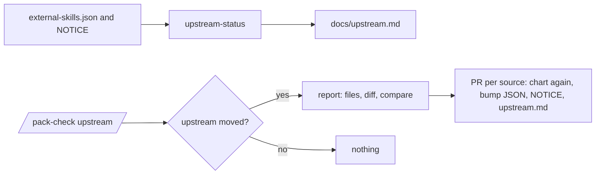

# PS24: docs/upstream.md: last synced commit per source (pstack, Matt, caveman), report-only check, update one source per PR
- Status: todo (docs only; build waits for Sven go per PBI)
- Batch: B6
- Depends on: PS03, PS04, PS05
- Absorbs old: none
- Lane: Builder (Cursor CLI for docs and markdown, Cloud Agent if multi-file C#)
- Release: squad v2 ([README](README.md#squad-v2))
- Docs: [STRUCTURE](STRUCTURE.md) (where), [SHAPES](SHAPES.md) (how it looks), [FLOWS](FLOWS.md) (flow per command), [MIGRATION](MIGRATION.md) (v1 to v2 rows), [FORKS](FORKS.md) (forks), [gh-aw](gh-aw/README.md)

## 1. Goal

**Problem on main (`6c59f49`).** [`plugins/squad/external-skills.json`](https://github.com/svennijhuis/agentPacks/blob/6c59f49/plugins/squad/external-skills.json):

> pin

Pins and NOTICE SHAs are spread over many files; no one view shows what we last synced and what moved upstream.

**Why we change it.**

- Sven 2026-11-01: a doc with the last status commit from Matt and pstack, so changes can be tracked and things updated when needed.
- PO 2026-11-01: generated from the JSON and NOTICE, report-only check, one source per PR, REF rule, gh-aw schedule only after Sven yes.

**What it gives the user.**

- Local (Cursor, Claude Code, CLI): `/pack-check upstream` by hand.
- gh-aw: Scheduled read-only check, disabled until Sven yes.

**Out of scope.** auto update.

Current state details:

- Pins sit in `external-skills.json`, source SHAs sit in each copy NOTICE. No one file says per source what we last synced and what moved upstream since.

## 2. Depends on

PS03, PS04, PS05. Start only when those PBIs are merged on main. Build order: [README](README.md#new-set-and-build-order).

## 3. What gets replaced

| Kind | Now | After | Action |
|---|---|---|---|
| doc | (none) | `docs/upstream.md` | add (generated by scripts/upstream-status) |

Full list for all PBIs: [MIGRATION.md](MIGRATION.md#path-table).

## 4. Technical design

### 4.1 Tree before and after

Before (main):

```text
(none)
```

After:

```text
docs/upstream.md  (generated)
scripts/upstream-status
.github/workflows/upstream-check.md  (gh-aw, disabled)
```

### 4.2 Skeleton of the new file

Shape rules: [SHAPES.md](SHAPES.md#summary).

```text
| Upstream skill | Route | Our path | Based on SHA |
|---|---|---|---|
| skills/caveman | pin | external-skills.json | 5184b3d |
```

### 4.3 Target detail

**Source of truth** stays `plugins/squad/external-skills.json` plus the source SHA in each NOTICE. **`docs/upstream.md`** is generated from them by `scripts/upstream-status`. Never hand-edited.

One table per source, with the source line above it:

- [cursor/plugins](https://github.com/cursor/plugins) (pstack): last synced [`ae5650f`](https://github.com/cursor/plugins/commit/ae5650febf4320793844c12c4adaa937f417f8da), 2026-10-31.
- [mattpocock/skills](https://github.com/mattpocock/skills) (Matt): last synced [`4ae2317`](https://github.com/mattpocock/skills/commit/4ae2317ddb22b046e26455e4f9c9b3aaaf62212d), 2026-10-31.
- [JuliusBrussee/caveman](https://github.com/JuliusBrussee/caveman): last synced [`5184b3d`](https://github.com/JuliusBrussee/caveman/commit/5184b3d11ac6a1acb7d44b9bfaa31698157cff97).

| Upstream skill | Route | Our path | Based on SHA |
|---|---|---|---|
| `pstack/skills/create-verification-skill` | copy + adapt | `plugins/squad/skills/create-verification-skill/` | `ae5650f` |
| `skills/engineering/tdd` | weave | `plugins/squad/skills/squad-mode/playbooks/feature.md` | `4ae2317` |
| `skills/caveman` | pin | `external-skills.json` | `5184b3d` |
| `pstack/skills/setup-pstack` | not used | none | `ae5650f` |

**Check** `/pack-check upstream` (calls `scripts/upstream-status --check`). Report only, never writes:
1. Per source: latest upstream `main` commit next to our SHA, and the compare link `<ours>...main`.
2. Per skill with a changed upstream file: the files, a short diff (first 20 lines per file), the compare link.
3. A skill whose frontmatter changed (for example `disable-model-invocation`) is marked "chart again".

**Update** goes through a normal PR, one source per PR: the new SHA lands in `external-skills.json`, every NOTICE of that source and `docs/upstream.md` in the same commit. Each copy or weave is judged again with the decision chart, and its "What we changed or added" stays true.

**REF10** (`/pack-check` validate, error): a SHA in `docs/upstream.md` that differs from `external-skills.json` or a NOTICE fails; a pin or copy with no row fails.

**gh-aw:** a scheduled `upstream-check` workflow (weekly, report as an issue comment, read only) is described here but ships disabled. It turns on only after Sven's explicit yes.

### 4.4 Interfaces and contracts

| Caller | Callee | Input | Output | State file |
|---|---|---|---|---|
| upstream-status | script | external-skills.json, NOTICE files | docs/upstream.md | none |
| /pack-check upstream | command, report only | upstream clones | files, short diff, compare link per skill | read only |

### 4.5 Flow



### 4.6 Choices

| Chosen | Rejected | Why |
|---|---|---|
| generated file | hand-kept table | a hand table drifts; generated plus REF10 cannot |
| report only | auto bump | a bump needs the chart again |
| schedule off by default | schedule on | nothing scheduled without Sven yes |

### 4.7 Checks and error messages

| Rule | Checks | Error message |
|---|---|---|
| UpstreamStatusTests | generated equals committed | `upstream.md stale: passed` |
| REF10 | mismatch fails | `NOTICE 0000000: passed` |

### 4.8 Risks and what breaks

| Risk | Fix |
|---|---|
| upstream rename | removed plus new, chart again |

Also: Upstream renames a file: `--check` lists it as removed plus new, marked chart again.; Out: turning on the schedule (needs Sven yes).

### 4.9 Per environment

| Environment | What is different |
|---|---|
| Local (Cursor, Claude Code, CLI) | Local: `/pack-check upstream`. |
| gh-aw | gh-aw: workflow present, disabled. |

### 4.10 Subagents and what they load

- main agent.

## 5. Steps

0. **Inventory (forks and upstream alike).** `git diff --name-status <basis>...HEAD -- plugins shared docs .github` (basis: the agentPacks commit you started from; on upstream itself the list is empty). Add every own standard, rule, skill, agent and instructions file to `docs/pbi/squad/fork-inventory.md` ([format](FORKS.md#step-0-inventory-every-pbi-before-any-edit)). Never delete or overwrite a listed file; unsure means keep it and mark the row `open`.
1. Branch from main: `git switch -c pbi/ps24-upstream-status origin/main`.
2. Save the base for the fork check: `git rev-parse HEAD > /tmp/base.sha`.
3. Read [SHAPES.md](SHAPES.md) for every kind in section 3, and each source in section 6.
4. Do each row of section 3 in order. Move or rename with `git mv`. If a row's target path already holds a fork file, follow the [conflict table](MIGRATION.md#fork-path). A copy keeps the `Source:` line and `## What we changed or added`.
5. Do these steps, nothing else:
   1. Write `scripts/upstream-status` (generate and `--check`).
   2. Generate `docs/upstream.md` at the current pins.
   3. Add `/pack-check upstream` and REF10.
   4. Describe the gh-aw `upstream-check` workflow, disabled.
   5. Link from the README and the `/pack-author` copy step (bump JSON, NOTICE, upstream.md together).
6. Run every command in section 8. All must pass.
7. Open one PR titled `PS24: docs/upstream.md: last synced commit per source (pstack, Matt, caveman), report-only check, update one source per PR`. Body: link to this file, the section 3 table, the section 8 output.

## 6. Sources

| Step | Skill (repo, path, SHA) | Licence | Mode | Lives in | Reason |
|---|---|---|---|---|---|
| pstack | [poteto-help](https://github.com/cursor/plugins/blob/ae5650febf4320793844c12c4adaa937f417f8da/pstack/skills/poteto-help/SKILL.md) | MIT (cursor/plugins, Lauren Tan) | weave | `pack-check-mode` setup-state step | Knows setup did not run when its file is missing; we say the same when the `## Squad` block is missing (PS23). |
| Matt | [Matt setup-matt-pocock-skills](https://github.com/mattpocock/skills/blob/4ae2317ddb22b046e26455e4f9c9b3aaaf62212d/skills/engineering/setup-matt-pocock-skills/SKILL.md) | MIT (mattpocock/skills) | weave | `setup-github-mode/playbooks/generate.md` | Explore, show, confirm, write; one block updated in place; `docs/agents/issue-tracker.md` and glossary. Woven into our setup, not shipped (PS21, PS23). |
| always on | [caveman, caveman-compress](https://github.com/JuliusBrussee/caveman/tree/5184b3d11ac6a1acb7d44b9bfaa31698157cff97/skills/caveman) | MIT (cursor/plugins, Lauren Tan) | pin | `plugins/squad/external-skills.json` | We change nothing (Sven 2026-11-01: "als we geen wijzigingen gaan doen hou gewoon extern"). Always on: hub `## Writing the reply` and every agent prompt, locally and in gh-aw. |

Route per external skill ([decision](README.md#decision-pin-copy--adapt-weave-or-not-used)):

- poteto-help: **weave**. `pack-check-mode` setup-state step.
- Matt setup-matt-pocock-skills: **weave**. `setup-github-mode/playbooks/generate.md`.
- caveman, caveman-compress: **pin**. `plugins/squad/external-skills.json`.

Every copy + adapt here adds, beyond its own changes: `Source:` line with SHA, a Standards line, the Gates, the Autonomy line for gh-aw, `## Provider notes`, `## What we changed or added`, and a NOTICE line.

Upstream: pstack [cursor/plugins at ae5650f](https://github.com/cursor/plugins/tree/ae5650febf4320793844c12c4adaa937f417f8da/pstack) (MIT), Matt [mattpocock/skills at 4ae2317](https://github.com/mattpocock/skills/tree/4ae2317ddb22b046e26455e4f9c9b3aaaf62212d) (MIT). Map: [skill map](sources/pstack-matt-skill-map.md).

## 7. Example

Good:

```text
$ /pack-check upstream
cursor/plugins: ours ae5650f, main 9c1e2aa, compare ae5650f...main
  tdd (weave): skills/tdd/SKILL.md +4 -1
  create-formal-verification-skill (copy): frontmatter changed, chart again
mattpocock/skills: in sync
```

Bad:

The check bumps the SHA itself, or a PR bumps `external-skills.json` but leaves the NOTICE on the old SHA.

## 8. DoD (checkable)

```bash
dotnet run --project tools/AgentPacks.Cli -- validate                       # 0 errors, 0 warnings
dotnet test tools/AgentPacks.Cli.Tests                                      # green
dotnet run --project tools/AgentPacks.Cli -- validate-all --out /tmp/agentpacks-marketplace
dotnet run --project tools/AgentPacks.Cli -- migrate-check --base "$(cat /tmp/base.sha)"   # from PS03 on; 0 LOST
for f in tests/fixtures/gh-aw/*.md; do gh aw compile --strict "$f"; done   # from GA04 on; before: write "n/a, no fixture yet"
dotnet run --project tools/AgentPacks.Cli -- migrate-check --base <fixture base> --root tests/fixtures/fork-acme   # fixture fork, 0 LOST
dotnet run --project tools/AgentPacks.Cli -- validate --root tests/fixtures/fork-acme                              # fixture fork, 0 errors
grep -rnP "[\x{2013}\x{2014}]" plugins docs || echo "no dashes"
```

Then locally: install `/tmp/agentpacks-marketplace` in Cursor or Claude Code, run `/pack-check` (same result as `validate`) and each command this PBI touches once.

- [ ] `scripts/upstream-status` output equals the committed `docs/upstream.md` (CI diff empty).
- [ ] Fixture `in-sync`: REF10 0 errors, `--check` on a FAKE local upstream at the same SHA reports nothing changed.
- [ ] Fixture `behind`: FAKE upstream one commit ahead with one changed file; `--check` lists exactly that skill, file, short diff and compare link; `git status --porcelain` empty after.
- [ ] Fixture `mismatch`: NOTICE says `0000000`, upstream.md says `ae5650f`; REF10 fails.
- [ ] No network call in CI; the gh-aw workflow file has no enabled trigger.
- [ ] Dash and placeholder grep 0.
- [ ] Local: works in Cursor, Claude Code and CLI (Copilot CLI, Codex). Proof offline: generated client manifests and fixture tests (`ClientManifestTests`, `ComponentGenerationTests`).
- [ ] gh-aw: the fixture workflow under `tests/fixtures/gh-aw/` that uses this PBI's files passes `gh aw compile --strict` (pinned gh-aw, no run, no secrets, no Actions minutes). See [gh-aw README](gh-aw/README.md).
- [ ] `dotnet run --project tools/AgentPacks.Cli -- validate` exits 0, 0 errors, 0 warnings.
- [ ] `/pack-check` locally gives the same result (same rules, one source).
- [ ] `dotnet test tools/AgentPacks.Cli.Tests` green; main stays green and all 7 commands still load after merge ([MIGRATION](MIGRATION.md)).
- [ ] No em dash, no tokens in markdown, FAKE fixture values only.
- [ ] Every row of `docs/pbi/squad/fork-inventory.md` is present in v2 (status `done` or `open` with a reason) and `/pack-check` is green, locally and in gh-aw. The fixture fork `tests/fixtures/fork-acme` (one own standard, one own rule) still passes after this PBI.

## 9. Evidence

- `docs/upstream.md` at the current pins, REF10 and `--check` output for the three fixtures.

## 10. For forks

Rules for every fork: [FORKS.md](FORKS.md). For this PBI: A fork adds its own sources as tables; ours stay.
