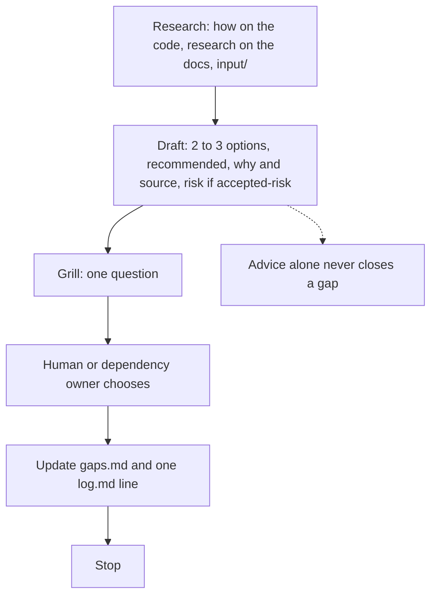
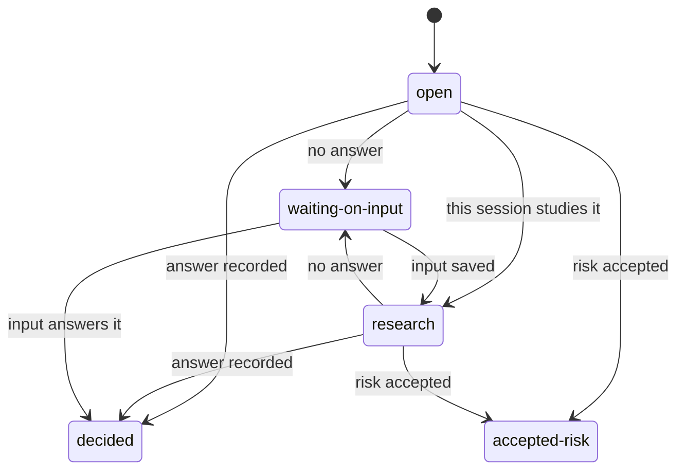
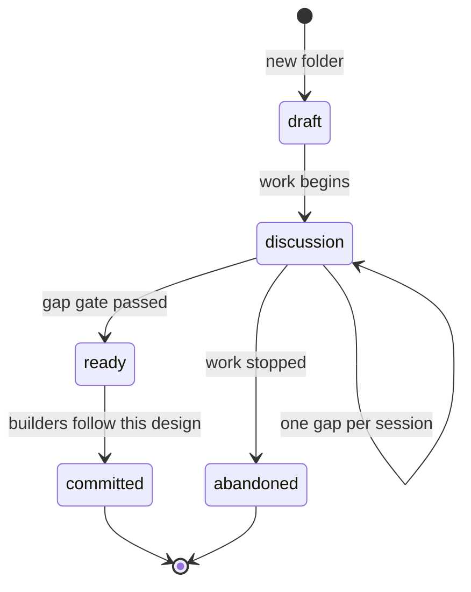

# productivity

A capability pack for a technical design developers can build. `/tech-design` charts a shared map, then closes gaps one at a time, until a later wayfinder pass can turn the design into tickets that take story points.

Claude, Cursor, and Codex run `/tech-design` (Codex: `$tech-design`). Copilot picker: `/productivity:tech-design`. The skill is `tech-design`.

The person types the command. The model does not start a design on its own. One session charts the folder, takes one gap, or runs the ready gate, then stops. Research gaps are the exception: chart can fire those subagents together.

Structure and style inspired by mattpocock/skills wayfinder @4ae2317, text rewritten. [NOTICE](skills/tech-design/NOTICE.md).

## Which external skill when

Same rows as [Skill per step](skills/tech-design/SKILL.md#skill-per-step). `pin` is a row in `external-skills.json`. `copy + adapt` arrives in TD2+.

| Step | Skills | Use | Source | Output |
| --- | --- | --- | --- | --- |
| Chart: destination and frontier | grilling, domain-modeling | pin | [grilling](https://github.com/mattpocock/skills/tree/4ae2317ddb22b046e26455e4f9c9b3aaaf62212d/skills/productivity/grilling), [domain-modeling](https://github.com/mattpocock/skills/tree/4ae2317ddb22b046e26455e4f9c9b3aaaf62212d/skills/engineering/domain-modeling) | design.md map, gaps.md, glossary.md |
| Research per gap (first) | how (TD2+) on the code, research on the docs, read input/ | copy + adapt for how, pin for research | [how](https://github.com/cursor/plugins/tree/ae5650febf4320793844c12c4adaa937f417f8da/pstack/skills/how), [research](https://github.com/mattpocock/skills/tree/4ae2317ddb22b046e26455e4f9c9b3aaaf62212d/skills/engineering/research) | `research/<topic>.md` |
| Draft advice | architect (TD2+) and principle-exhaust-the-design-space (TD2+) for options, codebase-design when a seam is in play, why (TD2+) for the source, blast-radius (TD2+) for the risk line | copy + adapt for architect, principle-exhaust-the-design-space, why, and blast-radius. pin for codebase-design | [architect](https://github.com/cursor/plugins/tree/ae5650febf4320793844c12c4adaa937f417f8da/pstack/skills/architect), [principle-exhaust-the-design-space](https://github.com/cursor/plugins/tree/ae5650febf4320793844c12c4adaa937f417f8da/pstack/skills/principle-exhaust-the-design-space), [codebase-design](https://github.com/mattpocock/skills/tree/4ae2317ddb22b046e26455e4f9c9b3aaaf62212d/skills/engineering/codebase-design), [why](https://github.com/cursor/plugins/tree/ae5650febf4320793844c12c4adaa937f417f8da/pstack/skills/why), [blast-radius](https://github.com/cursor/plugins/tree/ae5650febf4320793844c12c4adaa937f417f8da/pstack/skills/blast-radius) | advice block in the gap |
| Grill (one question) | grilling, domain-modeling | pin | [grilling](https://github.com/mattpocock/skills/tree/4ae2317ddb22b046e26455e4f9c9b3aaaf62212d/skills/productivity/grilling), [domain-modeling](https://github.com/mattpocock/skills/tree/4ae2317ddb22b046e26455e4f9c9b3aaaf62212d/skills/engineering/domain-modeling) | answer in the gap, log line |
| No answer | to-questionnaire (TD2+) | copy + adapt | [to-questionnaire](https://github.com/mattpocock/skills/tree/4ae2317ddb22b046e26455e4f9c9b3aaaf62212d/skills/productivity/to-questionnaire) | question in input/, waiting-on-input |
| State diagram | statechart (TD2+) | copy + adapt | [statechart](https://github.com/cursor/plugins/tree/ae5650febf4320793844c12c4adaa937f417f8da/pstack/skills/statechart) | mermaid state in design.md |
| Every edit of design.md | writing-for-agents, plus deslop on openapi.yaml or code | pin | [writing-for-agents](https://github.com/mattpocock/skills/tree/4ae2317ddb22b046e26455e4f9c9b3aaaf62212d/skills/productivity/writing-for-agents), [deslop](https://github.com/cursor/plugins/tree/ae5650febf4320793844c12c4adaa937f417f8da/cursor-team-kit/skills/deslop) | (none) |
| Ready | interrogate (TD2+) over the whole design, then technical-writing (TD2+), unslop (TD2+) and the no-op pass, then to-spec (TD2+) and to-tickets (TD2+) | copy + adapt for interrogate, technical-writing, unslop, to-spec, and to-tickets. The no-op pass is this skill | [interrogate](https://github.com/cursor/plugins/tree/ae5650febf4320793844c12c4adaa937f417f8da/pstack/skills/interrogate), [technical-writing](https://github.com/cursor/plugins/tree/ae5650febf4320793844c12c4adaa937f417f8da/pstack/skills/technical-writing), [unslop](https://github.com/cursor/plugins/tree/ae5650febf4320793844c12c4adaa937f417f8da/pstack/skills/unslop), [to-spec](https://github.com/mattpocock/skills/tree/4ae2317ddb22b046e26455e4f9c9b3aaaf62212d/skills/engineering/to-spec), [to-tickets](https://github.com/mattpocock/skills/tree/4ae2317ddb22b046e26455e4f9c9b3aaaf62212d/skills/engineering/to-tickets) | tickets.md, wayfinder-brief.md |

## Start

`/tech-design new <name> [types]` charts the map.

1. Name the destination. Call the Skill tool with `grilling` and `domain-modeling`: a technical design developers can build. The destination fixes the scope.
2. Call the Skill tool with `grilling` and `domain-modeling`, breadth-first, to map the frontier. If no fog shows up, a design map is not needed. Stop and ask how to proceed.
3. Create `docs/design/<name>/` with `design.md` (status `draft`, map block filled, Decisions so far empty), `glossary.md`, `gaps.md`, and `log.md`. Call `writing-for-agents` on `design.md`. `research/` and `input/` appear when the first note is saved. `openapi.yaml` is added only when the api type is in use. This folder has no readme of its own. This file is the owner guide.
4. Add the gaps you can specify now, then wire the `blocks` column in a second pass. Sketch the rest in **Not yet specified**.
5. Fire a research subagent for each research gap. Call `how` (TD2+) on the code, then `research`. Findings go in `research/<topic>.md`.
6. Stop. Charting resolves nothing by hand.

A second `new` for a folder that already exists stops. Resume instead.

## Resume

`/tech-design <name>` loads `design.md` (the status line and the map sections), `gaps.md`, and the last `log.md` line. It does not load every research note.

Status `ready`, `committed`, or `abandoned`: say so and stop. Otherwise claim the first frontier gap (status `open`, nothing in `blocks` still open, no owner) before any work, or the gap the person named. Resolve that one gap by its type, then stop.

`/tech-design <name> grill [gap]` is the same path. Research and advice come before the one question.

`/tech-design <name> ready` runs the gap gate. It sets document status `ready` only when no gap is `open`, `research`, or `waiting-on-input`. It then runs the Ready row (interrogate, technical-writing, unslop, the no-op pass, to-spec, and to-tickets) and writes `tickets.md` and `wayfinder-brief.md`.

## Loop

One gap, then stop. Never more than one gap in a session, except research gaps.

Claim it first (`owner` set). The frontier is the open, unblocked, unclaimed rows. Refer to a gap by its question, not by a bare id.

- **Research** (AFK): call `how` (TD2+) on the code, then `research` on the docs, and read `input/`. Findings go in `research/<topic>.md`.
- **Prototype** (HITL): a cheap artifact to react to, linked from the gap row. The human's reaction is the answer.
- **Grilling** (HITL): call the Skill tool with `grilling` and `domain-modeling`, then the flowchart below. The agent never answers its own grill question.
- **Task** (HITL or AFK): work that unblocks a decision. No real call to a dependency. Proof is the owner's spec, or their written answer, saved in `input/`.

A grilling gap, in this order:

1. Research. Call `how` (TD2+) on the code, then `research` on the docs, and read specs in `input/`.
2. Draft advice. Call `architect` and `principle-exhaust-the-design-space` for the options, `codebase-design` when a seam is in play, `why` for the source, and `blast-radius` for the risk line. Offer 2 to 3 options, the recommended one, why with a source, and the risk if `accepted-risk` is chosen.
3. Grill. Ask one question with the recommended option.
4. The human or the dependency owner chooses.
5. Update the gap row, add one `log.md` line, and add a gist line under **Decisions so far**.
6. Add gaps the answer made specifiable, graduate fog, rule out-of-scope gaps out, and update invalidated gaps.
7. Stop.

Advice alone never closes a gap. No answer calls `to-questionnaire` (TD2+), saves the question under `input/`, and sets `waiting-on-input`.

## Fog, decisions, and out of scope

The map block sits at the top of `design.md`, under the status line. It is an index, loaded once per session. The decision lives in the gap row. The map only gists it.

**Decisions so far** is one line per closed gap: the question, a pointer to the row, and a one-line gist.

**Not yet specified** is the fog of war: in-scope questions you cannot phrase yet. Fog or ticket: if you can state the question precisely now, it is a gap, even when it is blocked. If you cannot phrase it yet, it stays fog. Fog graduates as the frontier advances. Do not pre-slice it.

**Out of scope** is work beyond the destination. It never graduates. Closing a gap that sits past the destination leaves one line here, and that line is not a decision.

## Gap status

A row holds id, question, type, status, owner, due, waiting-on note, source or answer, and blocks. `blocks` lists the gaps that must be `decided` or `accepted-risk` first. A `waiting-on-input` row has an owner and a due date. `decided` and `accepted-risk` do not block the ready gate.

## Document status

Status lives in `design.md`. `draft` is the new folder. `discussion` is work while gaps remain. `ready` means the gap gate passed. `committed` means builders follow this design. `abandoned` means the work stopped.

## Writing for humans and agents

Two readers. The agent researches and drafts. The human writes the decisions. Each grill question carries the recommended answer and why. The agent asks only what research cannot settle. The human confirms or overrides. That is the decision.

Every edit of `design.md` calls `writing-for-agents`. A change to `openapi.yaml` or a code snippet calls `deslop`. A state diagram calls `statechart` (TD2+).

Point to code. `design.md` links real files, symbols, and `openapi.yaml`.

Keep it short. Detail goes to `research/`. Every gap has a hard done-when.

Glossary. Each design folder has `glossary.md`.

No-op pass. The last pass removes every line that does not change what the reader does.

## Components

| Component | Name | Responsibility |
| --- | --- | --- |
| Skill | `tech-design` | User-invoked routing for new, resume, grill, and ready. Not model-invoked. |
| Command | `tech-design` | Runs the mode. Copilot picker: `/productivity:tech-design` |

Pins, loaded by exact Skill name: `domain-modeling`, `codebase-design`, `grilling`, `research`, `writing-for-agents`, `deslop`.

## Editing

Authored: `plugin.json`, `skills/`, `commands/`, and `external-skills.json`.

Generated only in validation output or on `marketplace` / `marketplace-beta`: client manifests.

Test on a feature branch without merging to `main`:
[ADD-SKILL.md: Test a skill locally](https://github.com/svennijhuis/agentPacks/blob/main/docs/ADD-SKILL.md#test-a-skill-locally).
