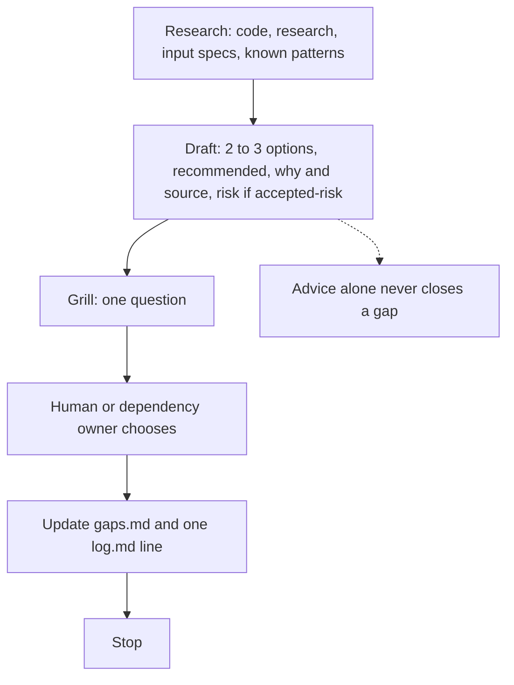
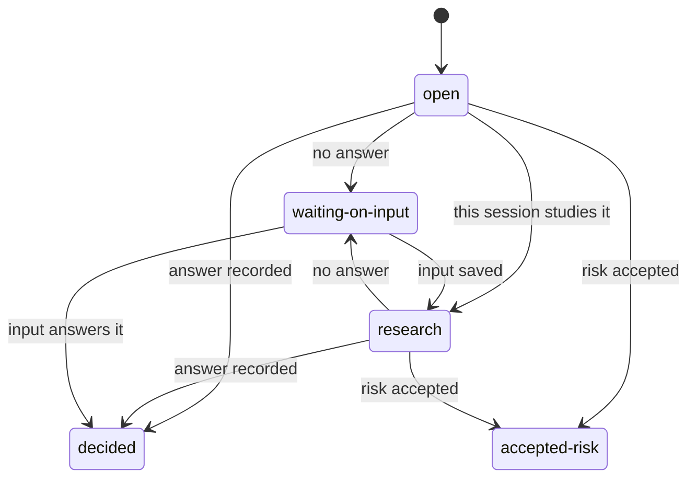
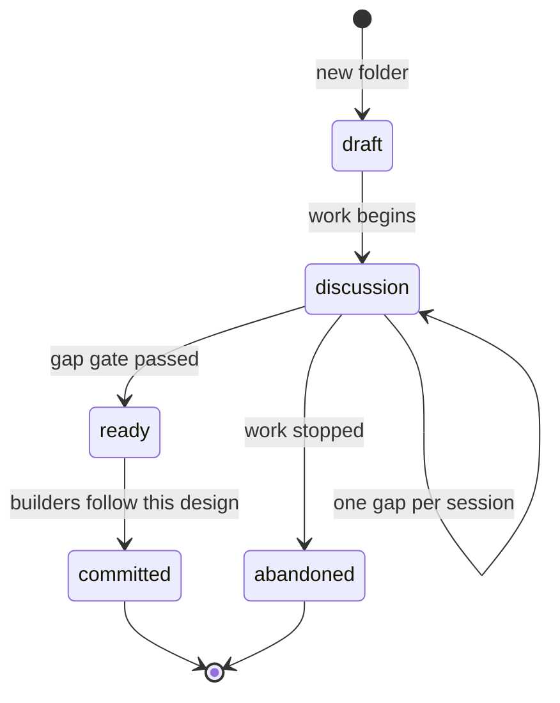

# productivity

A capability pack for a technical design developers can build. `/tech-design` closes gaps one at a time, with advice, until a later wayfinder pass can turn the design into tickets that take story points.

Claude, Cursor, and Codex run `/tech-design` (Codex: `$tech-design`). Copilot picker: `/productivity:tech-design`. The skill is `tech-design`.

The person types the command. The model does not start a design on its own. One session charts the folder, takes one gap, or runs the ready gate, then stops.

Adapted from Matt Pocock's wayfinder skill (`skills/engineering/wayfinder` at `4ae2317ddb22b046e26455e4f9c9b3aaaf62212d`). [NOTICE](skills/tech-design/NOTICE.md).

## Start

`/tech-design new <name> [types]`

Creates `docs/design/<name>/` with `README.md`, `design.md` (status `draft`), `glossary.md`, `gaps.md`, and `log.md`. `research/` and `input/` appear when the first note is saved. `openapi.yaml` is added only when the api type is in use. Charting does not close a gap.

The design folder `README.md` says how to resume.

## Resume

`/tech-design <name>` loads that folder and runs one gap, then stops.

`/tech-design <name> grill [gap]` researches first, then asks one question with the recommended option, then stops.

`/tech-design <name> ready` runs the gap gate. It sets document status `ready` only when no gap is `open`, `research`, or `waiting-on-input`. It then writes `tickets.md` and `wayfinder-brief.md`.

## Loop

One gap, in this order:

1. Research. Read the code first, call `research`, read specs in `input/`, and check known patterns.
2. Draft advice. Offer 2 to 3 options, the recommended one, why with a source, and the risk if `accepted-risk` is chosen.
3. Grill. Ask one question with the recommended option.
4. The human or the dependency owner chooses.
5. Update `gaps.md` and add one `log.md` line.
6. Stop.

Advice alone never closes a gap. The skill makes no real call to a dependency. Proof is the owner's spec, or their written answer, saved in `input/`.

## Gap status

A row holds id, question, status, owner, due, waiting-on note, source or answer, and blocks. A `waiting-on-input` row has an owner and a due date. `decided` and `accepted-risk` do not block the ready gate.

## Document status

Status lives in `design.md`. `draft` is the new folder. `discussion` is work while gaps remain. `ready` means the gap gate passed. `committed` means builders follow this design. `abandoned` means the work stopped.

## Writing for humans and agents

Two readers. The agent researches and drafts. The human writes the decisions. Each grill question carries the recommended answer and why. The agent asks only what research cannot settle. The human confirms or overrides. That is the decision.

Point to code. `design.md` links real files, symbols, and `openapi.yaml`.

Keep it short. Detail goes to `research/`. Every gap has a hard done-when.

Glossary. Each design folder has `glossary.md`.

No-op pass. The last pass removes every line that does not change what the reader does.

## Components

| Component | Name | Responsibility |
| --- | --- | --- |
| Skill | `tech-design` | User-invoked routing for new, resume, grill, and ready. Not model-invoked. |
| Command | `tech-design` | Runs the mode. Copilot picker: `/productivity:tech-design` |

Pins, loaded by exact Skill name: `domain-modeling`, `codebase-design`, `grilling`, `research`, `writing-for-agents`, `deslop`.

## Editing

Authored: `plugin.json`, `skills/`, `commands/`, and `external-skills.json`.

Generated only in validation output or on `marketplace` / `marketplace-beta`: client manifests.

Test on a feature branch without merging to `main`:
[ADD-SKILL.md: Test a skill locally](https://github.com/svennijhuis/agentPacks/blob/main/docs/ADD-SKILL.md#test-a-skill-locally).
