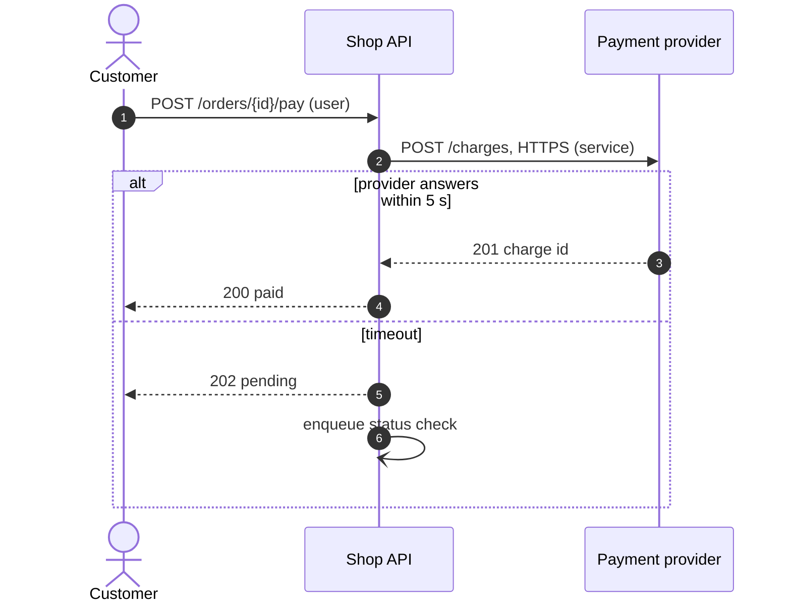

# Diagrams

A diagram is required by a trigger, not by taste. Draw the ones whose trigger fires and no others. Every diagram is Mermaid, in `design.md`, next to the text it explains.

## Which diagram when

| Diagram | Required when | Mermaid | Goes under |
| --- | --- | --- | --- |
| System context | Size is `medium` or `big`, or an actor or outside system changes | `flowchart LR`, the system in one `subgraph` | `### Context` |
| Container | Two or more deployable units or data stores change | `flowchart`, one `subgraph` per unit | `### Overview` |
| Sequence | Three or more participants exchange messages and the order matters. Always for each main flow of type `api` or `integration` | `sequenceDiagram` | `### Flows` |
| State | Something has three or more statuses, or a transition can be refused | `stateDiagram-v2` | `### State` |
| Entity relationship | Data is stored, or a schema changes. Always for type `data` | `erDiagram` | `### Data model` |
| Data flow | Data crosses a trust boundary: the internet, another tenant, a third party, personal data | `flowchart`, one dashed `subgraph` per trust zone | `### Security` |
| Swimlane | Two or more human roles hand work to each other, or there is an approval | `flowchart`, one `subgraph` per role | `### Flows` |
| Screen flow | Type `web`, or a journey of more than one screen | `flowchart` | `### Flows` |
| Deployment | Size is `big`, or new infrastructure, regions, or network paths | `flowchart` | `### Overview` |
| Decision table | Two or more conditions combine to decide an outcome | A markdown table, no diagram | `### Flows` |

A trigger that fires and a diagram you cannot draw yet is a gap. Add the row.

## Rules for every diagram

1. One sentence before it says what it shows and for which scenario.
2. `accTitle` and `accDescr` on the lines after the diagram type.
3. One level of detail. Do not mix systems with classes.
4. Every arrow goes one way and carries a label: a verb and the data. Between services, add the protocol. No arrow says only "uses".
5. Every arrow that crosses a boundary carries the auth level: `anonymous`, `user`, `service`, `admin`, or the name the codebase uses.
6. Names match `glossary.md` and the code.
7. At most 20 elements. More than that is two diagrams.
8. Meaning never rests on colour alone.
9. A text twin sits directly under it.

## Rules per diagram

- **Sequence.** One scenario per diagram. Use `autonumber`. Show the failure path with `alt` or `break`: at least timeout or refusal for each outside call. Mark async messages with `-)`.
- **State.** Start and end with `[*]`. Label each transition with its event and guard. Show the error and terminal states. The twin lists every illegal transition and what happens.
- **Entity relationship.** Mark keys with `PK` and `FK`. Every relationship has a cardinality and a label.
- **Data flow.** Show processes, stores, outside entities, and flows. Each crossing lists protocol, auth, and data classification.
- **Context.** Every actor from the Actors section appears. Every outside system from Dependencies appears.

## The text twin

A reader, human or agent, must not have to parse the picture. Under each diagram, write the same content as text:

| Diagram | Twin |
| --- | --- |
| Context | Table: partner, what it sends, what it receives, auth level |
| Container | Table: unit, responsibility, technology, talks to |
| Sequence | Numbered steps matching `autonumber`, then one line per failure branch |
| State | Table: from, event, guard, to. Then the illegal transitions |
| Entity relationship | Table: entity, owner, retention, classification |
| Data flow | Table: flow, crosses which boundary, protocol, auth, classification |
| Swimlane, screen flow | Numbered steps with the role or screen first |

When the diagram and the twin disagree, that is an error. Fix both.

## Example

The sequence below shows a customer paying an order when the payment provider answers in time, and when it does not.

````markdown


1. The customer asks the Shop API to pay the order, as a signed-in user.
2. The Shop API sends the charge to the payment provider over HTTPS, with its service credential.
3. The provider returns the charge id.
4. The Shop API tells the customer the order is paid.

Failure: when the provider does not answer within 5 s, the Shop API returns 202 pending and queues a status check.
````

## Mermaid that renders

- Use only `flowchart`, `sequenceDiagram`, `stateDiagram-v2`, and `erDiagram`.
- Do not use `C4Context`, `architecture-beta`, or any type marked beta.
- Do not use the word `end` in lowercase as a label. Write `End` or put it in quotes.
- Put a label with brackets, colons, or other punctuation in double quotes.
- Give states and nodes a short id and a separate label. No spaces in ids.
- Close every `alt`, `opt`, `loop`, `par`, and `break` with `end`.
