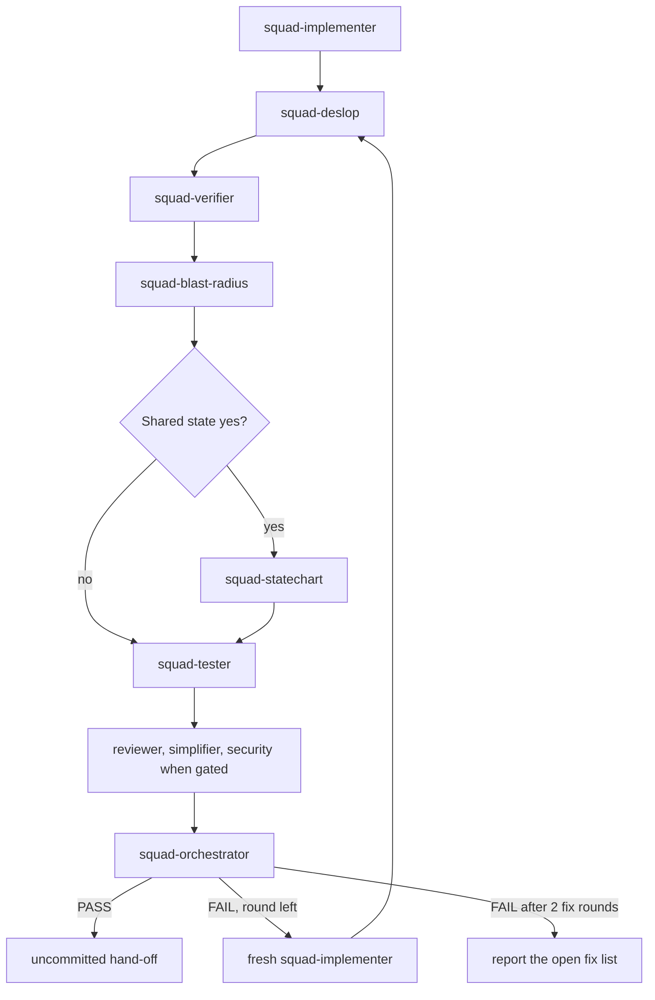
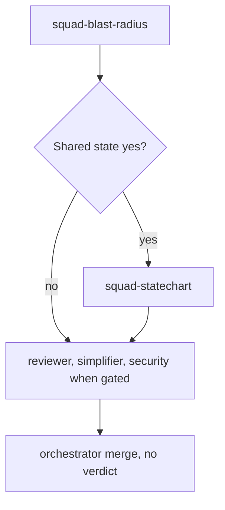

# Review playbook

Each row is the step, the subagent, and the skill that subagent loads.

Verifier runs after deslop and before the tester: the suite measures the cleaned tree, and a
new red test is not a failed criterion. Statechart runs only after blast-radius, because that
report is the trigger.

## Full loop

Each review round, including the round after a fix-list implementer. Announce the round number.

| Step | Subagent | Skill |
|---|---|---|
| 1 | `squad-deslop` | `deslop` |
| 2 | `squad-verifier` | none |
| 3 | `squad-blast-radius` | `blast-radius` |
| 4 | `squad-statechart` | `statechart`, only when step 3 says `Shared state: yes` |
| 5 | `squad-tester` | `<lang>-test-patterns` |
| 6 | `squad-reviewer`, `squad-simplifier`, `squad-security-reviewer` | none. Reviewer and simplifier always; security when the Security gate says run. Parallel. |
| 7 | `squad-orchestrator` | none |

When step 3 says `Shared state: no`, do not spawn `squad-statechart`. Pass
`squad-statechart: skipped (no shared state)`. When it says yes, pass
`docs/reviews/<yyyy-mm-dd>-<slug>/statechart/` (the plan slug) to `squad-statechart`.

A code-writing step (implementer, deslop, tester) is followed by the remaining steps. Verdict
`fix` spawns a fresh `squad-implementer` (`fix-list`), then this table again. At most two fix
rounds. If the second fix review is still FAIL, stop and report the open fix list. Do not push.
Hand off uncommitted. Residual fixup stays one spot-check. It is not another review round.

## Report mode

`/squad-review`. No `squad-deslop`. No `squad-tester`. No `squad-verifier`. No verdict. No fix round.

| Step | Subagent | Skill |
|---|---|---|
| 1 | `squad-blast-radius` | `blast-radius` |
| 2 | `squad-statechart` | `statechart`, only when step 1 says `Shared state: yes` |
| 3 | `squad-reviewer`, `squad-simplifier`, `squad-security-reviewer` | none. Parallel. Security when the gate says run. Pass `--pr` to `squad-reviewer` when the pin is `--pr`. |
| 4 | `squad-orchestrator` | none. Merge only. No Gate. |

Same skip line when shared state is no. The spec directory is
`docs/reviews/<yyyy-mm-dd>-<slug>/statechart/`.

Wire format: [the review contract](../references/review-contract.md). Decision: ADR 0002, `docs/adr/0002-review-sequence.md`.
