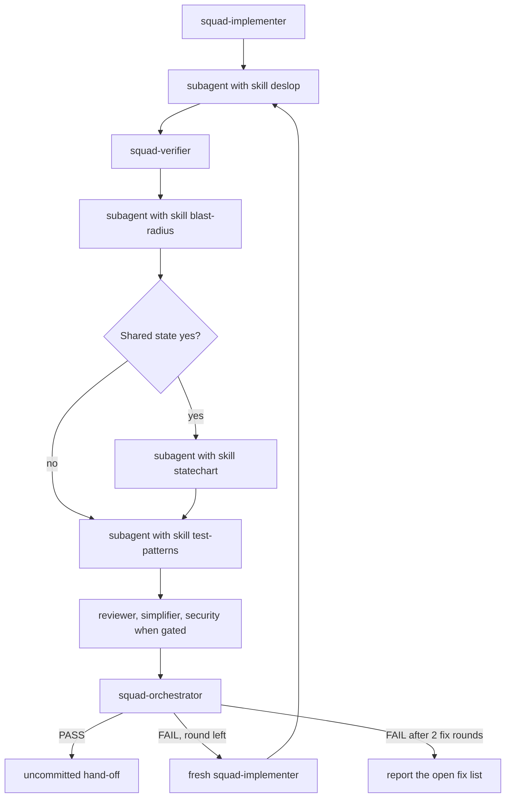
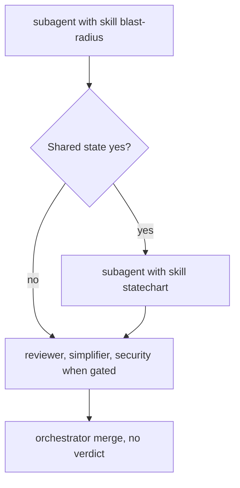

# Review playbook

A step that only loads a skill is a subagent with that skill. It is not a `squad-*` agent file.
`squad-verifier`, `squad-reviewer`, `squad-simplifier`, `squad-security-reviewer`, and
`squad-orchestrator` stay real agents.

Verifier runs after deslop and before the red tests: the suite measures the cleaned tree, and a
new red test is not a failed criterion. Statechart runs only after blast-radius, because that
report is the trigger.

## Full loop

Each review round, including the round after a fix-list implementer. Announce the round number.

1. Subagent with skill `deslop`. Output: `Result` pass or fail, and `Evidence`. Gate: `pass` or `fail`. Input is the review-base product diff, not `main`. A cleanup that would change behavior is reported and left unedited.
2. `squad-verifier`. Output: the verifier report. Gate: the review contract.
3. Subagent with skill `blast-radius`. Output: `Result` pass or fail, `Shared state` yes or no, and `Evidence`. Gate: `pass` or `fail`.
4. Subagent with skill `statechart`, only when step 3 says `Shared state: yes`. Output: `Result`, spec path, `Evidence` or `Rules not checked`, at most 5 invariants. Gate: `pass` or `fail`. `Rules not checked` does not fail.
5. Subagent with skill `<lang>-test-patterns`. Output: red unit or component tests for confirmed high or medium paths, or the green-CI skip. Gate: `pass` or `fail`.
6. `squad-reviewer`, `squad-simplifier`, and `squad-security-reviewer` when the Security gate says run, in parallel. Pass the tester step's Added names into `squad-reviewer`. Output: findings, or `No findings.` Do not file a failure of an Added test, and do not prescribe an edit to that test.

When step 3 says `Shared state: no`, do not run step 4. Pass `statechart: skipped (no shared state)`.
When it says yes, pass `docs/reviews/<yyyy-mm-dd>-<slug>/statechart/` (the plan slug).

Stop after step 6. The command merges once after that (`squad-orchestrator`). Gate: PASS or FAIL.
A `fix` re-runs steps 1-6, then merges once again. At most two fix rounds. This playbook does not
merge and does not start a fix round. Do not push. Hand off uncommitted. Residual fixup stays one
spot-check. It is not another review round.

## Report mode

`/squad-review`. No deslop step. No tester step. No `squad-verifier`. No verdict. No fix round.

1. Subagent with skill `blast-radius`. Output: `Result`, `Shared state` yes or no, `Evidence`. Gate: `pass` or `fail`.
2. Subagent with skill `statechart`, only when step 1 says `Shared state: yes`. Output and gate: same as the full loop. `Rules not checked` does not fail.
3. `squad-reviewer`, `squad-simplifier`, and `squad-security-reviewer` when the gate says run, in parallel. Pass `--pr` to `squad-reviewer` when the pin is `--pr`.
4. `squad-orchestrator`. Merge only. No Gate.

Same skip line when shared state is no. The spec directory is
`docs/reviews/<yyyy-mm-dd>-<slug>/statechart/`.

Wire format: [the review contract](../references/review-contract.md). Decision: ADR 0002, `docs/adr/0002-review-sequence.md`.
