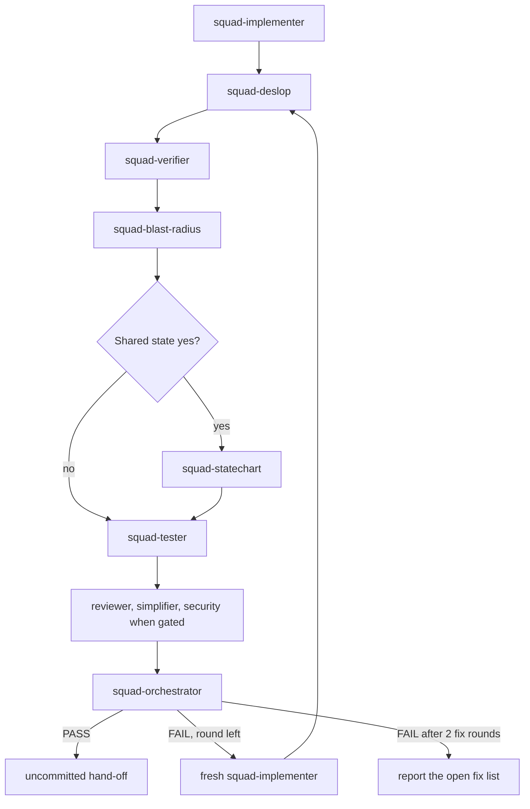
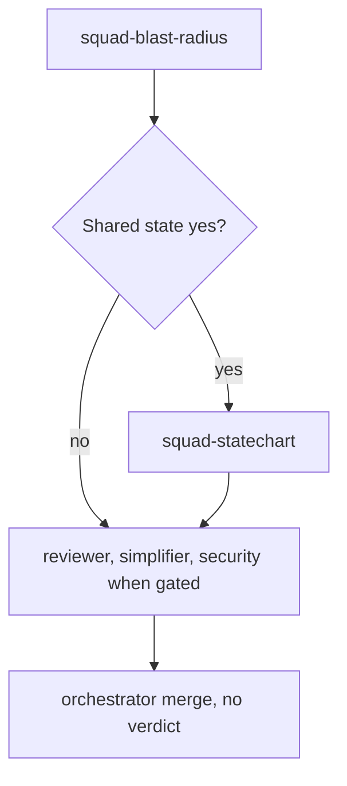

# Review playbook

The main agent runs these steps. Each subagent loads its own skill. This file does not.

Verifier runs after deslop and before the tester: the suite measures the cleaned tree, and a
new red test is not a failed criterion. Statechart runs only after blast-radius, because that
report is the trigger.

## Full loop

Each review round, including the round after a fix-list implementer. Announce the round number.

| Step | Subagent | When | Result | Evidence |
|---|---|---|---|---|
| 1 | `squad-deslop` | every full-loop round | `pass` or `fail` | diff stat, or `No slop.` and what was examined |
| 2 | `squad-verifier` | after deslop, before red tests | verifier report | command output |
| 3 | `squad-blast-radius` | every round | `pass` or `fail` | safety fact, proof run, `file:line` risks, `Shared state: yes` or `no` |
| 4 | `squad-statechart` | only when step 3 says `Shared state: yes` | `pass` or `fail` | spec path, TLC or `Rules not checked`, invariants, mermaid, per-rule walk |
| 5 | `squad-tester` | full loop only | `pass` or `fail` | red test output, or the green CI skip |
| 6 | `squad-reviewer`, `squad-simplifier`, `squad-security-reviewer` | reviewer and simplifier always; security when the Security gate says run. Parallel. | findings | table, or `No findings.` |
| 7 | `squad-orchestrator` | always | PASS or FAIL | verdict and the fix list |

When step 3 says `Shared state: no`, do not spawn `squad-statechart`. Pass
`squad-statechart: skipped (no shared state)`. When it says yes, pass
`docs/reviews/<yyyy-mm-dd>-<slug>/statechart/` (the plan slug) to `squad-statechart`.

A code-writing step (implementer, deslop, tester) is followed by the remaining steps. Verdict
`fix` spawns a fresh `squad-implementer` (`fix-list`), then this table again. At most two fix
rounds. If the second fix review is still FAIL, stop and report the open fix list. Do not push.
Hand off uncommitted. Residual fixup stays one spot-check. It is not another review round.

## Report mode

`/squad-review`. No `squad-deslop`. No `squad-tester`. No `squad-verifier`. No verdict. No fix round.

| Step | Subagent | When | Result | Evidence |
|---|---|---|---|---|
| 1 | `squad-blast-radius` | always | `pass` or `fail` | safety fact, proof run, `Shared state: yes` or `no` |
| 2 | `squad-statechart` | only when step 1 says `Shared state: yes` | `pass` or `fail` | spec path, TLC or `Rules not checked`, mermaid, per-rule walk |
| 3 | `squad-reviewer`, `squad-simplifier`, `squad-security-reviewer` | parallel, security when the gate says run. Pass `--pr` to `squad-reviewer` when the pin is `--pr`. | findings | table, or `No findings.` |
| 4 | `squad-orchestrator` | merge only | merged list | no Gate |

Same skip line when shared state is no. The spec directory is
`docs/reviews/<yyyy-mm-dd>-<slug>/statechart/`.

Wire format: [the review contract](../references/review-contract.md). Decision: ADR 0002, `docs/adr/0002-review-sequence.md`.
