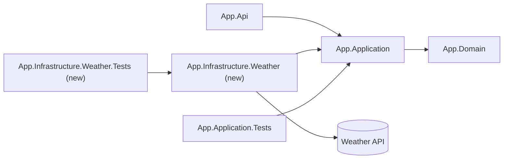

# Architect contract

`squad-architect` is read-only. It returns two sections; the planner writes them into the draft plan.

## When

A full change runs the architect when it touches more than one layer, adds a project or package, or
changes a public API. The planner states the rule that fired in the plan, or writes
`Design: skipped (small)` when none did. Small changes never run it.

## Design

```markdown
## Design
Rule fired: <layers | project or package | public API>
### Options
1. <option>: <shape, seams, cost>
2. <option>: <...>
### Decision
Chosen: <option>. Why: <reason>. Alternatives rejected: <option and reason>.
### Seams and ports
<each port, its owner, and its adapter>
### Diagram (optional)
<sequenceDiagram for a new cross-layer flow or external call (port to adapter to vendor API), or stateDiagram-v2 when model-the-domain fires; omit otherwise>
### Risks
<risk and the check that catches it>
### Hard decisions
<each hard-to-reverse decision (new layer or boundary, new dependency, storage or API contract change, dropped option) with its ADR link `docs/adr/NNNN-<plan-slug>.md`, or None>
```

## Map

```markdown
## Map
| Unit | Layer or project | Rule | Source |
|---|---|---|---|
| <new or changed unit> | <where it goes> | <rule text> | <layers.md ## Where new code goes, or skill path> |
| <unit> | MISSING | no rule places it | <what was searched> |
| Accepted ADRs | `docs/adr/` | decisions this change must respect | <ADR files read> |
| Existing `Infrastructure.*` projects | <each project and the external system it owns> | a new client joins the project for its system; never a duplicate | <solution file or glob> |

<one fenced mermaid `flowchart LR` of the touched layers and projects, new or changed nodes marked>
```

## Diagrams

The architect writes the Mermaid source; the planner pastes it into the plan unchanged.

- `## Map` always has one fenced `mermaid` block, `flowchart LR`, of the touched layers and projects (Api, Application, Domain, `Infrastructure.<Vendor>`, Tests). Mark new or changed nodes with `(new)` or `(changed)` in the label.
- `## Design` may add one `sequenceDiagram` (new cross-layer flow or external call: port to adapter to vendor API) or one `stateDiagram-v2` (when model-the-domain fires).
- An ADR may carry one before/after diagram. A retro has no diagrams.
- At most 3 diagrams per plan, under 15 nodes each. No styling, classes, or colors. One-sentence caption under each.

Good:

~~~markdown

The new Weather project implements the Application port and is the only project that calls the vendor API.
~~~

Bad: a 30-node diagram of every class, `style` or `classDef` lines, or a diagram with no caption.

## Prompts

- Model the domain: states and transitions over boolean flags and optional-field bags.
- Redesign from first principles when an option only bolts the new need onto the old shape.
- Sketch types and signatures before code; the caller's view comes first.

## Red flags

Screen every option. A red flag rejects or revises the option.

1. Shallow module: a large interface hiding little behavior.
2. Information leakage: one internal decision appears in several modules.
3. Temporal decomposition: modules split by execution order, not by owned knowledge.
4. Pass-through method: forwards the same arguments and adds nothing.
5. Split ownership: more than one module writes the same state.
6. Two ways to do one task: keep one, move callers, delete the rest.
7. Importable internals: callers can reach internals from outside the module.
8. Hand-synced list: two lists of the same items with nothing failing when they drift.
9. Missing vendor project: a new external system without its own `Infrastructure.<Vendor>` project (one project per external system). A new vendor project is a hard decision and gets an ADR under `### Hard decisions`.
