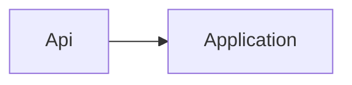

# Planning contract

This file defines the turn-based handoff between the main agent and `squad-planner`.

## Ownership

The main agent owns user interaction and planning state. It supplies the planner with the request, repository evidence, settled decisions, previous user answers, open frontier, and requested mode. It presents planner questions to the user and passes the answers into a later invocation.

The planner handles one invocation and returns. It never addresses the user directly, waits for an answer, or carries state that was not returned to the main agent.

Grill-style planning is this contract: frontier rounds with a recommended answer on every question.
Facts are discovered by the planner (a subagent). Decisions stay with the human. Do not load a
separate grilling skill or an external skills catalog. The main agent never grills itself: it
presents the planner's round.

Optional `docs/decisions.md` is a human-readable drop-box, not eager memory. Read it when present
and treat its entries as settled human decisions. Never create, edit, or append that file. The
plan's Decisions table still records this run.

## Planner input

Every invocation supplies:

```markdown
Mode: next-round | write-plan
Request: <user request>
Repository evidence: <paths, configuration, standards, workspace facts, and cited primary sources>
Facts to check: <numbered facts the main agent wants found, or None>
Settled decisions: <numbered decisions and rejected alternatives>
Human drop-box: <docs/decisions.md contents when that file exists, or None>
Previous user answers: <latest answers, or None>
Open frontier: <known open decisions and dependencies>
Plan path: docs/plans/<yyyy-mm-dd>-<slug>.md
User confirmation: <exact confirmation, required only for write-plan>
```

Missing evidence is explicit. The planner may inspect the repository or primary sources to fill factual gaps; it must not turn discoverable facts into user questions.

## Ask the frontier, in rounds

The **frontier** is every decision whose prerequisites are already settled: the questions that can be
asked now without guessing at an answer that has not been received yet.

Ask the whole frontier in one round. Number the questions and give a recommended answer to each. A
question whose answer depends on another question still open belongs to a later round. Every question
carries a recommendation so the user can confirm, correct, or choose differently without doing the
planner's analysis themselves.

The planner returns exactly one round and stops. The main agent presents that round to the user and
waits for the answers. It then supplies those answers and the returned state to a new planner
invocation. The planner itself never waits across turns or assumes an answer.

The user's answers reshape the decision tree. Settled decisions push the frontier outward and unblock
their dependants. Recompute the tree before returning the next round.

### Draft plan file

Round 1 creates `docs/plans/<yyyy-mm-dd>-<slug>.md` (run date, kebab-case slug) with `# <outcome>`,
`## Request`, `## Status` set to `draft`, and `## Grill log`. Right after round 1 writes the draft, the main agent runs check-plan on it and fixes its findings before presenting the round. Every round, the planner appends
`### Round <n>` to `## Grill log`: the questions, the recorded answers, decisions taken, and options
rejected with the reason. Never rewrite an earlier round. Stop or abandon leaves the file at `draft`.
Plan edits are a hard step. Every time the plan is written (round 1 draft, each round, write-plan, `## Status`, `## Fix list`, `## Handoff notes`, and on a resumed or stopped run), the main agent runs the `pack-check` skill's `scripts/check-plan.sh <plan>` (or `check-plan.ps1` without `sh`), fixes every error-level finding in the plan text, and reruns until it exits 0 before doing anything else. Before any agent starts or the retro is written, the last plan edit must be followed by check-plan exit 0: before each implementer slice, before the fix-list implementer, before each reviewer round, and before `squad-retro` at hand-off. The linter lives in the `pack-check` plugin folder at `skills/pack-check/scripts/check-plan.sh` and `skills/pack-check/scripts/check-plan.ps1`; use that path, never a filesystem search. An em dash (U+2014) is an error: replace it with `:` or `,`, and paraphrase quoted vendor text instead of pasting it. Warnings are passed to the next planner invocation and do not block. A rejected or failed linter call counts as not run, never as a manual pass: shell rejected → stop with `Environment block: no shell`. Only a pack-check that is not installed is skipped and noted.

Writing: plain words, short sentences, one idea per line, no filler or hype, no em dashes or curly quotes.

Small change: the main agent writes a tiny plan instead, with `## Request`, `## Goal`, `## Decision`,
`## Verify` (one command), and `## Status`. No agents.

### `next-round` output

Return exactly one planning round and stop:

```markdown
## Planning round <n>

**Facts found:** <numbered fact, answer, and source path or citation; or None>
**Settled:** <compact numbered summary, or None>

❓ **Q1, <title>:** <decision, viable options, and material trade-offs>
➡️ **Recommendation:** <choice and reason>

---

❓ **Q2, <title>:** <...>
➡️ **Recommendation:** <...>

**State for next invocation**
- Settled decisions: <complete carried state>
- Inapplicable branches: <branch and reason>
- Open frontier: <remaining decisions and dependencies, or Empty>
```

Design consequential public interfaces, module boundaries, and seams in at least two viable shapes
before recommending one.

## Decision branches

Visit every applicable branch before the frontier is empty. Mark a branch inapplicable with a reason
rather than silently skipping it.

| Branch | Ask when | Prefer constraints like |
|---|---|---|
| Outcome | Always | What done looks like; what is explicitly out of scope |
| Scope / non-goals | Always on behavior change | Must not deepen obscure edges when the goal is MVP-complete |
| Interface | Public API, module, or seam changes | Two shapes; must not break named callers |
| Data | Persistence or schema | Migration / compatibility bound |
| Failure | User-visible or trust-boundary paths | Exact error contract |
| Compatibility | Existing clients or formats | Must not change wire without a version story |
| Security | Trust boundary | Deny-by-default; name the actor and control; must not widen auth surface without a decision |
| Dependency philosophy | New package, scaffold, or "from scratch" work | Allowed libs; forbidden shortcuts; implement vs reuse |
| Performance / resources | Latency, throughput, memory, or timeouts matter | Concrete bounds; "fast enough" is not a bound |
| Architecture fitness | New subsystem or consequential seam | Shape must still work if scope grows one notch |
| Verification | Always | Exact commands; test-plan matrix |
| Rollout | Deployed or irreversible | Rollback / feature-flag bound |
| Worktree | Parallel checkout needed | Exact path; preserve primary checkout |

Recommendations prefer **constraints** ("must not…", "out of scope…", "timeout ≤ …") over long
do-lists. Do not invent performance or dependency questions when the change cannot touch them; mark
those branches inapplicable.

## Find facts yourself

Finding facts is the planner's job, never the user's. Inspect the repository, tests, Git history, and
tooling for anything they can answer. "Does this project use Vitest or Jest?" is a fact to discover;
"Should the new tests join the existing suite or use their own?" is a decision for the frontier.

Facts outside the repository come from primary sources such as official documentation, source,
standards, or specifications, and the plan cites the source beside the decision it settled. Recalled
facts without evidence remain unresolved.

Name facts, do not dig for them. The main agent runs on the user's model; the planner runs on the
`standard` tier. When the main agent needs a fact to route, answer the user, or shape the next round,
it lists that fact under `Facts to check` and lets the planner find it, instead of reading the
repository itself. The planner answers every listed fact under `**Facts found:**` with its source
before asking anything, and carries the answers forward as repository evidence. A fact it could not
find is reported as not found with what was searched, never as a question to the user.

The grill is the product of the round. **Facts found** is a prelude so the main agent does not dig;
it never replaces the frontier round. After facts, ask the whole current frontier with a
recommendation each. Only the empty-frontier confirmation round may return no decision questions.
The planner finds facts with its granted tools this turn. It does not spawn `squad-*` agents.

A fact still being researched is an unsettled prerequisite only for decisions downstream of that
fact. Ask the rest of the current frontier now rather than blocking the whole round on one lookup.

## Stop when the frontier is empty

Planning ends only after every applicable branch has been visited and nothing remains silently
assumed. When the frontier becomes empty, return one final `next-round` response that states the
complete shared understanding as a numbered list and asks the user to confirm it. The main agent
presents that confirmation round and waits; the planner writes only the draft round.

If the user says to stop asking and decide, treat that as an answer: use the planner's recommendations
as the chosen decisions and record that the user accepted them. This is an explicit decision, not
permission to silently fill unresolved branches.

## Write the plan

Ownership: the architect owns `## Design` and `## Map` (where the change goes and why). The planner
owns `## Slices` (what gets built and in what order). Each slice lists its files (taken from the Map),
the test it adds, and its done check. A change that touches more than one project needs at least 2 slices, or a `Single slice because: <reason>` line under `## Slices`.

If the work is too big for one implementer pass, write ordered `## Slices` (data structures and scaffold first, ports and seams before adapters, each slice ending green). Up to 3 slices stay in one session. Cap: ≤3 slices; more → session split: return `Session split: <n> steps` with no `## Slices`, and the main agent deletes this run's draft `docs/plans/` file (so retro catch-up never sees it), writes `docs/squad-plan.md` by the forced-split rules (a plan already there → ask once: replace or append; in task mode: splits that task in place, never rewrites the plan) and stops ([session split](session-split.md)). A slice that would ship a known-worse shape → stop, split, or ask. One plan file. Same branch. Sequential: one fresh `squad-implementer` per slice, then the next.

Write mode is valid only when the input includes the user's confirmation, every applicable decision branch is settled, and the open frontier is empty. Otherwise return the missing condition without writing.

On valid input, complete the draft at `docs/plans/<yyyy-mm-dd>-<slug>.md` and set `## Status` to `confirmed`. Keep `## Grill log`. Do not write source code or a separate research artifact. Put repository evidence, primary-source citations, assumptions, decisions, and rejected alternatives in the plan.

The plan contains:

````markdown
# <outcome as a sentence>

## Request
<the user's ask, verbatim, not a paraphrase>

## Grill log
### Round 1
<questions, answers, decisions, rejected options>

## Design
<from squad-architect (references/architect-contract.md), or `Design: skipped (small)`>
## Map
<from squad-architect, omitted when Design is skipped; lists `docs/adr/`>

Hard decisions get an ADR per [the ADR contract](adr.md); the plan links each one.

## Problem
## Decisions
| # | Decision | Chosen | Why |
|---|---|---|---|

## Workspace
## Standards in force
| Standard | Source |
|---|---|

## Repository conventions observed
| Convention | Evidence |
|---|---|

## Assumptions
## Acceptance criteria
1. <observable, testable statement>

## Test plan matrix
| Criterion | Happy | Edge | Fail | Kind | Seam |
|---|---|---|---|---|---|
| 1 | <happy path> | <edge> | <fail> | unit or integration | <pre-agreed test seam> |

## Slices
1. <slice name>: criteria <ids>; files <from ## Map>; test <the test it adds>; done when <check, e.g. those matrix rows are green>
2. <next slice, when the change touches more than one project>: files <...>; test <...>; done when <...>
Single slice because: <reason; required instead of slice 2 when one slice is enough>

## In scope
## Out of scope
## Non-goals
## Dependency philosophy
<allowed / forbidden libs and implement-vs-reuse, or `N/A: no new dependencies`>
## Performance / resource bounds
<concrete bounds, or `N/A: not performance-sensitive`>
## Open questions
None.
## Status
draft | confirmed | implementing | implementing slice <n>/<total> | verifying | reviewing | fix-round <n> | fixup | hand-off
## Fix list
<rewritten each merge; empty until first review>
## Handoff notes
<rewritten each phase; deviations, concerns, open risks>
## Verification
<exact commands or a criterion saying which check must be created>
````

`## Status`, `## Fix list`, and `## Handoff notes` are **run scratch**: the main agent and
`squad-orchestrator` rewrite those sections in place during the loop. Do not append forever inside
the plan. No writer puts U+2014 (em dash) into these sections; use `:` or `,`. Lessons go to the run's retro file. While implementing, `## Status` may say
`implementing slice <n>/<total>`.

`## Request` is the user's words as typed; the title is the planner's outcome sentence. Do not expand
or narrow the ask there: scope belongs in `## In scope`, `## Out of scope`, and `## Non-goals`. It is
there so a later reader, human or `/squad-review` on the same branch, can see drift between the ask
and the plan without the chat transcript.

An open question is never converted into an assumption or acceptance criterion. Completion means the user confirmed the shared understanding, `## Open questions` is exactly `None.`, and the planner returns the written plan path to the main agent.

Each acceptance criterion is observable and can fail. "Handles errors well" is not a criterion;
"returns 400 naming the missing field" is. State what is out of scope so review can distinguish a
deliberate boundary from an omission. Give the exact verification commands; when a check does not
exist yet, making that check is itself planned work.

A criterion that states a number, a bound, count, size, or latency, is **quantitative**. Write it
as metric, operator, bound (`p95 ≤ 200 ms`, `bundle ≤ 2.4 MB`) and name the command that measures
it under `## Verification`. The verifier re-measures and quotes `<measured> <op> <bound>`. A green test name is not a measurement.

Every business criterion in `## Acceptance criteria` requires one `## Test plan matrix` row: a
happy path, an edge case, a failure case, whether that check is a unit or an integration test,
and a named Seam: the pre-agreed test surface. Blank or unconfirmed Seam is `not verified`,
never `pass`. Tests that hit internals not named in the Seam column fail.
The implementer TDDs that matrix. The verifier proves the matrix is covered; happy-path-only
coverage is rejected. Deployed/API smoke cites
[smoke-matrix](../../../references/smoke-matrix.md): happy/edge/fail/auth/timeout/5xx. Kind is
`smoke`. URLs and secrets stay in the app repo.

The plan lives in the file. The implementer builds from it, the verifier checks it, and reviewers
measure the change against it.

## Resume

A resumed or stopped run edits the plan too (the catch-up sets nothing, but resuming rewrites `## Status`): write, run check-plan, and do not continue until it exits 0.

## Catch-up retro

After `squad-retro` writes the catch-up `docs/retros/<yyyy-mm-dd>-<slug>-interrupted.md`, the main agent runs check-retro on it (not just `test -f`) and fixes its findings before round 1 starts.

## Precedence

Precedence: the repo's own structure and conventions come first; the architect Map reads them and the planner records them under `## Repository conventions observed`. Skill standards fill the gaps where the repo has no convention. A standard overrides a repo convention only as an explicit improvement, logged under `## Decisions` with the reason, plus an ADR if it changes structure.

## Gap markers

- `Design gap: <question>`: the planner found a hole in `## Design`. The main agent spawns `squad-indexer` with that gap question (the files, functions, types or callers it names), then reruns `squad-architect` once with that question and the list, then the planner continues. At most 1 rerun.
- `Plan gap: <question>`: the implementer needs a decision the plan lacks. It stops the slice instead of guessing and leaves any partial diff uncommitted. The main agent runs the planner in `next-round` mode on that gap only, so the question goes to the user. The answer is recorded in `## Grill log` and `## Decisions`. The architect reruns only when the gap is about design (spawn `squad-indexer` first with the gap question). A fresh implementer then redoes that slice with the updated plan path (spawn `squad-indexer` first with that slice's files, types or callers to locate).
- Saving a Plan gap: before the planner round, the main agent saves the partial diff, untracked files included, to `$(git rev-parse --git-dir)/squad/<yyyy-mm-dd>-<slug>.gap-<n>.patch` (never a literal `.git/` path: in a linked worktree `.git` is a file), and checks that the file exists and is non-empty. Saving fails → stop the run. Implementers never commit, so there is no slice commit to reset to: the tree is left as it is (no `reset --hard`, `clean`, `checkout`, or `restore`; the git pack blocks them and they would drop finished slices). The patch lives outside the worktree, so it is never committed and needs no ignore rule: never edit the product `.gitignore` for it. `git status` after the save shows only the slice files. The fresh implementer gets the patch path to read and redoes the slice on the current tree, keeping or replacing the partial edits to match the updated plan. The retro lists the gap.

```sh
p="$(git rev-parse --git-dir)/squad/<yyyy-mm-dd>-<slug>.gap-<n>.patch" && mkdir -p "${p%/*}" && git add -N . && git diff HEAD --binary > "$p" && test -s "$p" && git reset -q
```

`git add -N .` only marks untracked files intent-to-add so the diff includes them; the closing `git reset -q` drops those index entries again before hand-off and keeps every working-tree change. The git pack allows it (no `--hard`).

- Replan after a Plan gap: the main agent runs `git diff --stat` and passes its output with `$(git rev-parse --git-dir)/squad/<yyyy-mm-dd>-<slug>.gap-<n>.patch`; the planner reads both and rewrites the open slice from the code as it stands now. The slice keeps its already-changed files so the fresh implementer can keep or replace the partial edits; finished slices are not redone.
- Who answers a Plan gap: the user, unless this session explicitly said to accept recommendations. An old grill log or a prior plan is not authorization.
- Cap: at most 1 `Plan gap:` per slice. A second one on the same slice becomes `Replan:` for the whole plan, and the retro records it.

Grill rounds stay as they are.

## The rule that outranks the rest

**An open question is never a criterion.** Return it to the frontier. Never replace it with the
planner's unconfirmed guess or soften it into wording that can pass under several incompatible
answers. A vague criterion can make the loop verify and approve the wrong behavior.

An assumption is valid only when the answer genuinely cannot be resolved before implementation,
such as a value that exists only at runtime. Record it under `## Assumptions`, in the user's words
when available, with enough detail for a reviewer to challenge it. An assumption never substitutes
for an answer that the repository, a primary source, or the user can provide.
